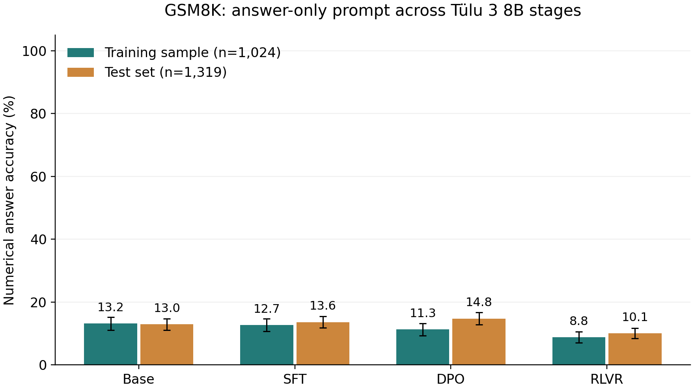
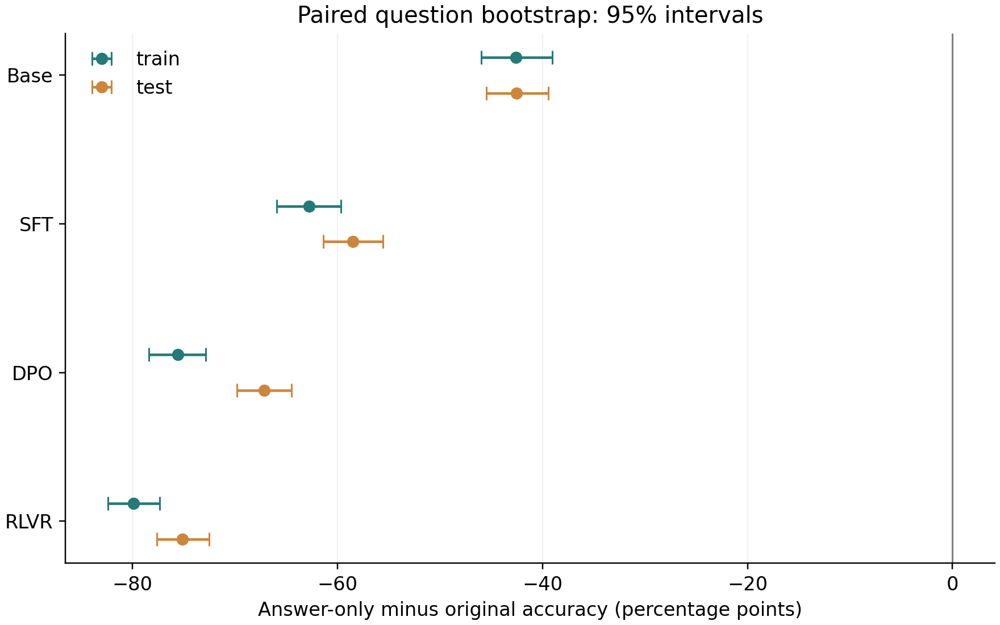

# Tülu 3 8B 四阶段「直接答案」复测

正式评测完成9,372次解答，独立重算核验通过。Base→RLVR的训练抽样正确率由13.18%变为8.79%；测试集由12.96%变为10.08%。

训练抽样：Base→SFT -0.49 个百分点；SFT→DPO -1.37 个百分点；DPO→RLVR -2.54 个百分点。
完整测试集：Base→SFT +0.68 个百分点；SFT→DPO +1.14 个百分点；DPO→RLVR -4.70 个百分点。
RLVR相对DPO在训练抽样变化-2.54个百分点，95%区间为[-4.49, -0.68]，区间全为负。同题比较中，38题错→对、64题对→错；提升与退化同时存在。
RLVR相对DPO在完整测试集变化-4.70个百分点，95%区间为[-6.67, -2.65]，区间全为负。同题比较中，60题错→对、122题对→错；提升与退化同时存在。

## 数据与协议

训练组1,024题（seed42，无放回），测试组1,319题；独立工程试跑32题×4模型另计。四模型使用同一直接答案指令与缩短后的8-shot正文；8个示范题原文和顺序不变，答案依次仅为6、5、39、8、9、29、33、8；目标题逐字沿用上轮。BF16、greedy、1024输出token上限、8192上下文，EOS或新题标记停止。仅解析新生成文本，去数字千分位后取最后有符号数，与gold做数值等值比较；无数字计错。协议在全部pilot技术检查通过后冻结，无正确率或格式符合率门槛。即使输出计算过程仍保留，不重试。格式符合要求仅一个数值，可带Answer:、Final answer:、The answer is前缀、单个boxed及外层数学定界符、首尾空白和末尾句号；格式违规不改变主评分。 输出指令原文：Answer the question directly. Give only the final numerical answer, without calculations, reasoning steps, or explanations.

## 正确率

| 数据 | 阶段 | 正确 / 总数 | 正确率 | 95%区间 | 无数值答案 | 截断 | 平均输出token | 格式符合率 |
|---|---|---:|---:|---|---:|---:|---:|---:|
| 训练抽样 | Base | 135 / 1024 | 13.18% | 11.13%–15.23% | 0 (0.00%) | 0 (0.00%) | 4.3 | 95.41% |
| 训练抽样 | SFT | 130 / 1024 | 12.70% | 10.74%–14.75% | 0 (0.00%) | 0 (0.00%) | 4.5 | 89.36% |
| 训练抽样 | DPO | 116 / 1024 | 11.33% | 9.38%–13.28% | 0 (0.00%) | 0 (0.00%) | 4.8 | 89.06% |
| 训练抽样 | RLVR | 90 / 1024 | 8.79% | 7.13%–10.55% | 0 (0.00%) | 0 (0.00%) | 4.1 | 94.63% |
| 完整测试集 | Base | 171 / 1319 | 12.96% | 11.14%–14.78% | 0 (0.00%) | 0 (0.00%) | 4.6 | 94.31% |
| 完整测试集 | SFT | 180 / 1319 | 13.65% | 11.83%–15.47% | 0 (0.00%) | 0 (0.00%) | 4.7 | 88.48% |
| 完整测试集 | DPO | 195 / 1319 | 14.78% | 12.89%–16.76% | 0 (0.00%) | 0 (0.00%) | 5.0 | 88.48% |
| 完整测试集 | RLVR | 133 / 1319 | 10.08% | 8.49%–11.75% | 0 (0.00%) | 0 (0.00%) | 4.3 | 94.54% |



## 同题阶段变化

| 数据 | 阶段变化 | 准确率差（百分点） | 95%区间（百分点） | 错→对 | 对→错 | 一直对 | 一直错 |
|---|---|---:|---|---:|---:|---:|---:|
| 训练抽样 | Base→SFT | -0.49 | -2.54–+1.56 | 56 | 61 | 74 | 833 |
| 训练抽样 | SFT→DPO | -1.37 | -3.03–+0.29 | 31 | 45 | 85 | 863 |
| 训练抽样 | DPO→RLVR | -2.54 | -4.49–-0.68 | 38 | 64 | 52 | 870 |
| 完整测试集 | Base→SFT | +0.68 | -1.21–+2.58 | 85 | 76 | 95 | 1063 |
| 完整测试集 | SFT→DPO | +1.14 | -0.45–+2.73 | 64 | 49 | 131 | 1075 |
| 完整测试集 | DPO→RLVR | -4.70 | -6.67–-2.65 | 60 | 122 | 73 | 1064 |

## 与上一轮逐题配对比较

差值方向统一为“直接答案版减上一轮”。本轮同时改变示范答案形式和输出指令，差值描述这套直接答案提示的整体效果；未展示计算过程不表示模型内部没有推理。每组使用相同题目，按题配对 bootstrap 10,000 次，报告百分位 95% 区间。

| 数据 | 阶段 | 上轮正确率 | 本轮正确率 | 差/百分点 | 95%区间/百分点 | 改善 | 退化 | 一直对 | 一直错 |
| --- | --- | --- | --- | --- | --- | --- | --- | --- | --- |
| 训练 | Base | 55.76% | 13.18% | -42.58 | [-46.00, -39.06] | 38 | 474 | 97 | 415 |
| 训练 | SFT | 75.49% | 12.70% | -62.79 | [-65.92, -59.67] | 18 | 661 | 112 | 233 |
| 训练 | DPO | 86.91% | 11.33% | -75.59 | [-78.42, -72.85] | 8 | 782 | 108 | 126 |
| 训练 | RLVR | 88.67% | 8.79% | -79.88 | [-82.42, -77.34] | 8 | 826 | 82 | 108 |
| 测试 | Base | 55.50% | 12.96% | -42.53 | [-45.49, -39.42] | 46 | 607 | 125 | 541 |
| 测试 | SFT | 72.18% | 13.65% | -58.53 | [-61.41, -55.57] | 32 | 804 | 148 | 335 |
| 测试 | DPO | 81.96% | 14.78% | -67.17 | [-69.83, -64.52] | 24 | 910 | 171 | 214 |
| 测试 | RLVR | 85.22% | 10.08% | -75.13 | [-77.63, -72.55] | 22 | 1013 | 111 | 173 |



### 输出格式与长度（上轮 → 本轮）

| 数据 | 阶段 | 格式符合率 | 平均token | 中位token | 截断率 |
| --- | --- | --- | --- | --- | --- |
| 训练 | Base | 0.00% → 95.41% | 99.1 → 4.3 | 80.0 → 4.0 | 1.37% → 0.00% |
| 训练 | SFT | 0.00% → 89.36% | 89.3 → 4.5 | 78.0 → 4.0 | 0.59% → 0.00% |
| 训练 | DPO | 0.00% → 89.06% | 98.8 → 4.8 | 89.0 → 4.0 | 0.00% → 0.00% |
| 训练 | RLVR | 0.00% → 94.63% | 110.0 → 4.1 | 98.0 → 3.0 | 0.00% → 0.00% |
| 测试 | Base | 0.00% → 94.31% | 99.4 → 4.6 | 83.0 → 4.0 | 1.14% → 0.00% |
| 测试 | SFT | 0.00% → 88.48% | 91.0 → 4.7 | 79.0 → 4.0 | 0.61% → 0.00% |
| 测试 | DPO | 0.00% → 88.48% | 103.2 → 5.0 | 91.0 → 5.0 | 0.00% → 0.00% |
| 测试 | RLVR | 0.00% → 94.54% | 114.1 → 4.3 | 102.0 → 3.0 | 0.00% → 0.00% |

| 阶段 | 正式进程耗时/分：上轮 → 本轮 | 生成耗时/分：上轮 → 本轮 |
| --- | --- | --- |
| Base | 33.62 → 5.15 | 33.03 → 4.57 |
| SFT | 29.34 → 5.31 | 28.75 → 4.72 |
| DPO | 30.70 → 5.48 | 30.10 → 4.90 |
| RLVR | 33.42 → 5.35 | 32.82 → 4.77 |

计时为各阶段训练与测试合计；进程耗时含模型加载，受缓存及系统负载影响，不能完全归因于提示变化。

### 同模型改善与退化案例

逐题对照 (external or historical artifact; see the repository artifact policy) · 完整案例 (external or historical artifact; see the repository artifact policy) · [对照统计](protocol_comparison.csv)。每阶段、每数据组、每方向按题目 ID 排序选前两例；网页可展开原始回答。


## 执行与核验

正式运行累计进程时间0.35小时（含模型加载）；基础设施失败0次。128次工程试跑另计。

全部16个权重分片与固定官方发布版本的完整SHA256一致。7,473条RLVR GSM8K记录全部与原始训练集一一匹配。原始输出、题目/token清单、冻结指纹、运行日志及逐题变化随报告交付。独立评分实现复核了9,372条回答、8个阶段×数据组统计与6个相邻阶段对比，并独立复算全部8个新旧提示对比及其配对区间、格式、长度与耗时。

正式完成后实际重启管线验证恢复：全部输出与运行记录逐字节一致，未新增推理任务、未重新生成已完成答案。核验记录见 manifests/resume_check.json。

| 阶段 | 正式进程耗时（分） | 已提交生成耗时（分） | 总输出token | 生成吞吐（token/秒） | 失败尝试 |
|---|---:|---:|---:|---:|---:|
| Base | 5.15 | 4.57 | 10424 | 38.0 | 0 |
| SFT | 5.31 | 4.72 | 10770 | 38.0 | 0 |
| DPO | 5.48 | 4.90 | 11483 | 39.0 | 0 |
| RLVR | 5.35 | 4.77 | 9906 | 34.6 | 0 |

进程耗时含模型加载；生成耗时仅包含已提交批次。吞吐是整卡聚合输出token/秒，不是单条回答速度。

## 改善与退化案例

[打开可展开的同题四阶段回答](report_zh.md)；案例原始数据 (external or historical artifact; see the repository artifact policy)；全部逐题对照 (external or historical artifact; see the repository artifact policy)。每个数据组、相邻阶段和变化方向取按题目ID排序的前两题，展示改善与退化；案例不代表总体错误分布。

## 固定版本与复查

| 阶段 | 官方模型 | 固定 revision |
|---|---|---|
| Base | meta-llama/Llama-3.1-8B | d04e592bb4f6aa9cfee91e2e20afa771667e1d4b |
| SFT | allenai/Llama-3.1-Tulu-3-8B-SFT | f2a0b46b0cfda21003c6141b1ff837b7e165524d |
| DPO | allenai/Llama-3.1-Tulu-3-8B-DPO | a7beb67e33ffd01cc87ac3b46cadc1000985b8db |
| RLVR | allenai/Llama-3.1-Tulu-3-8B | 666943798adbde0b1aff34626007e26986a3c107 |

RLVR 数据 revision：7dbd180f5440c0b90f2944e6efea934b85437a95；GSM8K commit：3101c7d5072418e28b9008a6636bde82a006892c。协议冻结时间：2026-10-04T15:16:30.858406+00:00。完整配置及输入/权重指纹分别见 experiment.json 与 manifests/。Base tokenizer使用默认BOS；三个聊天模型直接使用apply_chat_template生成的token，不另加BOS。三个聊天阶段在全部2,375道pilot及正式题上的输入token完全一致。推理环境：RTX 3090 24GB，vLLM 0.7.2，PyTorch 2.5.1 / CUDA 12.4，Transformers 4.49.0；完整依赖快照随项目保存。

## 解释边界

- Base使用纯文本，SFT/DPO/RLVR使用各自官方聊天模板；Base→SFT同时包含权重与格式变化。
- 训练组是官方RLVR数据池中的固定抽样，不保证发布版模型实际采样过每条题，也不假定前两后训练阶段未见过相同内容。
- 测试集被广泛用于模型开发评测，不能当作完全未接触的新测试。训练/测试差距不能单独证明记忆或推理机制。
- 阶段间数据、目标和训练预算共同变化，阶段差值不能单独归因于某个训练算法。
- 本轮不计算MechanisticProbe SP1/SP2。GSM8K现成答案与解答不提供原指标所需的输入语句证明图，不能据本轮判断grounding/reasoning分离。
- 使用固定的最后数值答案评分；数字提取不保证回答推理过程正确。截断回答仍计入分母，截断率单独报告。
- 95%区间来自各split内按题配对bootstrap10000次，用于描述估计不确定性；不据未校正的多个区间作整体显著性结论。
- 完整测试集的本次得分本身是确定统计；bootstrap区间描述题目构成变化的敏感性，不包含重跑随机性或训练随机性。
- 新旧差值是示范答案形式和输出指令共同改变的整体效果；不输出过程不意味着内部没有推理。
- 本轮只执行所列固定提示和解码协议，不声称完整复现官方排行榜分数。

## 来源

- [Tülu 官方训练配置](https://github.com/allenai/open-instruct/blob/main/docs/tulu3.md)
- [RLVR 训练混合](https://huggingface.co/datasets/allenai/RLVR-GSM-MATH-IF-Mixed-Constraints)
- [GSM8K 官方数据](https://github.com/openai/grade-school-math)
- [MechanisticProbe 原论文](https://aclanthology.org/2023.emnlp-main.299/)


## 整合后的证据范围

本仓库公开汇总统计、图表和本报告。完整输入、分词结果、原始生成和逐题表留在本地，未上传到新仓库或新 Release。历史验收记录描述当时的完整证据检查；公开汇总不能代替重新评分或配对 bootstrap。

## 原 HTML 中保留的补充诊断

### 同模型改善与退化案例

```text
James writes a 3-page letter to 2 different friends twice a week. 3 x 2 = 6 pages a week. 6 x 52 = 312 pages a year. So the answer is 312.
```

### 同模型改善与退化案例

```text
Grandpa Lou watched 4 hours and 30 minutes on Tuesday. 90 minutes is 1.5 hours. So 4 hours and 30 minutes is 4.5 hours. 4.5 hours is 4 x 1.5 = 6 movies. On Wednesday, he watched twice as many movies as on Tuesday. So he watched 6 x 2 = 12 movies. So the answer is 12.
```

### 同模型改善与退化案例

```text
Julie started with 120 pages. Yesterday, she read 12 pages. Today, she read twice as many pages as yesterday. So she read 2 x 12 = 24 pages. So she has 120 - 12 - 24 = 84 pages left. If she wants to read half of the remaining pages tomorrow, she needs to read 84 / 2 = 42 pages. So the answer is 42.
```

### 同模型改善与退化案例

```text
It cost 13 dollars for the unicorn piñata. 4 bags of Reese's for 9 dollars each is 4 x 9 = 36 dollars. 3 bags of Snickers for 5 dollars each is 3 x 5 = 15 dollars. 5 bags of Skittles for 7 dollars each is 5 x 7 = 35 dollars. 13 + 36 + 15 + 35 = 99. So the answer is 99.
```

### 同模型改善与退化案例

```text
John writes 20 pages a day. So he writes 20 * 7 = 140 pages a week. So he writes 140 * 4 = 560 pages a month. So he writes 560 * 3 = 1680 pages a month. So it will take him 1680 / 20 = 84 days. So the answer is 84.
```

### 同模型改善与退化案例

```text
The retail price is 80% more than the wholesale price. So the wholesale price is 100% of the retail price, which is $36. So the answer is 36.
```

### 同模型改善与退化案例

```text
Julie read 12 pages yesterday and 12 x 2 = 24 pages today. So, she has read 12 + 24 = 36 pages. Thus, she has 120 - 36 = 84 pages left. If she wants to read half of the remaining pages tomorrow, she should read 84 / 2 = 42 pages. So the answer is 42.
```

### 同模型改善与退化案例

```text
The cheddar cheese cost $10. The cream cheese cost half the price of the cheddar cheese, so it cost $10 / 2 = $5. The cold cuts cost twice the price of the cheddar cheese, so it cost $10 * 2 = $20. Jasper spent $10 + $5 + $20 = $35 on the ingredients. So the answer is 35.
```

### 同模型改善与退化案例

```text
Let's break down the information given:

* Tank gathered 10 more eggs than Emma in the first round.
* Let's say Emma gathered x eggs in the first round. Then Tank gathered x + 10 eggs in the first round.
* In the second round, Emma gathered twice as many eggs as Tank, and Tank gathered 20 less eggs than in the first round.
* So, Emma gathered 2 * (x + 10 - 20) = 2x - 30 eggs in the second round.
* Given that Emma gathered 60 eggs in the second round, we can set up the equation: 2x - 30 = 60.
* Solving for x, we add 30 to both sides: 2x = 90.
* Then divide by 2: x = 45.
* So, Emma gathered 45 eggs in the first round, and Tank gathered 45 + 10 = 55 eggs in the first round.
* Tank gathered 55 - 20 = 35 eggs in the second round.
* Total eggs gathered by Tank and Emma in both rounds: 45 + 55 + 35 = 135 eggs.
* The total number of eggs collected by everyone (including the 6 other people) is 400 eggs.
* Therefore, the 6 other people collected 400 - 135 = 265 eggs.

So, the 6 other egg hunters collected 265 eggs.
```

### 同模型改善与退化案例

```text
Each dog has 4 legs, and Mariel has 2 legs. So, if there are 36 legs in total, and Mariel's 2 legs are included, then the number of dog legs is 36 - 2 = 34. Since each dog has 4 legs, the number of dogs is 34 / 4 = 8.5. Since you can't have half a dog, this means Mariel is walking 8 dogs (because 8 * 4 = 32 legs, and 36 - 32 = 4, which could be Mariel's 2 legs and the other walker's 2 legs). However, considering the context and the fact that the problem might expect a whole number answer, the most reasonable interpretation is that Mariel is walking 8 dogs, with the remaining legs belonging to the other walker and their dogs. So the answer is 8.
```

### 同模型改善与退化案例

```text
Yesterday, Julie read 12 pages. Today, she read twice as many, which is 12 * 2 = 24 pages. So, in total, she has read 12 + 24 = 36 pages. The book originally had 120 pages, so there are 120 - 36 = 84 pages left. Julie wants to read half of the remaining pages tomorrow, which is 84 / 2 = 42 pages. So the answer is 42.
```

### 同模型改善与退化案例

```text
First, Carl takes away 4 pink hard hats, leaving 26 - 4 = 22 pink hard hats. Then John takes away 6 pink hard hats, leaving 22 - 6 = 16 pink hard hats. John also takes away twice as many green hard hats as the number of pink hard hats he removed, which is 2 * 6 = 12 green hard hats. Initially, there were 15 green hard hats, so after John takes his, there are 15 - 12 = 3 green hard hats left. The number of yellow hard hats remains unchanged at 24. To find the total number of hard hats remaining, add the remaining pink, green, and yellow hard hats: 16 (pink) + 3 (green) + 24 (yellow) = 43. So the answer is 43.
```

### 同模型改善与退化案例

```text
Betty is 60 years old. Her daughter is 40% younger than Betty, which means the daughter is 60 * 40 / 100 = 24 years old. The granddaughter is one-third her mother's age, so the granddaughter is 24 / 3 = 8 years old. So the answer is 8.
```

### 同模型改善与退化案例

```text
In the first week, Jackson runs 3 miles a day. In the next four weeks, he increases his daily run by 1 mile each week. So, in the second week, he runs 3 + 1 = 4 miles a day. In the third week, he runs 4 + 1 = 5 miles a day. In the fourth week, he runs 5 + 1 = 6 miles a day. At the end of the program, Jackson is running 6 miles a day. So the answer is 6.
```

### 同模型改善与退化案例

```text
Yesterday, Julie read 12 pages. Today, she read twice as many pages, so she read 2 * 12 = 24 pages. In total, she has read 12 + 24 = 36 pages. The book originally had 120 pages, so there are 120 - 36 = 84 pages left. Julie wants to read half of the remaining pages tomorrow, so she should read 84 / 2 = 42 pages. So the answer is 42.
```

### 同模型改善与退化案例

```text
Initially, there were 26 + 15 + 24 = 65 hard hats. Carl took away 4 pink hard hats, leaving 26 - 4 = 22 pink hard hats. John took away 6 pink hard hats, leaving 22 - 6 = 16 pink hard hats. John also took away twice as many green hard hats as the number of pink hard hats he removed, which is 2 * 6 = 12 green hard hats. Initially, there were 15 green hard hats, so after John took his share, there were 15 - 12 = 3 green hard hats left. The number of yellow hard hats remained unchanged at 24. Therefore, the total number of hard hats remaining in the truck is 16 (pink) + 3 (green) + 24 (yellow) = 43. So the answer is 43.
```

### 同模型改善与退化案例

```text
Charlie can make 10 candles for every pound of beeswax. 10 x 20 = 200 candles. 200 candles will cost 200 x 10 = 2000 dollars in beeswax. 2000 - 10 = 1990 dollars. So the answer is 1990.
```

### 同模型改善与退化案例

```text
Marcy will get 50,000 dollars per year for 40 years. So she will get 50,000 x 40 = 2,000,000 dollars. She will get 5% of that for each year after 20 years. So she will get 5% of 2,000,000 for 10 years. 5% of 2,000,000 is 100,000. So she will get 100,000 dollars per year for 10 years. So the answer is 100,000.
```

### 同模型改善与退化案例

```text
Janet’s ducks lay 16 eggs per day. She eats 3 for breakfast. She bakes 4 for muffins. So she has 16 - 3 - 4 = 9 eggs left. She sells 9 eggs for $2 each. So she makes 9 x 2 = 18 dollars. So the answer is 18.
```

### 同模型改善与退化案例

```text
James runs 60 meters each sprint. He runs 3 sprints 3 times a week. So he runs 60 x 3 = 180 meters each day. 3 days a week is 180 x 3 = 540 meters. So the answer is 540.
```

### 同模型改善与退化案例

```text
The 2 groups that are equal in number have 200 / 3 = 66.67 students. Since you can't have a fraction of a student, this means that the 2 groups have 66 students each. The smallest group has 66 - 10 = 56 students. So the answer is 56.
```

### 同模型改善与退化案例

```text
Josh starts with 3 balls and adds 1 ball each week for 4 weeks. So he has 3 + 4 = 7 balls. He drops 3 balls, 2 are caught, and 1 is lost. So he has 7 - 3 + 2 = 6 balls. So the answer is 6.
```

### 同模型改善与退化案例

```text
Janet’s ducks lay 16 eggs per day. She eats three for breakfast every morning and bakes muffins for her friends every day with four. She sells the remainder at the farmers' market daily for $2 per fresh duck egg. She eats 3 + 4 = 7 eggs. She sells 16 - 7 = 9 eggs. She makes 9 * 2 = $18 every day at the farmers' market. So the answer is 18.
```

### 同模型改善与退化案例

```text
He runs 3 sprints 3 times a week so he runs 3 * 3 = 9 sprints. He runs 60 meters each sprint so he runs 60 * 9 = 540 meters. So the answer is 540.
```

### 同模型改善与退化案例

```text
John runs 60 miles in 3 days. So he runs 60 / 3 = 20 miles per day. On the first day, he runs 3 hours. So his speed that day is 20 miles / 3 hours = 6.67 miles per hour. On the other two days, he runs half as much, which is 20 / 2 = 10 miles per day. So his speed on those days is 10 miles / (1/2) * 3 hours = 15 miles per hour. Since he spends 1/2 * 3 = 1.5 hours running on each of the other two days, his average speed over the week is (6.67 * 3 + 15 * 3 * 1.5) / 7 hours. This simplifies to (20.01 + 52.25) / 7 = 72.26 / 7 = 10.29 miles per hour. So the answer is 10.29.
```

### 同模型改善与退化案例

```text
First find how many sets of 10 feet Julia rows to get to shore: 64 seconds / 16 seconds per 20 feet = 4 sets of 10 feet. Then multiply the number of sets by the amount of water taken on per set to find the total: 4 sets * 2 liters / set = 8 liters. So the answer is 8.
```

### 同模型改善与退化案例

```text
Janet’s ducks lay 16 eggs per day. She eats 3 and bakes muffins with 4, so she uses 3 + 4 = 7 eggs. This leaves 16 - 7 = 9 eggs to sell. She sells each egg for $2, so she makes 9 * 2 = $18 every day at the farmers' market. So the answer is 18.
```

### 同模型改善与退化案例

```text
Josh bought the house for $80,000 and added $50,000 in repairs, so the total investment was $80,000 + $50,000 = $130,000. The value of the house increased by 150%, which means the new value is 150% of the original value plus the original value. 150% of the original value ($80,000) is $80,000 * 1.5 = $120,000. The new value of the house is $80,000 + $120,000 = $200,000. The profit is the difference between the new value and the total investment: $200,000 - $130,000 = $70,000. So the answer is 70000.
```

### 同模型改善与退化案例

```text
First, calculate the distance John covered on his way out: 3 hours * 60 mph = 180 miles. Then, calculate the distance he covered in the last part of his return trip: (4 - 2 - 0.5) hours * 80 mph = 1.5 hours * 80 mph = 120 miles. Next, calculate the distance he covered during the 0.5 hour at 30 mph: 0.5 hours * 30 mph = 15 miles. Now, sum up all the distances: 180 miles (outward) + 120 miles (last part of return) + 15 miles (0.5 hour return) = 315 miles. So the answer is 315.
```

### 同模型改善与退化案例

```text
60 * 3 = 180 miles (outward trip) 180 * 2 / 80 = 4.5 hours (time to cover half the return trip at 80 mph) 4.5 + 0.5 = 5 hours (time spent driving at 30 mph) 4 - 5 = -1 hours (time remaining to meet the 4-hour goal) Since he cannot drive a negative amount of time, this indicates he is still driving towards home at the end of the 4 hours. To find the distance, calculate the distance covered at 30 mph and the remaining distance: 30 * 0.5 = 15 miles (covered at 30 mph) Distance from home = Total distance - (distance covered at 80 mph + 15 miles) Total distance = 180 miles (outward trip) Distance covered at 80 mph = 80 * (4 - 2 - 0.5) = 80 * 1.5 = 120 miles Distance from home = 180 - (120 + 15) = 180 - 135 = 45 miles
Answer:45
```

### 同模型改善与退化案例

```text
Since Dana skips at 3 miles per hour, and her skipping speed is half her running speed, her running speed is 3 * 2 = 6 miles per hour. Dana spends one - third of the time running, so she runs for 6 / 3 = 2 hours. Dana spends two - thirds of the time walking, so she walks for 6 * 2 / 3 = 4 hours. In 2 hours of running, she covers 6 * 2 = 12 miles. In 4 hours of walking, she covers 3 * 4 = 12 miles. Therefore, in total, Dana can travel 12 + 12 = 24 miles in six hours. So the answer is 24.
```

### 同模型改善与退化案例

```text
Janet’s ducks lay 16 eggs per day. She eats 3 and bakes muffins with 4, so she uses 3 + 4 = 7 eggs. This leaves 16 - 7 = 9 eggs. She sells these 9 eggs for $2 each, so she makes 9 * 2 = $18 every day at the farmers' market. So the answer is 18.
```

### 同模型改善与退化案例

```text
The robe takes 2 bolts of blue fiber. It takes half that much white fiber, so 2 / 2 = 1 bolt of white fiber. In total, it takes 2 + 1 = 3 bolts of fiber. So the answer is 3.
```

### 改善与退化案例

```text
Answer: 54,000 / 3 = 18,000 seconds. 18,000 seconds / 60 = 300 minutes. 300 minutes / 60 = 5 hours.
```

