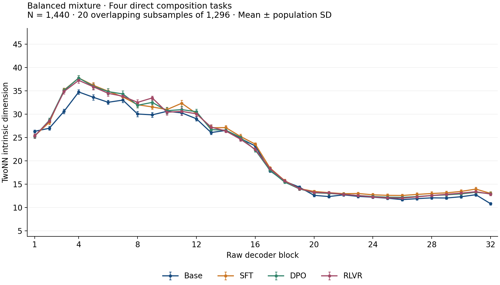
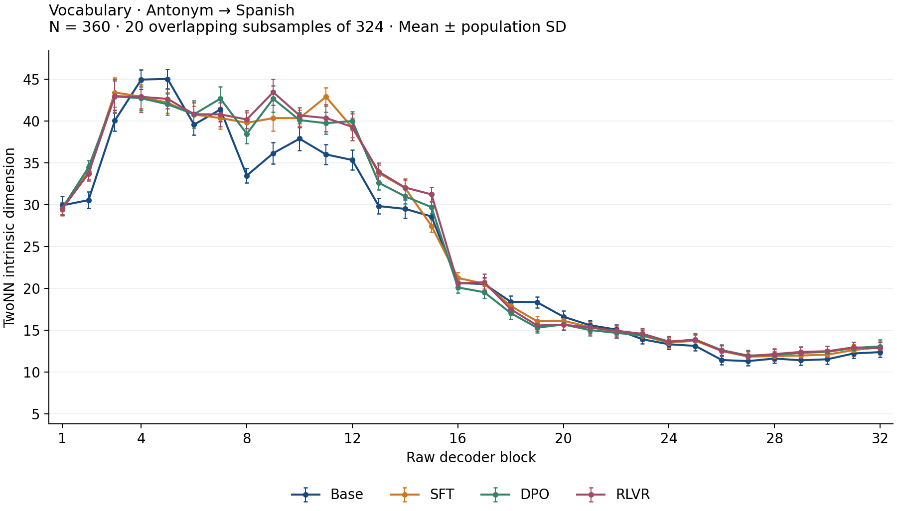
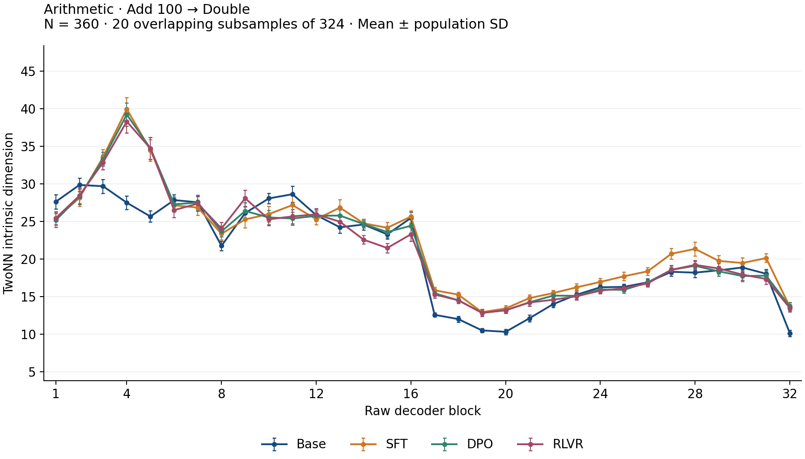
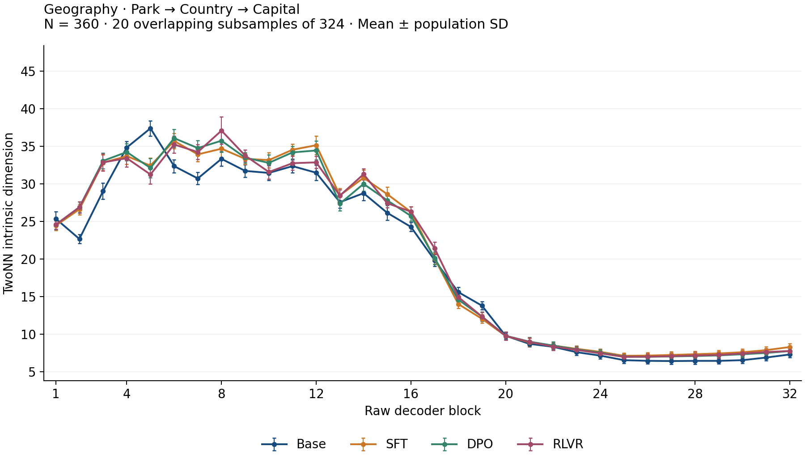
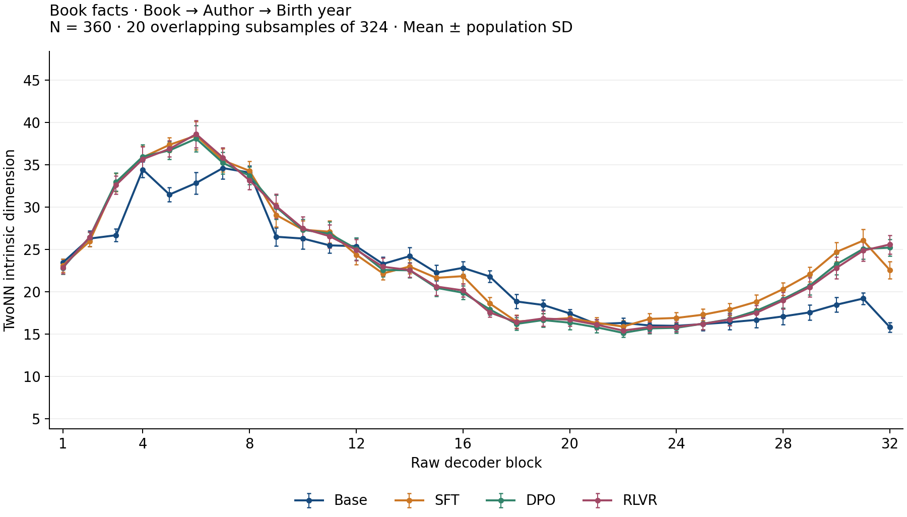

# 直接组合题的逐层 TwoNN

四阶段回放同一批 1,440 道直接组合题的原始 10-shot token ID。每题用 FP32 前向读取最后一个有效输入 token 在 32 个 decoder block 的原始输出。

每个点为 20 个重叠子样本的 TwoNN 均值，误差条为总体标准差。混合图在每次抽样中合并四类各 324 道后直接计算近邻。单任务和混合的估计样本数分别为 324 和 1,296，跨图以逐层形状为主。Base 使用原生续写，后三阶段使用原生聊天模板且输入 token 逐题相同。

## 四任务等量混合

[SVG](figures/mixed.svg)

## 词汇

[SVG](figures/antonym-spanish.svg)

## 算术

[SVG](figures/plus-hundred-times-two.svg)

## 地理

[SVG](figures/park-country-capital.svg)

## 书籍事实

[SVG](figures/book-author-birthyear.svg)

## 峰位与末层

峰值取未平滑均值的最大点，并列时取最早层。峰后上升步数统计相邻层均值回升的次数。PrOntoQA 的四阶段均值峰位为 L14–L15，峰后整体回落，末层仍高于首层。以下逐阶段数值供形状对照。[PrOntoQA 报告第 3 节](../../../prontoqa/reports/report.zh-CN.md#3-twonn共同中部峰形阶段差异随深度变化)

| 题集 | 阶段 | 峰层 | L1 | 峰值 | L32 | 峰值 − L32 | 峰后上升步数 |
| --- | --- | --- | ---: | ---: | ---: | ---: | ---: |
| 四任务等量混合 | Base | L4 | 26.33 | 34.76 | 10.83 | 23.92 | 8 |
| 四任务等量混合 | SFT | L4 | 25.34 | 37.74 | 13.04 | 24.71 | 8 |
| 四任务等量混合 | DPO | L4 | 25.27 | 37.75 | 12.96 | 24.79 | 7 |
| 四任务等量混合 | RLVR | L4 | 25.35 | 37.25 | 12.90 | 24.35 | 7 |
| 词汇 | Base | L5 | 29.92 | 45.02 | 12.40 | 32.62 | 7 |
| 词汇 | SFT | L3 | 29.43 | 43.41 | 12.96 | 30.45 | 9 |
| 词汇 | DPO | L3 | 29.56 | 42.94 | 13.08 | 29.86 | 10 |
| 词汇 | RLVR | L9 | 29.52 | 43.44 | 12.85 | 30.59 | 7 |
| 算术 | Base | L2 | 27.62 | 29.86 | 10.16 | 19.70 | 15 |
| 算术 | SFT | L4 | 25.40 | 39.96 | 13.67 | 26.29 | 15 |
| 算术 | DPO | L4 | 25.16 | 39.22 | 13.70 | 25.52 | 13 |
| 算术 | RLVR | L4 | 25.44 | 38.30 | 13.50 | 24.80 | 14 |
| 地理 | Base | L5 | 25.38 | 37.39 | 7.32 | 30.07 | 7 |
| 地理 | SFT | L6 | 24.46 | 35.71 | 8.31 | 27.40 | 11 |
| 地理 | DPO | L6 | 24.56 | 36.08 | 7.78 | 28.30 | 10 |
| 地理 | RLVR | L8 | 24.58 | 37.09 | 7.78 | 29.30 | 10 |
| 书籍事实 | Base | L7 | 23.45 | 34.61 | 15.83 | 18.79 | 10 |
| 书籍事实 | SFT | L6 | 23.11 | 38.45 | 22.57 | 15.88 | 13 |
| 书籍事实 | DPO | L6 | 22.83 | 38.08 | 25.22 | 12.86 | 11 |
| 书籍事实 | RLVR | L6 | 22.89 | 38.62 | 25.60 | 13.02 | 11 |

[逐层汇总](id_summary.csv) · [逐次估计](id_replicates.csv) · [题号](sample_ids.csv) · [子样索引](subsamples.json) · [验证清单](manifest.json)
