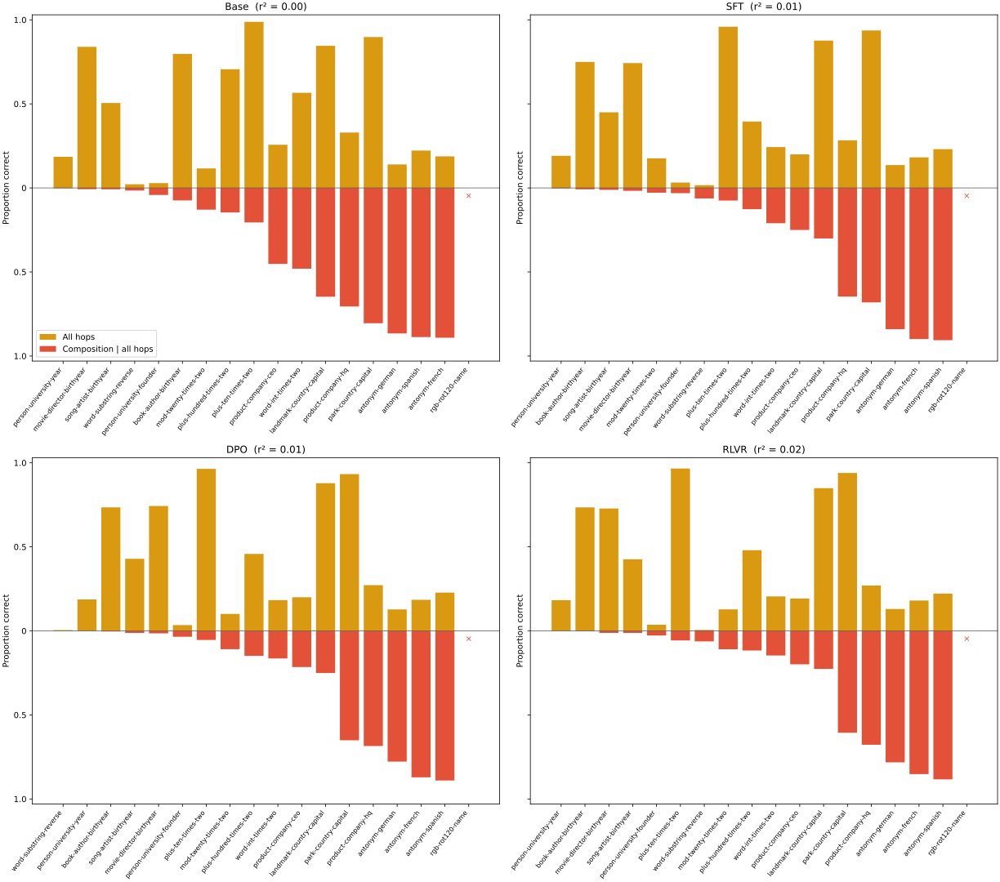
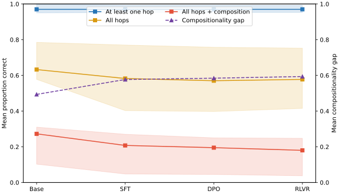

# Tülu 3 四阶段组合性缺口实验

四个固定 checkpoint 均完成 18 个任务的 36,802 题评估，每阶段生成 140,686 条预测。四任务版本按论文的抽样口径从同一批预测中读取，四阶段题目配对。 [论文第 3 节](https://arxiv.org/pdf/2510.01685v2#page=3)

## 18 任务全量

| 阶段 | 至少一跳 | 全部单跳 | 直接组合 | 单跳与组合均正确 | 组合性缺口 | 全部单跳正确题数 |
|---|---:|---:|---:|---:|---:|---:|
| Base | 83.47% | 32.59% | 16.38% | 10.76% | 66.97% | 11,992 |
| SFT | 81.84% | 29.63% | 13.12% | 7.48% | 74.75% | 10,905 |
| DPO | 80.89% | 29.07% | 12.11% | 7.00% | 75.93% | 10,699 |
| RLVR | 80.94% | 28.95% | 11.64% | 6.66% | 76.99% | 10,653 |

缺口是全部单跳正确的题目中，直接组合失败的比例。这里按题汇总。图 1 按任务展示全单跳准确率，以及全单跳正确时的组合准确率。条件分母为零的任务在图中标为 ×。

## 四任务各 100 题

| 阶段 | 至少一跳 | 全部单跳 | 单跳与组合均正确 | 组合性缺口 | 缺口有定义的任务数 |
|---|---:|---:|---:|---:|---:|
| Base | 97.00% | 63.25% | 27.25% | 49.34% | 4 |
| SFT | 97.00% | 58.25% | 20.75% | 57.68% | 4 |
| DPO | 97.00% | 57.00% | 19.50% | 58.44% | 4 |
| RLVR | 97.00% | 57.75% | 18.00% | 59.36% | 4 |

图 2 对四个任务的指标取等权平均。阴影是任务间四分位范围。

## 逐 token 解码补算

| 阶段 | 任一答案翻转题数 | 任一答案错→对 | 任一答案对→错 | 组合错→对 | 组合对→错 | 全单跳正确分母变化 | 缺口变化（百分点） |
|---|---:|---:|---:|---:|---:|---:|---:|
| Base | 3 | 0 | 3 | 0 | 0 | -1 | -0.00 |
| SFT | 30,145 | 0 | 30,145 | 0 | 4,829 | -10,905 | 未定义 |
| DPO | 29,020 | 0 | 29,020 | 0 | 4,317 | -10,630 | +11.02 |
| RLVR | 28,349 | 0 | 28,349 | 0 | 4,068 | -10,411 | +13.92 |

补算沿用生成 token ID。逐 token 解码保留作者 Fig. 1 实现中的特殊 token 解码行为。表中的差值方向为逐 token 减整段解码。同一题的不同 hop 可以向两个方向翻转。逐任务及各 hop 的准确率和双向翻转见 [指标表](metrics.csv) 和 [解码补算](decode-sensitivity.csv)。

## 复现边界

- Base 用原生 tokenizer 续写。三个 Tülu 阶段各用原生聊天模板预填助手回合的 `A:`。阶段比较同时体现了各自的模板。
- 四阶段统一用 BF16 greedy、最多 20 个新 token、批大小 1。主结果采用整段解码和原样字符串匹配。BF16 与作者 Transformers 加载代码的默认 FP32 有所区别。
- 数据版本、顺序、抽样种子、权重哈希、运行环境和逐题输出均随运行保留。数据发布行序可重建 Table 1 示例。作者当次运行的逐题 prompt 日志未公开。
