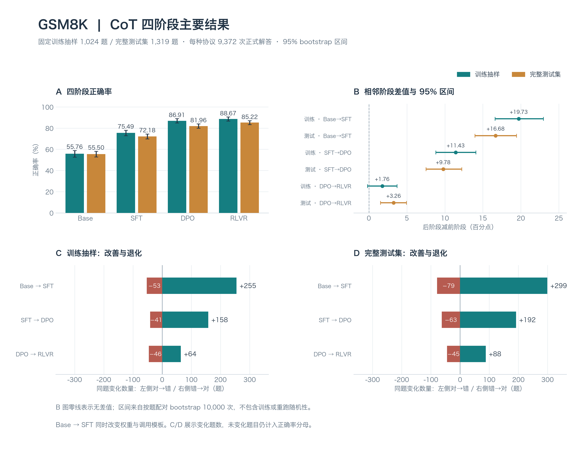

# Tülu 3 8B 四阶段 GSM8K 比较

正式评测完成9,372次解答，独立重算核验通过。Base→RLVR的训练抽样正确率由55.76%变为88.67%；测试集由55.50%变为85.22%。

训练抽样：Base→SFT +19.73 个百分点；SFT→DPO +11.43 个百分点；DPO→RLVR +1.76 个百分点。
完整测试集：Base→SFT +16.68 个百分点；SFT→DPO +9.78 个百分点；DPO→RLVR +3.26 个百分点。
RLVR相对DPO在训练抽样增加1.76个百分点，95%区间为[-0.20, +3.71]，区间覆盖0。同题比较中，64题错→对、46题对→错；提升与退化同时存在。
RLVR相对DPO在完整测试集增加3.26个百分点，95%区间为[+1.52, +4.93]，区间全为正。同题比较中，88题错→对、45题对→错；提升与退化同时存在。

## 数据与协议

训练组1,024题（seed42，无放回），测试组1,319题；独立工程试跑32题×4模型另计。四模型共享真实RLVR8-shot正文；BF16、greedy、1024输出token上限、8192上下文，EOS或新题标记停止。仅解析新生成文本，去数字千分位后取最后有符号数，与gold做数值等值比较；无数字计错。协议在全部pilot技术检查通过后冻结，无正确率门槛。

## 正确率

| 数据 | 阶段 | 正确 / 总数 | 正确率 | 95%区间 | 无数值答案 | 截断 | 平均输出token |
|---|---|---:|---:|---|---:|---:|---:|
| 训练抽样 | Base | 571 / 1024 | 55.76% | 52.64%–58.89% | 0 (0.00%) | 14 (1.37%) | 99.1 |
| 训练抽样 | SFT | 773 / 1024 | 75.49% | 72.85%–78.03% | 0 (0.00%) | 6 (0.59%) | 89.3 |
| 训练抽样 | DPO | 890 / 1024 | 86.91% | 84.86%–88.96% | 0 (0.00%) | 0 (0.00%) | 98.8 |
| 训练抽样 | RLVR | 908 / 1024 | 88.67% | 86.72%–90.53% | 0 (0.00%) | 0 (0.00%) | 110.0 |
| 完整测试集 | Base | 732 / 1319 | 55.50% | 52.77%–58.15% | 0 (0.00%) | 15 (1.14%) | 99.4 |
| 完整测试集 | SFT | 952 / 1319 | 72.18% | 69.75%–74.53% | 0 (0.00%) | 8 (0.61%) | 91.0 |
| 完整测试集 | DPO | 1081 / 1319 | 81.96% | 79.91%–84.00% | 0 (0.00%) | 0 (0.00%) | 103.2 |
| 完整测试集 | RLVR | 1124 / 1319 | 85.22% | 83.24%–87.11% | 0 (0.00%) | 0 (0.00%) | 114.1 |



**主要结果图。**A 展示训练抽样和完整测试集的正确率及 95% 区间；B 展示后阶段减前阶段的配对差值，虚线为零；C/D 分别展示训练、测试中的对→错（左侧）和错→对（右侧）题数。CoT 下四阶段正确率逐步上升，但每次阶段变化仍伴随部分题目退化。DPO→RLVR 在训练抽样中的差值区间跨零，在测试集中的差值区间全为正；区间跨零不能据此认定模型等效。

图表直接读取已保存的汇总统计，未重跑推理或重新计算 bootstrap。[绘图脚本](../../plot_main_results.py)；[SVG](figures/main-results.svg) / [PDF](figures/main-results.pdf)。从 `gsm8k/` 目录运行 `python plot_main_results.py` 可重建两份报告的四张图（需 Matplotlib 和中文字体）。

## 同题阶段变化

| 数据 | 阶段变化 | 准确率差（百分点） | 95%区间（百分点） | 错→对 | 对→错 | 一直对 | 一直错 |
|---|---|---:|---|---:|---:|---:|---:|
| 训练抽样 | Base→SFT | +19.73 | +16.60–+22.95 | 255 | 53 | 518 | 198 |
| 训练抽样 | SFT→DPO | +11.43 | +8.79–+14.06 | 158 | 41 | 732 | 93 |
| 训练抽样 | DPO→RLVR | +1.76 | -0.20–+3.71 | 64 | 46 | 844 | 70 |
| 完整测试集 | Base→SFT | +16.68 | +13.95–+19.41 | 299 | 79 | 653 | 288 |
| 完整测试集 | SFT→DPO | +9.78 | +7.51–+12.21 | 192 | 63 | 889 | 175 |
| 完整测试集 | DPO→RLVR | +3.26 | +1.52–+4.93 | 88 | 45 | 1036 | 150 |

## 执行与核验

正式运行累计进程时间2.12小时（含模型加载）；基础设施失败0次。128次工程试跑另计。

全部16个权重分片与固定官方发布版本的完整SHA256一致。7,473条RLVR GSM8K记录全部与原始训练集一一匹配。原始输出、题目/token清单、冻结指纹、运行日志及逐题变化随报告交付。独立评分实现复核了9,372条回答、8个阶段×数据组统计与6个相邻阶段对比。

正式完成后实际重启管线验证恢复：全部输出与运行记录逐字节一致，未新增推理任务、未重新生成已完成答案。核验记录见 manifests/resume_check.json。

| 阶段 | 正式进程耗时（分） | 已提交生成耗时（分） | 总输出token | 生成吞吐（token/秒） | 失败尝试 |
|---|---:|---:|---:|---:|---:|
| Base | 33.62 | 33.03 | 232673 | 117.4 | 0 |
| SFT | 29.34 | 28.75 | 211505 | 122.6 | 0 |
| DPO | 30.70 | 30.10 | 237242 | 131.4 | 0 |
| RLVR | 33.42 | 32.82 | 263129 | 133.6 | 0 |

进程耗时含模型加载；生成耗时仅包含已提交批次。吞吐是整卡聚合输出token/秒，不是单条回答速度。

## 改善与退化案例

以下保留同题四阶段的选例；完整原始案例与逐题对照表为外部证据。每个数据组、相邻阶段和变化方向取按题目ID排序的前两题，展示改善与退化；案例不代表总体错误分布。

## 固定版本与复查

| 阶段 | 官方模型 | 固定 revision |
|---|---|---|
| Base | meta-llama/Llama-3.1-8B | d04e592bb4f6aa9cfee91e2e20afa771667e1d4b |
| SFT | allenai/Llama-3.1-Tulu-3-8B-SFT | f2a0b46b0cfda21003c6141b1ff837b7e165524d |
| DPO | allenai/Llama-3.1-Tulu-3-8B-DPO | a7beb67e33ffd01cc87ac3b46cadc1000985b8db |
| RLVR | allenai/Llama-3.1-Tulu-3-8B | 666943798adbde0b1aff34626007e26986a3c107 |

RLVR 数据 revision：7dbd180f5440c0b90f2944e6efea934b85437a95；GSM8K commit：3101c7d5072418e28b9008a6636bde82a006892c。协议冻结时间：2026-10-04T04:41:40.542323+00:00。完整配置及输入/权重指纹分别见 experiment.json 与 manifests/。Base tokenizer使用默认BOS；三个聊天模型直接使用apply_chat_template生成的token，不另加BOS。三个聊天阶段在全部2,375道pilot及正式题上的输入token完全一致。推理环境：RTX 3090 24GB，vLLM 0.7.2，PyTorch 2.5.1 / CUDA 12.4，Transformers 4.49.0；完整依赖快照随项目保存。

## 解释边界

- Base使用纯文本，SFT/DPO/RLVR使用各自官方聊天模板；Base→SFT同时包含权重与格式变化。
- 训练组是官方RLVR数据池中的固定抽样，不保证发布版模型实际采样过每条题，也不假定前两后训练阶段未见过相同内容。
- 测试集被广泛用于模型开发评测，不能当作完全未接触的新测试。训练/测试差距不能单独证明记忆或推理机制。
- 阶段间数据、目标和训练预算共同变化，阶段差值不能单独归因于某个训练算法。
- 本轮不计算MechanisticProbe SP1/SP2。GSM8K现成答案与解答不提供原指标所需的输入语句证明图，不能据本轮判断grounding/reasoning分离。
- 使用固定的最后数值答案评分；数字提取不保证回答推理过程正确。截断回答仍计入分母，截断率单独报告。
- 95%区间来自各split内按题配对bootstrap10000次，用于描述估计不确定性；不据未校正的多个区间作整体显著性结论。
- 完整测试集的本次得分本身是确定统计；bootstrap区间描述题目构成变化的敏感性，不包含重跑随机性或训练随机性。
- 本轮只执行所列固定提示和解码协议，不声称完整复现官方排行榜分数。

## 来源

- [Tülu 官方训练配置](https://github.com/allenai/open-instruct/blob/main/docs/tulu3.md)
- [RLVR 训练混合](https://huggingface.co/datasets/allenai/RLVR-GSM-MATH-IF-Mixed-Constraints)
- [GSM8K 官方数据](https://github.com/openai/grade-school-math)
- [MechanisticProbe 原论文](https://aclanthology.org/2023.emnlp-main.299/)


## 整合后的证据范围

本仓库公开汇总统计、图表和本报告。完整输入、分词结果、原始生成和逐题表留在本地，未上传到新仓库或新 Release。历史验收记录描述当时的完整证据检查；公开汇总不能代替重新评分或配对 bootstrap。

## 原 HTML 中保留的补充诊断

### 改善与退化案例

```text
Jasper bought 2 pounds of cheddar cheese for $10. The price of the cheddar cheese is $10 / 2 = $5 per pound. The price of the cream cheese is half the price of the cheddar cheese, so it is $5 / 2 = $2.50 per pound. The price of the cold cuts is twice the price of the cheddar cheese, so it is $10 x 2 = $20 per pound. The total cost is 2 x $5 + 1 x $2.50 + 1 x $20 = $17.50. So the answer is $17.50.
```

### 改善与退化案例

```text
The cheddar cheese cost $10. The cream cheese cost half the price of the cheddar cheese, so it cost $10 / 2 = $5. The cold cuts cost twice the price of the cheddar cheese, so it cost $10 * 2 = $20. Jasper spent $10 + $5 + $20 = $35 on the ingredients. So the answer is 35.
```

### 改善与退化案例

```text
The cheddar cheese costs $10 for 2 pounds, so it costs $10 / 2 = $5 per pound. The cream cheese costs half of $5, which is $5 / 2 = $2.50 per pound. The cold cuts cost twice the price of the cheddar cheese, which is $10 * 2 = $20. The total cost is $10 (cheddar) + $2.50 (cream cheese) + $20 (cold cuts) = $32.50. So the answer is 32.5.
```

### 改善与退化案例

```text
The cheddar cheese costs $10 for 2 pounds, so it costs $10 / 2 = $5 per pound. The cream cheese costs half the price of the cheddar cheese, so it costs $5 / 2 = $2.5 per pound. The pack of cold cuts costs twice the price of the cheddar cheese, so it costs $10 * 2 = $20. Adding up the costs, Jasper spends $10 (cheddar cheese) + $2.5 (cream cheese) + $20 (cold cuts) = $32.5. So the answer is 32.5.
```

### 改善与退化案例

```text
There are 26 pink hard hats, 15 green hard hats, and 24 yellow hard hats. Carl takes away 4 pink hard hats. John takes away 6 pink hard hats and twice as many green hard hats as the number of pink hard hats that he removed. So John takes away 6 + 2 x 4 = 14 green hard hats. So there are 26 - 4 = 22 pink hard hats left. There are 15 - 14 = 1 green hard hats left. There are 24 yellow hard hats left. So the answer is 22 + 1 + 24 = 47.
```

### 改善与退化案例

```text
Carl took away 4 pink hard hats, so there are 26 - 4 = 22 pink hard hats left. John took away 6 pink hard hats, so there are 22 - 6 = 16 pink hard hats left. John also took away twice as many green hard hats as the number of pink hard hats that he removed, so he took away 6 * 2 = 12 green hard hats. There are 15 - 12 = 3 green hard hats left. The total number of hard hats that remained in the truck is 16 + 3 + 24 = 43. So the answer is 43.
```

### 改善与退化案例

```text
First, Carl takes away 4 pink hard hats, leaving 26 - 4 = 22 pink hard hats. Then John takes away 6 pink hard hats, leaving 22 - 6 = 16 pink hard hats. John also takes away twice as many green hard hats as the number of pink hard hats he removed, which is 2 * 6 = 12 green hard hats. Initially, there were 15 green hard hats, so after John takes his, there are 15 - 12 = 3 green hard hats left. The number of yellow hard hats remains unchanged at 24. To find the total number of hard hats remaining, add the remaining pink, green, and yellow hard hats: 16 (pink) + 3 (green) + 24 (yellow) = 43. So the answer is 43.
```

### 改善与退化案例

```text
Initially, there were 26 + 15 + 24 = 65 hard hats. Carl took away 4 pink hard hats, leaving 26 - 4 = 22 pink hard hats. John took away 6 pink hard hats, leaving 22 - 6 = 16 pink hard hats. John also took away twice as many green hard hats as the number of pink hard hats he removed, which is 2 * 6 = 12 green hard hats. Initially, there were 15 green hard hats, so after John took his share, there were 15 - 12 = 3 green hard hats left. The number of yellow hard hats remained unchanged at 24. Therefore, the total number of hard hats remaining in the truck is 16 (pink) + 3 (green) + 24 (yellow) = 43. So the answer is 43.
```

### 改善与退化案例

```text
James earns $20 an hour at his main job. 20% less at his second job is 20% of 20, which is 4. So he earns $16 an hour at his second job. He works 30 hours at his main job and 30/2 = 15 hours at his second job. So he earns 30 x 20 = 600 dollars at his main job and 15 x 16 = 240 dollars at his second job. 600 + 240 = 840. So the answer is 840.
```

### 改善与退化案例

```text
James earns 20 * 30 = $600 at his main job. He earns 20% less at his second job, so he earns 20 * .2 = 4% less. That means he earns 100 - 4 = 96% of his main job's pay. So he earns 600 * .96 = $576 at his second job. In total, he earns 600 + 576 = $1176 per week. So the answer is 1176.
```

### 改善与退化案例

```text
James earns $20/hr at his main job and works 30 hours, so he earns 20 * 30 = $600 at his main job. At his second job, he earns 20% less, which is 20 / 100 * 20 = $4 less per hour. So he earns 20 - 4 = $16/hr at his second job. He works half as much at his second job as his main job, which is 30 / 2 = 15 hours. So he earns 16 * 15 = $240 at his second job. In total, he earns $600 + $240 = $840 per week. So the answer is 840.
```

### 改善与退化案例

```text
James earns $20 per hour at his main job. He works 30 hours, so he earns 30 * 20 = $600 at his main job. At his second job, he earns 20% less, which is $20 * 20 / 100 = $4 less per hour. So he earns $20 - $4 = $16 per hour at his second job. He works half as much at his second job as his main job, which is 30 / 2 = 15 hours. So he earns 15 * $16 = $240 at his second job. In total, James earns $600 + $240 = $840 per week. So the answer is 840.
```

### 改善与退化案例

```text
John writes 20 pages a day. 3 books that are 400 pages each will be 3 x 400 = 1200 pages. 1200 pages / 20 pages per day = 60 days. So the answer is 60 days.
```

### 改善与退化案例

```text
John writes 20 pages a day. So he writes 20 * 7 = 140 pages a week. So he writes 140 * 4 = 560 pages a month. So he writes 560 * 3 = 1680 pages a month. So it will take him 1680 / 20 = 84 days. So the answer is 84.
```

### 改善与退化案例

```text
John writes 20 pages a day. So to write 400 pages, he will take 400 / 20 = 20 days. Since he has 3 books to write, he will take 3 * 20 = 60 days. So the answer is 60.
```

### 改善与退化案例

```text
First find the total number of pages in the 3 books: 400 pages / book * 3 books = 1200 pages. Then divide the total number of pages by the number of pages John writes per day to find the number of days: 1200 pages / 20 pages per day = 60 days. So the answer is 60.
```

### 改善与退化案例

```text
Let's say her previous monthly income was $x. 40% of $x is 0.4x. 25% of $x is 0.25x. 0.4x - 0.25x = 0.15x. 0.15x = 600. x = 600 / 0.15 = 4000. So the answer is 4000.
```

### 改善与退化案例

```text
Let x be the previous monthly income. 40% of x is 0.4x. 25% of x + 600 is 0.25x + 600. 0.4x = 0.25x + 600. 0.15x = 600. x = 600 / 0.15. x = 4000. So the answer is 4000.
```

### 改善与退化案例

```text
Let x be Mrs. Snyder's previous monthly income. 40% of x is 0.4x. After her salary increased by $600, her new income is x + 600. 25% of her new income is 0.25(x + 600). Since the amount spent on rent and utilities remains the same, 0.4x = 0.25(x + 600). Expanding the equation gives 0.4x = 0.25x + 150. Subtracting 0.25x from both sides gives 0.15x = 150. Dividing both sides by 0.15 gives x = 1000. So Mrs. Snyder's previous monthly income was $1000. So the answer is 1000.
```

### 改善与退化案例

```text
Let's denote Mrs. Snyder's previous monthly income as x. According to the problem, 40% of x was spent on rent and utilities. This can be expressed as 0.4x. After her salary increased by $600, her rent and utilities now amount to 25% of her new income, which is (x + 600) * 0.25. We know these two amounts are equal, so we can set up the equation:

0.4x = (x + 600) * 0.25

To solve for x, we first clear the decimals by multiplying every term by 100:

40x = 25(x + 600)

Expanding the right side:

40x = 25x + 15000

Subtract 25x from both sides:

15x = 15000

Divide both sides by 15:

x = 1000

So Mrs. Snyder's previous monthly income was $1000. So the answer is 1000.
```

### 改善与退化案例

```text
Betty is 60 years old. Her daughter is 40% younger than she is. So her daughter is 60 - 40% of 60 = 60 - 24 = 36 years old. Her granddaughter is one-third her mother's age. So her granddaughter is 36 / 3 = 12 years old. So the answer is 12.
```

### 改善与退化案例

```text
Betty's daughter is 60 * .4 = 24 years younger than Betty. So Betty's daughter is 60 - 24 = 36 years old. The granddaughter is one - third her mother's age, so she is 36 / 3 = 12 years old. So the answer is 12.
```

### 改善与退化案例

```text
Betty's daughter is 40 / 100 * 60 = 24 years old. The granddaughter is one - third her mother's age, so the granddaughter is 24 / 3 = 8 years old. So the answer is 8.
```

### 改善与退化案例

```text
Betty is 60 years old. Her daughter is 40% younger than Betty, which means the daughter is 60 * 40 / 100 = 24 years old. The granddaughter is one-third her mother's age, so the granddaughter is 24 / 3 = 8 years old. So the answer is 8.
```

### 改善与退化案例

```text
Let x be the number of eggs that Tank gathered in the first round. Then Emma gathered x + 10 eggs in the first round. In the second round, Tank gathered x - 20 eggs, and Emma gathered 2x eggs. So the total number of eggs in the pile is 400. So we have the equation: x + x + 10 + x - 20 + 2x = 400. Simplifying, we get 6x - 10 = 400. So 6x = 410. So x = 410/6 = 68.5. So Tank gathered 68.5 eggs in the first round. Emma gathered 68.5 + 10 = 78.5 eggs in the first round. In the second round, Tank gathered 68.5 - 20 = 48.5 eggs, and Emma gathered 2 x 68.5 = 137 eggs. So the total number of eggs in the pile is 68.5 + 78.5 + 48.5 + 137 = 332.5. So the 6 other egg hunters collected 400 - 332.5 = 67.5 eggs. So the answer is 67.5.
```

### 改善与退化案例

```text
In the first round, Tank gathered 10 more eggs than Emma, so Emma gathered 10 less eggs than Tank. Since Tank gathered 10 more eggs than Emma, Tank gathered 10 + 10 = 20 eggs more than Emma. Emma gathered 60 eggs in the second round, so in the first round, Emma gathered 60 / 2 = 30 eggs. In the first round, Tank gathered 30 + 20 = 50 eggs. In the second round, Tank gathered 20 less eggs than the first round, so she gathered 50 - 20 = 30 eggs. In total, Tank gathered 50 + 30 = 80 eggs. In total, Emma gathered 30 + 60 = 90 eggs. In total, they gathered 80 + 90 = 170 eggs. The 6 other egg hunters gathered 400 - 170 = 230 eggs. So the answer is 230.
```

### 改善与退化案例

```text
Let's break down the information given:

* Tank gathered 10 more eggs than Emma in the first round.
* Let's say Emma gathered x eggs in the first round. Then Tank gathered x + 10 eggs in the first round.
* In the second round, Emma gathered twice as many eggs as Tank, and Tank gathered 20 less eggs than in the first round.
* So, Emma gathered 2 * (x + 10 - 20) = 2x - 30 eggs in the second round.
* Given that Emma gathered 60 eggs in the second round, we can set up the equation: 2x - 30 = 60.
* Solving for x, we add 30 to both sides: 2x = 90.
* Then divide by 2: x = 45.
* So, Emma gathered 45 eggs in the first round, and Tank gathered 45 + 10 = 55 eggs in the first round.
* Tank gathered 55 - 20 = 35 eggs in the second round.
* Total eggs gathered by Tank and Emma in both rounds: 45 + 55 + 35 = 135 eggs.
* The total number of eggs collected by everyone (including the 6 other people) is 400 eggs.
* Therefore, the 6 other people collected 400 - 135 = 265 eggs.

So, the 6 other egg hunters collected 265 eggs.
```

### 改善与退化案例

```text
Let's break down the information:

* In the first round, Tank gathered 10 more eggs than Emma. Let's say Emma gathered x eggs in the first round. Then Tank gathered x + 10 eggs in the first round.
* In the second round, Emma gathered twice as many eggs as Tank. Since Tank gathered 20 less eggs in the second round than in the first round, Tank gathered (x + 10) - 20 = x - 10 eggs in the second round. Emma gathered 2 * (x - 10) eggs in the second round.
* We know Emma gathered 60 eggs in the second round, so 2 * (x - 10) = 60. Solving for x, we get 2x - 20 = 60, which simplifies to 2x = 80, and x = 40.
* So, in the first round, Emma gathered 40 eggs, and Tank gathered 40 + 10 = 50 eggs.
* In the second round, Tank gathered 50 - 20 = 30 eggs, and Emma gathered 60 eggs.
* The total number of eggs gathered by Tank and Emma in both rounds is: 40 (first round) + 50 (first round) + 30 (second round) + 60 (second round) = 180 eggs.
* The total number of eggs collected by everyone (including the 6 other people) is 400 eggs.
* Therefore, the number of eggs collected by the 6 other people is 400 - 180 = 220 eggs.

So the answer is 220.
```

### 改善与退化案例

```text
Madeline spends 18 hours a week in class. She spends 4 hours per day working on homework. She spends 8 hours per day sleeping. She works part-time 20 hours per week. So she has 18 + 4 + 8 + 20 = 50 hours. So she has 168 - 50 = 118 hours left over. So the answer is 118.
```

### 改善与退化案例

```text
Madeline spends 18 hours in class, 4 hours on homework, 8 hours sleeping, and 20 hours working. That is 18 + 4 + 8 + 20 = 50 hours. There are 24 hours in a day. So that is 24 - 50 = -26 hours. So the answer is -26.
```

### 改善与退化案例

```text
Madeline spends 18 hours in class, 4 hours on homework, 8 hours sleeping, and 20 hours working. That's a total of 18 + 4 + 8 + 20 = 50 hours. There are 7 days in a week, so there are 7 * 24 = 168 hours in a week. Madeline has 168 - 50 = 118 hours left over. So the answer is 118.
```

### 改善与退化案例

```text
Madeline spends 18 hours a week in class. She spends 4 hours per day on homework, which is 4 * 7 = 28 hours per week. She spends 8 hours per day sleeping, which is 8 * 7 = 56 hours per week. She works part-time 20 hours per week. In total, she spends 18 + 28 + 56 + 20 = 122 hours per week. There are 7 days in a week, so there are 7 * 24 = 168 hours in a week. Madeline has 168 - 122 = 46 hours left over. So the answer is 46.
```

### 改善与退化案例

```text
Mark was going 75 miles per hour in a 30 mile per hour zone. So he was going 45 miles per hour over the speed limit. The fine is increased by $2 for every mile per hour Mark was going over the speed limit. So the fine is 45 x 2 = 90 dollars. The fine is also doubled because he was in a school zone. So the fine is 90 x 2 = 180 dollars. Finally, the judge makes Mark pay $300 in court costs and he also has to pay his lawyer $80/hour for three hours of work. So he has to pay 3 x 80 = 240 dollars. So the total is 180 + 300 + 240 = 720 dollars. So the answer is 720.
```

### 改善与退化案例

```text
Mark was going 75 - 30 = 45 miles per hour over the speed limit. So the fine is increased by 45 * 2 = $90. So the base fine of $50 is increased to 50 + 90 = $140. The fine is doubled because he was in a school zone so the fine is 140 * 2 = $280. Mark also has to pay $300 in court costs and $80 * 3 = $240 to his lawyer. So Mark owes 280 + 300 + 240 = $820. So the answer is 820.
```

### 改善与退化案例

```text
Mark was going 75 - 30 = 45 miles per hour over the speed limit. The fine is increased by $2 for every mile per hour over the limit, so the additional fine is 45 * 2 = $90. The base fine of $50 plus the additional fine of $90 equals a total fine of $50 + $90 = $140. The fine is doubled because it was in a school zone, so the total fine is 2 * $140 = $280. Adding the court costs of $300, Mark owes $280 + $300 = $580. Mark's lawyer charges $80 per hour, so for 3 hours, the lawyer's fee is 3 * $80 = $240. Adding the lawyer's fee to the total fine and court costs, Mark owes $580 + $240 = $820. So the answer is 820.
```

### 改善与退化案例

```text
First, calculate the amount over the speed limit: 75 - 30 = 45 miles per hour. The fine is increased by $2 for every mile per hour over the limit, so 45 * $2 = $90. The fine is then doubled because it was in a school zone, so $90 * 2 = $180. Adding the base fine of $50, Mark's fine is $50 + $180 = $230. Then, add the court costs: $230 + $300 = $530. Finally, calculate the lawyer's fees: 3 hours * $80/hour = $240. Adding the lawyer's fees to the total, Mark owes $530 + $240 = $770. So the answer is 770.
```

### 改善与退化案例

```text
Tom needs 500 pounds of flour. 50-pound bags of flour cost $20. So he needs 500 / 50 = 10 bags of flour. 10 bags of flour will cost 10 x 20 = 200 dollars. He also needs 10 pounds of salt. Salt costs $.2 a pound. So 10 pounds of salt will cost 10 x .2 = 2 dollars. He also spends $1000 promoting everything. He then sells tickets for $20 each and sells 500 tickets. So he will make 500 x 20 = 10000 dollars. 200 + 2 + 1000 + 10000 = 10202 dollars. So the answer is 10202 dollars.
```

### 改善与退化案例

```text
Tom needs 500 pounds of flour and he can buy 50-pound bags of flour for $20.  So he needs 500 / 50 = 10 bags of flour.  So he spends 10 x $20 = $200 on flour.  He also needs 10 pounds of salt and salt cost $.2 a pound.  So he spends 10 x $.2 = $2 on salt.  He also spends $1000 promoting everything.  So he spends a total of $200 + $2 + $1000 = $1202.  He then sells tickets for $20 each and sells 500 tickets.  So he makes 500 x $20 = $10,000.  So he made $10,000 - $1202 = $8798.  So the answer is 8798.
```

### 改善与退化案例

```text
Tom needs 500 pounds of flour and he buys 50-pound bags for $20.  So he needs 500 / 50 = 10 bags of flour.  Flour will cost him 10 * $20 = $200.  Salt costs $.2 a pound and he needs 10 pounds so that will cost him 10 * $.2 = $2.  He also spends $1000 promoting everything.  So his total cost is $200 + $2 + $1000 = $1202.  He sells tickets for $20 each and sells 500 tickets so he makes 500 * $20 = $10,000.  His profit is $10,000 - $1202 = $8,798. So the answer is 8798.
```

### 改善与退化案例

```text
First, calculate the cost of the flour: 500 pounds / 50 pounds per bag = 10 bags * $20 per bag = $200. Next, calculate the cost of the salt: 10 pounds * $0.2 per pound = $2. Then add the promotion cost: $200 (flour) + $2 (salt) + $1000 (promotion) = $1202. Now calculate the total revenue from ticket sales: 500 tickets * $20 per ticket = $10,000. Finally, subtract the total costs from the revenue to find the profit: $10,000 (revenue) - $1202 (costs) = $9798. So the answer is 9798.
```

### 改善与退化案例

```text
One glass costs 5 dollars. Every second glass costs 60% of the price. So the second glass will cost 5 x 0.6 = 3 dollars. The third glass will cost 5 dollars. The fourth glass will cost 3 dollars. The fifth glass will cost 5 dollars. The sixth glass will cost 3 dollars. The seventh glass will cost 5 dollars. The eighth glass will cost 3 dollars. The ninth glass will cost 5 dollars. The tenth glass will cost 3 dollars. The eleventh glass will cost 5 dollars. The twelfth glass will cost 3 dollars. The thirteenth glass will cost 5 dollars. The fourteenth glass will cost 3 dollars. The fifteenth glass will cost 5 dollars. The sixteenth glass will cost 3 dollars. So the total cost is 5 + 3 + 5 + 3 + 5 + 3 + 5 + 3 + 5 + 3 + 5 + 3 + 5 + 3 + 5 + 3 = 80 dollars. So the answer is 80.
```

### 改善与退化案例

```text
Kylar needs to buy 16 glasses, but every second glass costs only 60% of the price. So he needs to buy 8 glasses for the full price and 8 glasses for 60% of the price. 8 glasses for the full price will cost him 8 * 5 = $40. 8 glasses for 60% of the price will cost him 8 * 5 * 60 / 100 = $24. So he needs to pay 40 + 24 = $64. So the answer is 64.
```

### 改善与退化案例

```text
Kylar buys 16 glasses, but every second glass costs 60% of $5, which is $5 * 60 / 100 = $3. So, he pays $5 for the first glass, $3 for the second, $5 for the third, $3 for the fourth, and so on. This pattern repeats every 2 glasses: $5 + $3 = $8. Kylar buys 16 glasses, which is 8 sets of 2 glasses plus 0 glasses (since 16 / 2 = 8 with no remainder). Therefore, he pays 8 * $8 = $64. So the answer is 64.
```

### 改善与退化案例

```text
Kylar buys 16 glasses. Every second glass costs 60% of $5, which is $5 * 60 / 100 = $3. So, out of 16 glasses, 8 glasses cost $5 each and 8 glasses cost $3 each. The cost for the glasses that cost $5 each is $5 * 8 = $40. The cost for the glasses that cost $3 each is $3 * 8 = $24. The total cost is $40 + $24 = $64. So the answer is 64.
```

### 改善与退化案例

```text
Gloria has to choose between a pair of boots and two pairs of heels. The boots cost $33. One pair of heels costs $33. The other pair costs twice as much, so it costs $33 x 2 = $66. So the total cost of the heels is $33 + $66 = $99. The boots cost $33. So the boots cost $33 less than the heels. So the answer is $33.
```

### 改善与退化案例

```text
The more expensive pair of heels costs 33 * 2 = 66 dollars. So the two pairs of heels cost 66 + 33 = 99 dollars. The boots cost 5 dollars more than the two pairs of heels, so they cost 99 + 5 = 104 dollars. So the answer is 104.
```

### 改善与退化案例

```text
Let's denote the cost of the boots as x dollars. The two pairs of heels cost $33 and 2 * $33 = $66. Together, they cost $33 + $66 = $99, which is 5 dollars less than the boots. So, x = $99 + 5 = $104. Therefore, the boots cost x = $104. So the answer is 104.
```

### 改善与退化案例

```text
Let's denote the cost of the more expensive pair of heels as x dollars. Since one pair costs $33 and the other costs twice as much, x = 2 * 33 = $66. The total cost of the two pairs of heels is 33 + 66 = $99. The problem states that the total cost of the heels is five dollars less than the boots. Therefore, the cost of the boots is 99 + 5 = $104. So the answer is 104.
```

### 改善与退化案例

```text
There are 8 customers. The first 3 buy 1 DVD each. The next 2 buy 2 DVDs each. So 3 + 2 x 2 = 7 DVDs. The last 3 customers don't buy any DVDs. So 7 + 0 = 7. So the answer is 7.
```

### 改善与退化案例

```text
Billy sold 3 + 2 = 5 DVDs to the first 5 customers. So the answer is 5.
```

### 改善与退化案例

```text
Billy's first 3 customers bought 3 * 1 = 3 DVDs. His next 2 customers bought 2 * 2 = 4 DVDs. So, in total, his first 5 customers bought 3 + 4 = 7 DVDs. Since the last 3 customers didn't buy any DVDs, Billy sold a total of 7 DVDs on Tuesday. So the answer is 7.
```

### 改善与退化案例

```text
Billy's first 3 customers bought 3 * 1 = 3 DVDs. His next 2 customers bought 2 * 2 = 4 DVDs. So in total, Billy sold 3 + 4 = 7 DVDs on Tuesday. So the answer is 7.
```

### 改善与退化案例

```text
Henry started with 60 miles. He stopped after 20 miles. So he traveled 60 - 20 = 40 miles. He stopped 15 miles before the end of the trip. So he traveled 40 - 15 = 25 miles between his first and second stops. So the answer is 25.
```

### 改善与退化案例

```text
Henry traveled 20 miles before his first stop. He traveled 15 miles after his second stop. So he traveled 20 + 15 = 35 miles between his first and second stops. So the answer is 35.
```

### 改善与退化案例

```text
Henry's first stop was after 20 miles. His second stop was 15 miles before the end of the trip, which means he traveled 60 - 15 = 45 miles after his first stop. So, the distance between his first and second stops is 45 - 20 = 25 miles. So the answer is 25.
```

### 改善与退化案例

```text
Henry's first stop was after 20 miles. The second stop was 15 miles before the end of the trip, which means he had 60 - 15 = 45 miles left after the first stop. So the distance between the first and second stops is 45 - 20 = 25 miles. So the answer is 25.
```

### 改善与退化案例

```text
Josh bought the house for $80,000. He put in $50,000 in repairs. So the total cost was $80,000 + $50,000 = $130,000. The value of the house increased by 150%. 150% of $130,000 is 150% x $130,000 = 1.5 x $130,000 = $195,000. So the profit was $195,000 - $130,000 = $65,000. So the answer is $65,000.
```

### 改善与退化案例

```text
Josh spent $80,000 + $50,000 = $130,000.  The house increased in value by 150%, so the new value is $130,000 * 150% = $195,000.  He made a profit of $195,000 - $130,000 = $65,000. So the answer is 65000.
```

### 改善与退化案例

```text
Josh bought the house for $80,000 and added $50,000 in repairs, so the total investment was $80,000 + $50,000 = $130,000. The value of the house increased by 150%, which means the new value is 150% of the original value plus the original value. 150% of the original value ($80,000) is $80,000 * 1.5 = $120,000. The new value of the house is $80,000 + $120,000 = $200,000. The profit is the difference between the new value and the total investment: $200,000 - $130,000 = $70,000. So the answer is 70000.
```

### 改善与退化案例

```text
Josh bought the house for $80,000 and added $50,000 in repairs, so the total investment was $80,000 + $50,000 = $130,000. The value of the house increased by 150%, which means the new value is 150% of the original value plus the original value. The original value was $130,000, so 150% of $130,000 is $130,000 * 1.5 = $195,000. The profit is the new value minus the total investment: $195,000 - $130,000 = $65,000. So the answer is 65000.
```

### 改善与退化案例

```text
Melanie started with some number of vacuum cleaners. She sold a third of them at the green house. So she sold 1/3 of the number of vacuum cleaners she started with. She sold 2 more at the red house. So she sold 2 + 1/3 of the number of vacuum cleaners she started with. She sold half of what was left at the orange house. So she sold 1/2 of 2 + 1/3 of the number of vacuum cleaners she started with. So she sold 1/2 of 2 + 1/3 of the number of vacuum cleaners she started with. So she sold 1/2 of 2 + 1/3 of the number of vacuum cleaners she started with. So she sold 1/2 of 2 + 1/3 of the number of vacuum cleaners she started with. So she sold 1/2 of 2 + 1/3 of the number of vacuum cleaners she started with. So she sold 1/2 of 2 + 1/3 of the number of vacuum cleaners she started with. So she sold 1/2 of 2 + 1/3 of the number of vacuum cleaners she started with. So she sold 1/2 of 2 + 1/3 of the number of vacuum cleaners she started with. So she sold 1/2 of 2 + 1/3 of the number of vacuum cleaners she started with. So she sold 1/2 of 2 + 1/3 of the number of vacuum cleaners she started with. So she sold 1/2 of 2 + 1/3 of the number of vacuum cleaners she started with. So she sold 1/2 of 2 + 1/3 of the number of vacuum cleaners she started with. So she sold 1/2 of 2 + 1/3 of the number of vacuum cleaners she started with. So she sold 1/2 of 2 + 1/3 of the number of vacuum cleaners she started with. So she sold 1/2 of 2 + 1/3 of the number of vacuum cleaners she started with. So she sold 1/2 of 2 + 1/3 of the number of vacuum cleaners she started with. So she sold 1/2 of 2 + 1/3 of the number of vacuum cleaners she started with. So she sold 1/2 of 2 + 1/3 of the number of vacuum cleaners she started with. So she sold 1/2 of 2 + 1/3 of the number of vacuum cleaners she started with. So she sold 1/2 of 2 + 1/3 of the number of vacuum cleaners she started with. So she sold 1/2 of 2 + 1/3 of the number of vacuum cleaners she started with. So she sold 1/2 of 2 + 1/3 of the number of vacuum cleaners she started with. So she sold 1/2 of 2 + 1/3 of the number of vacuum cleaners she started with. So she sold 1/2 of 2 + 1/3 of the number of vacuum cleaners she started with. So she sold 1/2 of 2 + 1/3 of the number of vacuum cleaners she started with. So she sold 1/2 of 2 + 1/3 of the number of vacuum cleaners she started with. So she sold 1/2 of 2 + 1/3 of the number of vacuum cleaners she started with. So she sold 1/2 of 2 + 1/3 of the number of vacuum cleaners she started with. So she sold 1/2 of 2 + 1/3 of the number of vacuum cleaners she started with. So she sold 1/2 of 2 + 1/3 of the number of vacuum cleaners she started with. So she sold 1/2 of 2 + 1/3 of the number of vacuum cleaners she started with. So she sold 1/2 of 2 + 1/3 of the number of vacuum cleaners she started with. So she sold 1/2 of 2 + 1/3 of the number of vacuum cleaners she started with. So she sold 1/2 of 2 + 1/3 of the number of vacuum cleaners she started with. So she sold 1/2 of 2 + 1/3 of the number of vacuum cleaners she started with. So she sold 1/2 of 2 + 1/3 of the number of vacuum cleaners she started with. So she sold 1/2 of 2 + 1/3 of the number of vacuum cleaners she started with. So she sold 1/2 of 2 + 1/3 of the number of
```

### 改善与退化案例

```text
Melanie sold 1 / 3 of her vacuum cleaners at the green house, so she had 2 / 3 of her vacuum cleaners left. She sold 2 more at the red house, so she had 2 / 3 - 2 = 2 / 3 - 2 = 2 / 3 - 2 = 2 / 3 - 2 = 2 / 3 - 2 = 2 / 3 - 2 = 2 / 3 - 2 = 2 / 3 - 2 = 2 / 3 - 2 = 2 / 3 - 2 = 2 / 3 - 2 = 2 / 3 - 2 = 2 / 3 - 2 = 2 / 3 - 2 = 2 / 3 - 2 = 2 / 3 - 2 = 2 / 3 - 2 = 2 / 3 - 2 = 2 / 3 - 2 = 2 / 3 - 2 = 2 / 3 - 2 = 2 / 3 - 2 = 2 / 3 - 2 = 2 / 3 - 2 = 2 / 3 - 2 = 2 / 3 - 2 = 2 / 3 - 2 = 2 / 3 - 2 = 2 / 3 - 2 = 2 / 3 - 2 = 2 / 3 - 2 = 2 / 3 - 2 = 2 / 3 - 2 = 2 / 3 - 2 = 2 / 3 - 2 = 2 / 3 - 2 = 2 / 3 - 2 = 2 / 3 - 2 = 2 / 3 - 2 = 2 / 3 - 2 = 2 / 3 - 2 = 2 / 3 - 2 = 2 / 3 - 2 = 2 / 3 - 2 = 2 / 3 - 2 = 2 / 3 - 2 = 2 / 3 - 2 = 2 / 3 - 2 = 2 / 3 - 2 = 2 / 3 - 2 = 2 / 3 - 2 = 2 / 3 - 2 = 2 / 3 - 2 = 2 / 3 - 2 = 2 / 3 - 2 = 2 / 3 - 2 = 2 / 3 - 2 = 2 / 3 - 2 = 2 / 3 - 2 = 2 / 3 - 2 = 2 / 3 - 2 = 2 / 3 - 2 = 2 / 3 - 2 = 2 / 3 - 2 = 2 / 3 - 2 = 2 / 3 - 2 = 2 / 3 - 2 = 2 / 3 - 2 = 2 / 3 - 2 = 2 / 3 - 2 = 2 / 3 - 2 = 2 / 3 - 2 = 2 / 3 - 2 = 2 / 3 - 2 = 2 / 3 - 2 = 2 / 3 - 2 = 2 / 3 - 2 = 2 / 3 - 2 = 2 / 3 - 2 = 2 / 3 - 2 = 2 / 3 - 2 = 2 / 3 - 2 = 2 / 3 - 2 = 2 / 3 - 2 = 2 / 3 - 2 = 2 / 3 - 2 = 2 / 3 - 2 = 2 / 3 - 2 = 2 / 3 - 2 = 2 / 3 - 2 = 2 / 3 - 2 = 2 / 3 - 2 = 2 / 3 - 2 = 2 / 3 - 2 = 2 / 3 - 2 = 2 / 3 - 2 = 2 / 3 - 2 = 2 / 3 - 2 = 2 / 3 - 2 = 2 / 3 - 2 = 2 / 3 - 2 = 2 / 3 - 2 = 2 / 3 - 2 = 2 / 3 - 2 = 2 / 3 - 2 = 2 / 3 - 2 = 2 / 3 - 2 = 2 / 3 - 2 = 2 / 3 - 2
```

### 改善与退化案例

```text
Let x be the number of vacuum cleaners Melanie started with. She sold a third, so she had 2 / 3 * x left after the green house. She sold 2 more at the red house, so she had 2 / 3 * x - 2 left. Then she sold half of what was left at the orange house, so she had 1 / 2 * (2 / 3 * x - 2) left. This final amount is given as 5 vacuum cleaners. So, 1 / 2 * (2 / 3 * x - 2) = 5. Multiplying both sides by 2 gives 2 / 3 * x - 2 = 10. Adding 2 to both sides gives 2 / 3 * x = 12. Multiplying both sides by 3 / 2 gives x = 18. So Melanie started with 18 vacuum cleaners. So the answer is 18.
```

### 改善与退化案例

```text
Let's denote the initial number of vacuum cleaners as x. Melanie sold a third of them at the green house, so she had 2/3 * x left. She then sold 2 more at the red house, leaving her with 2/3 * x - 2 vacuum cleaners. Finally, she sold half of what was left at the orange house, which means she sold 1/2 * (2/3 * x - 2) vacuum cleaners. The number of vacuum cleaners she had left after the orange house visit is (2/3 * x - 2) - (1/2 * (2/3 * x - 2)). Simplifying this expression, we get (2/3 * x - 2) - (1/3 * (2/3 * x - 2)) = (2/3 * x - 2) - (2/9 * x - 2/3) = (4/9 * x - 4/3). We know that after all these transactions, Melanie had 5 vacuum cleaners left. Therefore, we set up the equation: 4/9 * x - 4/3 = 5. To solve for x, first find a common denominator for the fractions, which is 9. Rewriting the equation gives: (4/9) * x = 5 + (4/3). Converting 4/3 to a fraction with a denominator of 9 gives 12/9. So the equation becomes: 4/9 * x = 15/9. Dividing both sides by 4/9 gives x = 15. Therefore, Melanie started with 15 vacuum cleaners. So the answer is 15.
```

### 改善与退化案例

```text
Marissa started with 12 miles. She walked 4 miles in 1 hour. Then she walked 2 miles in 1 hour. So she has 12 - 4 - 2 = 6 miles left. If she wants to walk 6 miles in 1 hour, then she needs to walk 6 miles per hour. So the answer is 6.
```

### 改善与退化案例

```text
Marissa has walked 4 + 2 = 6 miles so far. She has 12 - 6 = 6 miles left to walk. She wants her average speed to be 4 miles per hour, so she needs to walk 6 miles / 1 hour = 6 miles per hour. So the answer is 6.
```

### 改善与退化案例

```text
Marissa has hiked 4 + 2 = 6 miles so far. She has 12 - 6 = 6 miles left to hike. To achieve an average speed of 4 miles per hour over the entire 12 miles, she needs to travel the entire 12 miles in 12 / 4 = 3 hours. For the remaining 6 miles, she needs to travel at a speed of 6 / 3 = 2 miles per hour. So the answer is 2.
```

### 改善与退化案例

```text
Marissa has hiked 4 + 2 = 6 miles so far. She has 12 - 6 = 6 miles left to hike. To achieve an average speed of 4 miles per hour over the entire 12 miles, she needs a total time of 12 / 4 = 3 hours. She has already spent 1 + 1 = 2 hours hiking the first 6 miles. Therefore, she needs 3 - 2 = 1 more hour to hike the remaining 6 miles. Her required speed for the remaining distance is 6 miles / 1 hour = 6 miles per hour. So the answer is 6.
```

### 改善与退化案例

```text
There are 250 calories per serving. There are 5 servings in a 300g bag. So 250 x 5 = 1250 calories in the bag. If you have already consumed 1800 calories, you can eat 2000 - 1800 = 200 calories. 200 calories is 200 / 1250 = 0.16 servings. 0.16 x 300 = 48 grams. So the answer is 48.
```

### 改善与退化案例

```text
You can eat 2000 - 1800 = 200 calories. So you can eat 200 / 250 = 0.8 servings. So you can eat 300 * 0.8 / 5 = 48 grams. So the answer is 48.
```

### 改善与退化案例

```text
First find the total calories in the bag: 250 calories / serving * 5 servings = 1250 calories. Then divide the total calories by your daily target to find the fraction of the bag you can eat: 2000 calories / 2000 calories = 1. Then multiply that by the number of servings to find the number of servings you can eat: 1 * 5 servings = 5 servings. Then multiply the number of servings by the weight per serving to find the weight in grams: 5 servings * 300g / 5 servings = 300g. Since you can eat 5 servings, you can eat the whole bag. You have already consumed 1800 calories, so eating the whole bag (1250 calories) will put you at 1800 + 1250 = 3050 calories, which is over your daily target. However, based on the question's premise that you can eat the whole bag if you stay within your daily target, and assuming you can somehow manage to stay within your target despite exceeding it, you can eat the whole 300g bag. So the answer is 300.
```

### 改善与退化案例

```text
First, calculate the total calories in the bag: 250 calories / serving * 5 servings = 1250 calories. Next, determine how many calories you can consume: 2000 - 1800 = 200 calories. Now, calculate how many servings you can eat: 200 calories / 250 calories per serving = 0.8 servings. Finally, calculate the grams you can eat: 0.8 servings * 300g / 5 servings = 48 grams. So the answer is 48.
```
