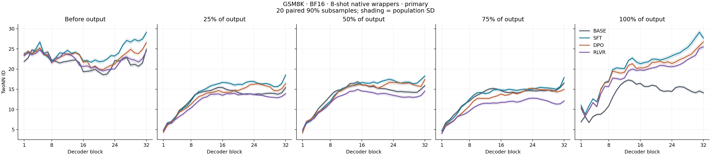
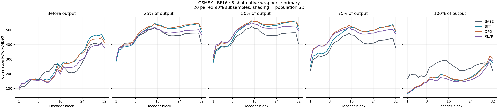
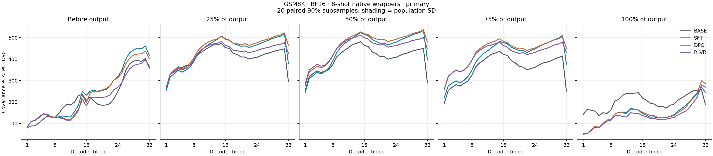
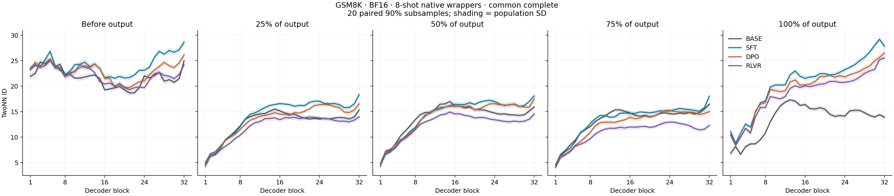
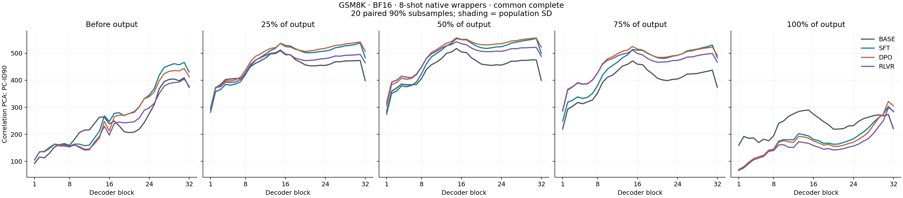
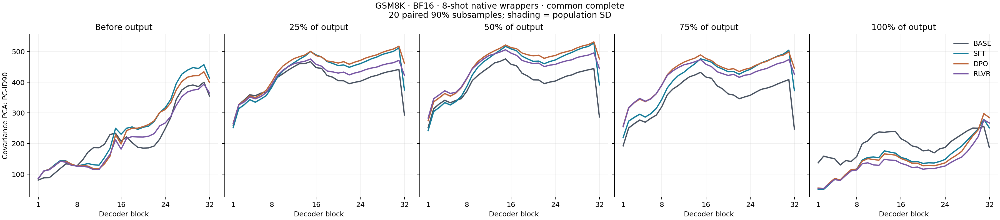

# GSM8K 四阶段 BF16 表示几何实验

本报告仅在完整生成、几何分析及独立核验通过后生成。

## 固定设置

完整测试集 1,319 题；原 CoT 八个推理示例；四个固定检查点；Base 纯文本，SFT／DPO／RLVR 官方聊天模板。BF16 贪心重新生成，上限 2,048 token，EOS 或下一题标记停止。

回答前及有效输出的 25%、50%、75%、100% 分别读取全部 32 层原始 decoder block 输出，不含最终 RMSNorm。过程位置向上取整；每题在每个位置贡献一个向量。

原始 BF16 激活转存为 float32，不恢复额外精度；TwoNN 使用原始向量的 float64 欧氏距离；相关矩阵和协方差 PCA 均计算完整谱并报告 PC-ID90。20 次配对、90% 无放回子采样；图中阴影为总体 SD，不是置信区间。另保留全样本估计。

## 本轮生成表现

| 阶段 | 正确/总数 | 准确率 | 截断 | 空输出 | 平均输出 token |
|---|---:|---:|---:|---:|---:|
| BASE | 723/1319 | 54.81% | 14 | 0 | 109.1 |
| SFT | 954/1319 | 72.33% | 7 | 0 | 96.4 |
| DPO | 1083/1319 | 82.11% | 0 | 0 | 103.2 |
| RLVR | 1126/1319 | 85.37% | 0 | 0 | 114.9 |

本轮与历史行为实验均使用 BF16，但输出预算为 2,048 token，旧实验为 1,024 token，推理实现也不同；本轮回答独立生成并重新评分。

## 题目覆盖

| 分析面板 | 题数 | 每次子采样 | 状态 |
|---|---:|---:|---|
| all_input | 1319 | 1187 | ok |
| all_trajectory | 1319 | 1187 | ok |
| common_complete | 1299 | 1169 | ok |

回答前主分析保留全部题；过程主分析使用四阶段均有非空输出的共同题目并保留截断。共同完成题复核进一步要求四阶段都正常结束，五个位置使用相同题目。截断回答的 100% 代表预算末端，不代表完成解题。

## 逐层曲线与过程变化

### 全量主分析

[TwoNN ID 矢量图](figures/primary_twonn.svg)

[Correlation PCA: PC-ID90 矢量图](figures/primary_correlation.svg)

[Covariance PCA: PC-ID90 矢量图](figures/primary_covariance.svg)

### 共同完成题复核

[TwoNN ID 矢量图](figures/common_complete_twonn.svg)

[Correlation PCA: PC-ID90 矢量图](figures/common_complete_correlation.svg)

[Covariance PCA: PC-ID90 矢量图](figures/common_complete_covariance.svg)

## 形状摘要

峰层取未平滑均值曲线最早最大值；下表直接给出峰值到末层的变化，不要求逐层单调。`shapes.csv` 保留全部位置与复核结果。“中部峰形”的描述性标记要求峰在 L9–L24 且高于 L1 与 L32，不作显著性检验。

| 方法 | 阶段 | 进度 | 首层 | 峰层 | 峰值 | 末层 | 峰至末层降幅 |
|---|---|---:|---:|---:|---:|---:|---:|
| twonn | BASE | 0% | 21.856 | L5 | 25.161 | 24.925 | 0.235 |
| twonn | SFT | 0% | 23.798 | L32 | 29.075 | 29.075 | 0.000 |
| twonn | DPO | 0% | 23.517 | L32 | 26.572 | 26.572 | 0.000 |
| twonn | RLVR | 0% | 23.293 | L5 | 24.733 | 24.513 | 0.220 |
| twonn | BASE | 25% | 4.652 | L15 | 15.465 | 15.391 | 0.073 |
| twonn | SFT | 25% | 4.823 | L32 | 18.531 | 18.531 | 0.000 |
| twonn | DPO | 25% | 4.261 | L32 | 16.405 | 16.405 | 0.000 |
| twonn | RLVR | 25% | 4.719 | L19 | 13.977 | 13.899 | 0.078 |
| twonn | BASE | 50% | 4.901 | L15 | 16.842 | 15.888 | 0.954 |
| twonn | SFT | 50% | 4.479 | L32 | 18.266 | 18.266 | 0.000 |
| twonn | DPO | 50% | 4.092 | L32 | 17.406 | 17.406 | 0.000 |
| twonn | RLVR | 50% | 4.815 | L15 | 14.933 | 14.507 | 0.426 |
| twonn | BASE | 75% | 4.668 | L32 | 16.530 | 16.530 | 0.000 |
| twonn | SFT | 75% | 4.736 | L32 | 17.900 | 17.900 | 0.000 |
| twonn | DPO | 75% | 4.168 | L24 | 15.249 | 14.941 | 0.309 |
| twonn | RLVR | 75% | 4.021 | L24 | 12.775 | 12.073 | 0.702 |
| twonn | BASE | 100% | 6.921 | L13 | 17.277 | 14.102 | 3.175 |
| twonn | SFT | 100% | 11.008 | L31 | 29.131 | 27.674 | 1.456 |
| twonn | DPO | 100% | 10.490 | L32 | 26.723 | 26.723 | 0.000 |
| twonn | RLVR | 100% | 10.228 | L32 | 25.491 | 25.491 | 0.000 |
| correlation | BASE | 0% | 92.300 | L31 | 412.650 | 375.750 | 36.900 |
| correlation | SFT | 0% | 104.400 | L31 | 469.950 | 433.550 | 36.400 |
| correlation | DPO | 0% | 104.350 | L31 | 446.850 | 415.100 | 31.750 |
| correlation | RLVR | 0% | 104.600 | L31 | 407.200 | 380.000 | 27.200 |
| correlation | BASE | 25% | 293.950 | L15 | 515.800 | 403.900 | 111.900 |
| correlation | SFT | 25% | 285.100 | L31 | 545.000 | 488.150 | 56.850 |
| correlation | DPO | 25% | 301.250 | L31 | 546.250 | 511.150 | 35.100 |
| correlation | RLVR | 25% | 299.250 | L15 | 518.700 | 469.600 | 49.100 |
| correlation | BASE | 50% | 286.900 | L15 | 523.250 | 404.500 | 118.750 |
| correlation | SFT | 50% | 277.850 | L15 | 561.800 | 505.800 | 56.000 |
| correlation | DPO | 50% | 308.950 | L15 | 562.800 | 527.050 | 35.750 |
| correlation | RLVR | 50% | 318.150 | L15 | 548.200 | 492.700 | 55.500 |
| correlation | BASE | 75% | 221.900 | L15 | 477.300 | 379.250 | 98.050 |
| correlation | SFT | 75% | 251.050 | L31 | 536.350 | 487.450 | 48.900 |
| correlation | DPO | 75% | 290.800 | L15 | 531.500 | 497.250 | 34.250 |
| correlation | RLVR | 75% | 288.200 | L15 | 517.100 | 472.150 | 44.950 |
| correlation | BASE | 100% | 165.600 | L15 | 293.400 | 223.250 | 70.150 |
| correlation | SFT | 100% | 63.750 | L31 | 295.200 | 278.450 | 16.750 |
| correlation | DPO | 100% | 69.850 | L31 | 323.150 | 306.650 | 16.500 |
| correlation | RLVR | 100% | 68.000 | L31 | 301.300 | 287.950 | 13.350 |
| covariance | BASE | 0% | 80.700 | L31 | 403.500 | 357.600 | 45.900 |
| covariance | SFT | 0% | 84.100 | L31 | 461.150 | 416.300 | 44.850 |
| covariance | DPO | 0% | 84.100 | L31 | 437.050 | 402.050 | 35.000 |
| covariance | RLVR | 0% | 84.250 | L31 | 396.000 | 367.250 | 28.750 |
| covariance | BASE | 25% | 262.050 | L15 | 472.850 | 296.500 | 176.350 |
| covariance | SFT | 25% | 254.950 | L31 | 518.900 | 379.500 | 139.400 |
| covariance | DPO | 25% | 269.400 | L31 | 522.300 | 464.900 | 57.400 |
| covariance | RLVR | 25% | 267.350 | L15 | 481.900 | 427.500 | 54.400 |
| covariance | BASE | 50% | 255.800 | L15 | 481.500 | 289.750 | 191.750 |
| covariance | SFT | 50% | 245.900 | L31 | 534.750 | 396.950 | 137.800 |
| covariance | DPO | 50% | 277.350 | L31 | 536.800 | 479.850 | 56.950 |
| covariance | RLVR | 50% | 285.500 | L15 | 511.500 | 448.000 | 63.500 |
| covariance | BASE | 75% | 194.300 | L15 | 437.350 | 250.850 | 186.500 |
| covariance | SFT | 75% | 221.000 | L31 | 510.450 | 376.600 | 133.850 |
| covariance | DPO | 75% | 259.100 | L31 | 504.650 | 450.900 | 53.750 |
| covariance | RLVR | 75% | 256.900 | L31 | 479.400 | 431.350 | 48.050 |
| covariance | BASE | 100% | 142.400 | L31 | 257.950 | 188.200 | 69.750 |
| covariance | SFT | 100% | 49.750 | L31 | 270.150 | 244.400 | 25.750 |
| covariance | DPO | 100% | 54.700 | L31 | 299.050 | 285.750 | 13.300 |
| covariance | RLVR | 100% | 53.450 | L31 | 279.950 | 269.650 | 10.300 |

## 解释边界与核验

Base 与后三阶段的模板及读出 token 不同；生成过程还包含各模型自己产生的文本、长度及 token 身份差异。进度对齐不等于语义步骤对齐。结果描述固定模型与条件下的几何，不识别训练算法的因果效应。

TwoNN 与 PCA 描述不同性质；预处理可以改变阶段排序。这里没有把 ID 当成知识数量、推理能力或信息量，也不通过四个检查点推断普遍的维度—正确率关系。

独立核验重新解析全部原始回答、检查精确 token 与读出位置、验证全部激活及谱文件，并在预先选定的四个数值单元中以独立距离回归和直接 SVD 重算。真实续跑核验确认完成的原始回答、激活与运行记录未改变。

[逐层汇总](summary.csv) · [全部重复估计](estimates.csv) · [配对阶段变化](paired_stage_deltas.csv) · [相对回答前的配对变化](paired_progress_deltas.csv) · [逐题结果](per_question.csv) · [独立核验](independent_audit.json)
