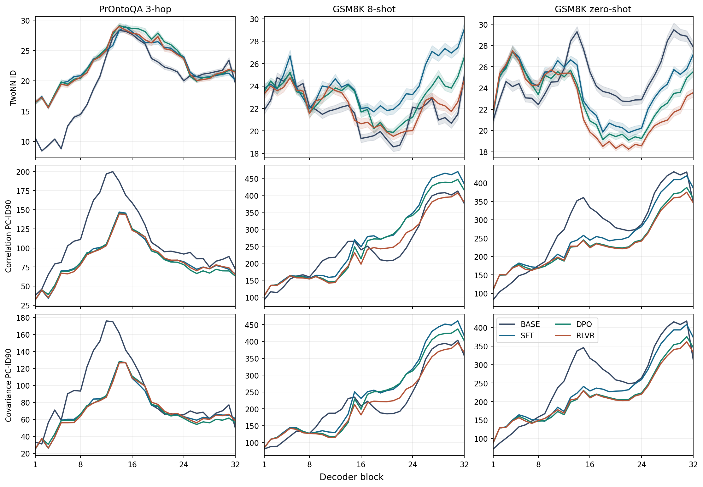
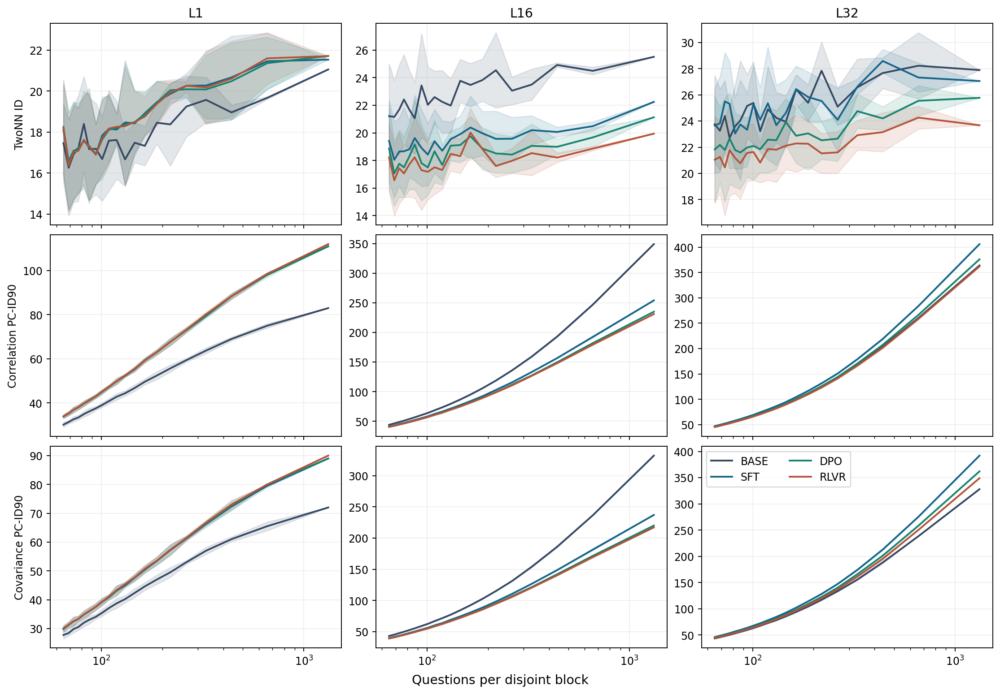

# GSM8K 无示例四阶段内在维度实验

完整测试集 1,319 题。Base 使用原行为实验纯文本提示，SFT、DPO、RLVR 使用原生聊天模板。四个检查点固定。BF16 提取 32 层原始 decoder block 输出，每层宽度为 4,096。回答前对问题提示单独前向，生成过程回放归档的原始 token ID。

## 回答前的主要比较

| 实验              | TwoNN 中部峰形        | 相关 PCA 中部峰形       | 协方差 PCA 中部峰形      | 两种 PCA 峰高均逐阶段下降 | Base 末层从相关 PCA 最高变为协方差 PCA 最低 |
| --------------- | ----------------- | ----------------- | ----------------- | --------------- | ----------------------------- |
| PrOntoQA 3-hop  | BASE、SFT、DPO、RLVR | BASE、SFT、DPO、RLVR | BASE、SFT、DPO、RLVR | 是               | 是                             |
| GSM8K 8-shot    | 无                 | 无                 | 无                 | 否               | 否                             |
| GSM8K zero-shot | 无                 | 无                 | 无                 | 是               | 否                             |

中部峰形要求未平滑均值曲线的最早最高点位于 L9–L24，且高于首层和末层。图中各面板使用自己的纵轴。阴影为 20 组共享的 90% 无放回子样本的总体 SD。

| 指标 | 阶段 | L1 | 峰层 | 峰值 | L32 | 峰至末层下降 |
| --- | --- | ---: | ---: | ---: | ---: | ---: |
| TwoNN ID | BASE | 20.954 | L29 | 29.482 | 27.878 | 1.604 |
| TwoNN ID | SFT | 21.536 | L4 | 27.455 | 27.151 | 0.304 |
| TwoNN ID | DPO | 21.671 | L4 | 27.419 | 25.533 | 1.886 |
| TwoNN ID | RLVR | 21.708 | L4 | 27.504 | 23.561 | 3.943 |
| Correlation PC-ID90 | BASE | 82.000 | L29 | 430.550 | 348.150 | 82.400 |
| Correlation PC-ID90 | SFT | 109.700 | L31 | 419.650 | 386.850 | 32.800 |
| Correlation PC-ID90 | DPO | 109.700 | L31 | 387.900 | 359.200 | 28.700 |
| Correlation PC-ID90 | RLVR | 109.950 | L31 | 375.000 | 346.450 | 28.550 |
| Covariance PC-ID90 | BASE | 71.700 | L31 | 417.850 | 314.400 | 103.450 |
| Covariance PC-ID90 | SFT | 87.800 | L31 | 408.550 | 373.800 | 34.750 |
| Covariance PC-ID90 | DPO | 88.050 | L31 | 375.800 | 346.600 | 29.200 |
| Covariance PC-ID90 | RLVR | 88.550 | L31 | 361.800 | 333.950 | 27.850 |

PrOntoQA 使用 FP32 和 1,440 道 3-hop 逻辑题。八示例 GSM8K 使用 BF16 前向，其轨迹来自独立生成，预算上限为 2,048 token。本轮无示例回答来自原 vLLM BF16 行为实验，预算上限为 1,024 token，激活通过 Transformers BF16 前向回放。

| 阶段 | 平均输入 token 数 | 最后输入 token ID |
| --- | ---: | --- |
| BASE | 63.70 | 25 |
| SFT | 70.70 | 397 |
| DPO | 70.70 | 397 |
| RLVR | 70.70 | 397 |

## 生成过程与原行为结果

- [主分析 TwoNN ID](figures/primary_twonn.png) · [共同完成题](figures/common_complete_twonn.png)
- [主分析 Correlation PC-ID90](figures/primary_correlation.png) · [共同完成题](figures/common_complete_correlation.png)
- [主分析 Covariance PC-ID90](figures/primary_covariance.png) · [共同完成题](figures/common_complete_covariance.png)

输出位置取有效 token 数乘进度后向上取整。排除终止 EOS 和停止字符串涉及的 token。生成主分析保留截断，截断回答的 100% 对应预算末端。共同完成题面板在五个位置使用同一批非空、未截断的题。

### 共同非空轨迹主分析

| 生成进度 | TwoNN 中部峰形 | 相关 PCA 中部峰形 | 协方差 PCA 中部峰形 |
| ---: | --- | --- | --- |
| 25% | BASE、DPO、RLVR | BASE、SFT、DPO、RLVR | BASE、SFT、DPO、RLVR |
| 50% | BASE、DPO、RLVR | BASE、SFT、DPO、RLVR | BASE、SFT、DPO、RLVR |
| 75% | BASE、DPO、RLVR | BASE、SFT、DPO、RLVR | BASE、DPO、RLVR |
| 100% | 无 | RLVR | 无 |

### 共同完成题复核

| 生成进度 | TwoNN 中部峰形 | 相关 PCA 中部峰形 | 协方差 PCA 中部峰形 |
| ---: | --- | --- | --- |
| 回答前 | BASE、SFT | 无 | 无 |
| 25% | BASE、DPO、RLVR | BASE、SFT、DPO、RLVR | BASE、SFT、DPO、RLVR |
| 50% | BASE、DPO、RLVR | BASE、SFT、DPO、RLVR | BASE、SFT、DPO、RLVR |
| 75% | BASE、DPO、RLVR | BASE、SFT、DPO、RLVR | BASE、SFT、DPO、RLVR |
| 100% | 无 | 无 | 无 |

| 题池 | 题数 | 每次子采样 |
| --- | ---: | ---: |
| 全部输入 | 1319 | 1187 |
| 共同非空轨迹 | 1319 | 1187 |
| 四阶段均完成 | 1140 | 1026 |

| 阶段 | 原行为正确数／总题数 | 正确率 | 原行为截断数 |
| --- | ---: | ---: | ---: |
| BASE | 329／1319 | 24.94% | 161 |
| SFT | 983／1319 | 74.53% | 3 |
| DPO | 884／1319 | 67.02% | 2 |
| RLVR | 946／1319 | 71.72% | 15 |

## 样本尺度与核验

L1、L16、L32 分别使用 1 至 20 个等长互斥块，每个 k 固定同一组题目排列。块间总体 SD 描述同一块大小下的变化。PCA 在每个子样本和尺度块内独立拟合。TwoNN 使用未经归一化的原始向量与 float64 欧氏距离。

| 指标 | L16 在全部 20 个尺度均高于 L1 和 L32 的阶段 | L32 从 1,319 题到 65 题的相对变化范围 |
| --- | --- | --- |
| TwoNN ID | 无 | -15.3% 至 -11.1% |
| Correlation PC-ID90 | 无 | -88.4% 至 -87.4% |
| Covariance PC-ID90 | 无 | -88.2% 至 -86.7% |

固定模板和读出上下文随阶段变化，生成进度只按 token 比例对齐。两种 PCA 描述全局方差，TwoNN 描述局部近邻几何。表中的阶段排序限定于这些检查点和协议。

[逐层估计](summary.csv) · [逐题读出](per_question.csv) · [形状与降幅](shapes.csv) · [分块尺度](scale_summary.csv) · [子采样索引](schedules/) · [独立核验](independent_audit.json)

[原无示例行为统计](../../zero-shot/reports/stage_summary.csv) · [八示例 GSM8K ID 报告](../../id-bf16/reports/report.zh-CN.md) · [PrOntoQA 报告](../../../prontoqa/reports/report.zh-CN.md)
