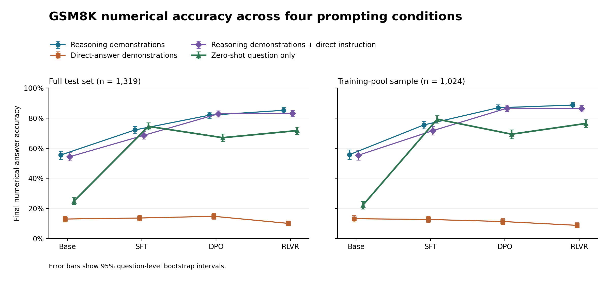

# Tülu 3 8B 四阶段 GSM8K 提示词对照

同一批 GSM8K 题目在 Base、SFT、DPO、RLVR 四个固定检查点上分别用四种提示词作答。准确率衡量新生成文本中最后一个数值是否与标准答案等值。 [评分实现](../cot/common.py#L68-L81) · [四组核验记录](#5-结果核验)

<!-- gsm8k-zero-shot:start -->
## 1. 准确率



左图为完整测试集，右图为训练池抽样。误差线是各数据组按题目重采样 10,000 次所得的百分位 95% 区间。 [矢量图](figures/four-conditions-accuracy.svg) · [32 个绘图单元的正确数、准确率和区间](four-conditions-accuracy.csv)

### 完整测试集（1,319 题）

| 阶段 | 推理示例 | 直接答案示例 | 推理示例＋直接输出指令 | 无示例 |
| --- | --- | --- | --- | --- |
| Base | 55.50%（732/1,319） | 12.96%（171/1,319） | 54.36%（717/1,319） | 24.94%（329/1,319） |
| SFT | 72.18%（952/1,319） | 13.65%（180/1,319） | 68.61%（905/1,319） | 74.53%（983/1,319） |
| DPO | 81.96%（1,081/1,319） | 14.78%（195/1,319） | 82.87%（1,093/1,319） | 67.02%（884/1,319） |
| RLVR | 85.22%（1,124/1,319） | 10.08%（133/1,319） | 83.24%（1,098/1,319） | 71.72%（946/1,319） |

### 训练池抽样（1,024 题）

| 阶段 | 推理示例 | 直接答案示例 | 推理示例＋直接输出指令 | 无示例 |
| --- | --- | --- | --- | --- |
| Base | 55.76%（571/1,024） | 13.18%（135/1,024） | 55.37%（567/1,024） | 22.17%（227/1,024） |
| SFT | 75.49%（773/1,024） | 12.70%（130/1,024） | 71.68%（734/1,024） | 79.30%（812/1,024） |
| DPO | 86.91%（890/1,024） | 11.33%（116/1,024） | 86.62%（887/1,024） | 69.34%（710/1,024） |
| RLVR | 88.67%（908/1,024） | 8.79%（90/1,024） | 86.43%（885/1,024） | 76.46%（783/1,024） |

各单元为准确率（正确数/总数）。 [推理示例统计](../cot/reports/statistics.json) · [直接答案示例统计](../direct-answer/reports/statistics.json) · [推理示例＋直接输出指令统计](../cot-direct-answer/reports/statistics.json) · [无示例统计](../zero-shot/reports/statistics.json)

### 同题配对差值

下表使用完整测试集，单位为百分点，括号内为配对 95% 区间。差值均按变化后减变化前计算。示例数量或答案内容变化时，输入长度也随之改变。

| 阶段 | 移除八条推理示例 | 在推理示例前加仅数值指令 | 保留指令，数值示例改为完整推理示例 |
| --- | --- | --- | --- |
| Base | -30.55 [-33.74, -27.29] | -1.14 [-2.73, +0.53] | +41.39 [+38.29, +44.43] |
| SFT | +2.35 [-0.30, +5.08] | -3.56 [-5.91, -1.29] | +54.97 [+52.01, +57.92] |
| DPO | -14.94 [-17.97, -12.05] | +0.91 [-0.83, +2.65] | +68.08 [+65.43, +70.74] |
| RLVR | -13.50 [-16.07, -10.92] | -1.97 [-3.71, -0.23] | +73.16 [+70.66, +75.59] |

两组题目的完整差值及对错转换数见各次比较文件。 [无示例与其他三组](../zero-shot/reports/protocol_comparison.csv) · [推理示例＋指令与早期两组](../cot-direct-answer/reports/protocol_comparison.csv) · [直接答案示例与原始推理示例](../direct-answer/reports/protocol_comparison.csv)

### 测试集输出诊断

仅数值格式比例使用相同的格式判定，分母为各阶段全部 1,319 道题。推理示例组和无示例组的该比例描述模型自发采用的输出格式。截断回答仍按数值规则评分。有多少回答只给了一个数值，允许 Answer: 等简短前缀或数学包装。这个指标只看格式。

| 条件 | 阶段 | 仅数值格式比例 | 截断数 | 输出 token 中位数 |
| --- | --- | --- | --- | --- |
| 推理示例 | Base | 0.00% | 15 | 83.0 |
| 推理示例 | SFT | 0.00% | 8 | 79.0 |
| 推理示例 | DPO | 0.00% | 0 | 91.0 |
| 推理示例 | RLVR | 0.00% | 0 | 102.0 |
| 直接答案示例 | Base | 94.31% | 0 | 4.0 |
| 直接答案示例 | SFT | 88.48% | 0 | 4.0 |
| 直接答案示例 | DPO | 88.48% | 0 | 5.0 |
| 直接答案示例 | RLVR | 94.54% | 0 | 3.0 |
| 推理示例＋直接输出指令 | Base | 0.00% | 13 | 81.0 |
| 推理示例＋直接输出指令 | SFT | 0.23% | 6 | 69.0 |
| 推理示例＋直接输出指令 | DPO | 0.00% | 0 | 84.0 |
| 推理示例＋直接输出指令 | RLVR | 0.00% | 0 | 87.0 |
| 无示例 | Base | 9.10% | 161 | 81.0 |
| 无示例 | SFT | 0.00% | 3 | 146.0 |
| 无示例 | DPO | 0.00% | 2 | 315.0 |
| 无示例 | RLVR | 0.00% | 15 | 319.0 |

[推理示例统计](../cot/reports/statistics.json) · [直接答案示例统计](../direct-answer/reports/statistics.json) · [推理示例＋直接输出指令统计](../cot-direct-answer/reports/statistics.json) · [无示例统计](../zero-shot/reports/statistics.json) · [推理示例组的仅数值比例](../direct-answer/reports/comparison.json) · [仅数值格式判定](../direct-answer/format_policy.py)

<!-- gsm8k-zero-shot:end -->

## 2. 四组提示词差异

| 条件 | 示例数 | 示例中的答案 | 开头输出指令 | 消息封装与生成起点 | 同题完整输入 |
| --- | ---: | --- | --- | --- | --- |
| 推理示例 | 8 | 完整解法及结果 | 无 | Base 纯文本 `\nAnswer:`，后训练单轮 `\n<\|assistant\|>\n` | [James](prompt_evidence.md#cot-james) · [Claire](prompt_evidence.md#cot-claire) |
| 直接答案示例 | 8 | 仅最终数值 | 有，置于八条示例之前 | Base 纯文本 `\nAnswer:`，后训练单轮 `\n<\|assistant\|>\n` | [James](prompt_evidence.md#direct-answer-james) · [Claire](prompt_evidence.md#direct-answer-claire) |
| 推理示例＋直接输出指令 | 8 | 完整解法及结果 | 有，置于八条示例之前 | Base 纯文本 `\nAnswer:`，后训练单轮 `\n<\|assistant\|>\n` | [James](prompt_evidence.md#cot-direct-answer-james) · [Claire](prompt_evidence.md#cot-direct-answer-claire) |
| 无示例 | 0 | — | 无 | Base 纯文本 `\nAnswer:`，后训练单轮 `\n<\|assistant\|>\n` | [James](prompt_evidence.md#zero-shot-james) · [Claire](prompt_evidence.md#zero-shot-claire) |

三组八示例条件使用相同的示例题和顺序。直接答案示例组将示例答案替换为数值，推理示例＋直接输出指令组保留解法。两组使用同一条英文指令，指令与后续内容之间有两个换行。 [推理示例组准备代码](../cot/prepare.py) · [直接答案示例组准备代码](../direct-answer/prepare.py) · [推理示例＋指令组准备代码](../cot-direct-answer/prepare.py) · [无示例组准备代码](../zero-shot/prepare.py)

> Answer the question directly. Give only the final numerical answer, without calculations, reasoning steps, or explanations.

以 Claire 做蛋卷（`gsm8k-test-00018`）为例，四组末尾使用同一句待答题。首条示例的答案在完整推理组以 `Answer:There are 15 trees originally.` 开头，在直接答案示例组为 `Answer:6`，无示例组从待答题开始。 [推理示例原文](prompt_evidence.md#cot-claire) · [直接答案示例原文](prompt_evidence.md#direct-answer-claire) · [推理示例＋指令原文](prompt_evidence.md#cot-direct-answer-claire) · [无示例原文](prompt_evidence.md#zero-shot-claire)

```text
Question: Claire makes a 3 egg omelet every morning for breakfast.  How many dozens of eggs will she eat in 4 weeks?
```

Base 在整个纯文本序列最前面编码一个 BOS（`128000`），待答题后追加 `\nAnswer:`，从冒号后续写。SFT、DPO、RLVR 各用本检查点的原生聊天模板，提示文本以 `<|user|>\n` 开始，示例和待答题同在这一个用户回合，末尾 `\n<|assistant|>\n` 打开生成位置。证据中的两道题在每个条件下，三个后训练检查点的输入文本与 token ID 分别相同，均无 BOS。 [分词实现](../cot-direct-answer/tokenize_panel.py) · [实际传给 vLLM 的字段](../cot-direct-answer/run_stage.py) · [逐题文本、token ID 和哈希](prompt_evidence.json)

| Claire 题的实际输入长度 | Base | SFT／DPO／RLVR |
| --- | ---: | ---: |
| 推理示例 | 696 | 703 |
| 直接答案示例 | 367 | 374 |
| 推理示例＋直接输出指令 | 717 | 724 |
| 无示例 | 33 | 40 |

长度单位为 token。 [Claire 的四组输入记录](prompt_evidence.json)

## 3. 提示词之外的设置和执行记录

| 项目 | 四组使用的设置 |
| --- | --- |
| 题目 | 同一批 1,024 道 RLVR 训练池抽样题和完整 1,319 道 GSM8K 测试题。另有 32 道与正式题不重叠的预实验题。训练池和预实验抽样种子分别为 42、43。 |
| 检查点 | 每组均运行同一组四个固定修订。组间对比固定同一阶段的权重和输入封装。Base → SFT 的阶段对比同时改变权重和输入封装。 |
| 解码 | BF16、贪心解码，`temperature=0`、`top_p=1`、`repetition_penalty=1`、推理种子 42。每题最多生成 1,024 token，上下文上限 8,192 token。EOS 或 `\n\nQuestion:` 停止。 |
| 评分 | 对新生成文本去除数字之间的逗号，取最后一个有符号数，与标准答案做数值等值比较。无数值计错。截断照常评分，保留在分母。 |
| 运行环境 | 四份资产记录均列出 RTX 3090 24 GB、驱动 550.120，以及 PyTorch 2.5.1、vLLM 0.7.2、Transformers 4.49.0、NumPy 1.26.4 和 Tokenizers 0.21.4。 |

[四组设置和资产记录摘录及哈希](prompt_evidence.json) · [推理示例配置](../cot/experiment.json) · [直接答案示例配置](../direct-answer/experiment.json) · [推理示例＋指令配置](../cot-direct-answer/experiment.json) · [无示例配置构造](../zero-shot/stage.py) · [原始题目面板清单](../cot/reports/manifests/data.json) · [评分实现](../cot/common.py#L68-L81)

| 阶段 | 模型与固定修订 |
| --- | --- |
| Base | [meta-llama/Llama-3.1-8B](https://huggingface.co/meta-llama/Llama-3.1-8B/tree/d04e592bb4f6aa9cfee91e2e20afa771667e1d4b) · `d04e592bb4f6aa9cfee91e2e20afa771667e1d4b` |
| SFT | [allenai/Llama-3.1-Tulu-3-8B-SFT](https://huggingface.co/allenai/Llama-3.1-Tulu-3-8B-SFT/tree/f2a0b46b0cfda21003c6141b1ff837b7e165524d) · `f2a0b46b0cfda21003c6141b1ff837b7e165524d` |
| DPO | [allenai/Llama-3.1-Tulu-3-8B-DPO](https://huggingface.co/allenai/Llama-3.1-Tulu-3-8B-DPO/tree/a7beb67e33ffd01cc87ac3b46cadc1000985b8db) · `a7beb67e33ffd01cc87ac3b46cadc1000985b8db` |
| RLVR | [allenai/Llama-3.1-Tulu-3-8B](https://huggingface.co/allenai/Llama-3.1-Tulu-3-8B/tree/666943798adbde0b1aff34626007e26986a3c107) · `666943798adbde0b1aff34626007e26986a3c107` |

四组分批执行。按统计文件的 UTC 时间，推理示例和直接答案示例为 2026 年 10 月 4 日，推理示例＋指令为 10 月 15 日，无示例为 11 月 17 日。输入长度随提示内容调整，实际输出长度、截断和计时随生成而变化。 [四组运行记录](prompt_evidence.json) · [推理示例计时](../cot/reports/timing.csv) · [直接答案示例计时](../direct-answer/reports/timing.csv) · [推理示例＋指令计时](../cot-direct-answer/reports/timing.csv) · [无示例计时](../zero-shot/reports/timing.csv)

## 4. 与 Ai2 官方 GSM8K 提示词对照

RLVR 训练：模型生成的整段回答，包括它写出的推理步骤，都参与 PPO 更新。正确性奖励取决于最后一个数值是否答对。 

官方测试：模型在八条推理示例之后作答，评测器提取回答中的最后一个数值来计算准确率。 

| 官方用途 | 示例放置 | 待答题及生成起点 | 同题证据 |
| --- | --- | --- | --- |
| 8B RLVR 训练 | 八条完整推理示例和 GSM8K `train` 的待答题，共置于一个用户回合 | 待答题后打开 `<\|assistant\|>` 回合。`ground_truth` 单独供验证器使用 | [James，固定版混合数据第 6351 行](prompt_evidence.md#ai2-rlvr-james) |
| OLMES GSM8K 测试 | 同样的八条示例，每条拆成一对用户与助手回合，助手示例以 `<\|end_of_text\|>` 结束 | `test` 待答题在第九个用户回合，在 `<\|assistant\|>\n` 后追加 `Answer:` | [Claire，按固定版实现重建](prompt_evidence.md#ai2-olmes-claire) |

[Ai2 论文训练节](https://arxiv.org/html/2411.15124v2#S6.SS1) · [Ai2 论文评测节](https://arxiv.org/html/2411.15124v2#S7.SS2) · [8B RLVR 配方](https://github.com/allenai/open-instruct/blob/f73ede5e4508b6daa6bdd1be200fb084f57a9f52/docs/tulu3.md#L306-L347) · [发布的 RLVR 数据](https://huggingface.co/datasets/allenai/RLVR-GSM-MATH-IF-Mixed-Constraints/blob/7dbd180f5440c0b90f2944e6efea934b85437a95/README.md) · [训练模板](https://github.com/allenai/open-instruct/blob/b08997673f7c451171fe3ed39463114e7eeaf141/open_instruct/dataset_processor.py#L133-L150) · [OLMES 任务配置](https://github.com/allenai/olmes/blob/e0d79fd5ad86dd46cc1a91874ecf0b3743827e39/oe_eval/configs/tasks.py#L1269-L1285) · [官方评测生成起点](https://github.com/allenai/olmes/blob/e0d79fd5ad86dd46cc1a91874ecf0b3743827e39/oe_eval/run_eval.py#L159-L175)

| 本实验条件 | 对照官方 RLVR 训练（James） | 对照官方 OLMES 测试（Claire） |
| --- | --- | --- |
| 推理示例 | 三个后训练检查点的实际输入与官方数据行按配方渲染的输入逐字、逐 token 相同 | 保留相同示例内容，使用单轮封装及自己的生成起点 |
| 直接答案示例 | 示例解法改为数值，并在前面加仅数值指令 | 同样替换示例答案和添加指令，使用单轮封装及自己的生成起点 |
| 推理示例＋直接输出指令 | 保留完整示例，在开头多一条仅数值指令 | 保留相同示例内容，额外加指令，使用单轮封装及自己的生成起点 |
| 无示例 | 移除八条示例，保留待答题 | 移除八条示例，使用单轮封装及自己的生成起点 |

在这个对照表中，本实验的 Base 用纯文本封装。其 `Answer:` 跟在纯文本题目之后。OLMES 的 `Answer:` 跟在聊天模板生成的助手标记之后。证据文件给出两道题的实际字节和 token 序列。 [本实验与官方的同题比较证据](prompt_evidence.md) · [实际序列](prompt_evidence.json) · [OLMES 多轮构造](https://github.com/allenai/olmes/blob/e0d79fd5ad86dd46cc1a91874ecf0b3743827e39/oe_eval/tasks/base_task.py#L424-L466)

固定版 OLMES 代码还设定了 512 token 生成预算，聊天模式的停止字符串为 `Question:`、`</s>`、`<|im_end|>`。它采用归一化后的精确匹配。本实验的预算、停止规则和数值等值判定见上节。官方 RLVR 的示例是发布数据行经训练模板渲染。官方测试的示例是公开评测代码的重建结果。训练数据行的实际采样次数和官方当次逐题请求需要相应运行日志。 [官方评测说明](https://arxiv.org/html/2411.15124v2#S7.SS2) · [OLMES 解码和指标配置](https://github.com/allenai/olmes/blob/e0d79fd5ad86dd46cc1a91874ecf0b3743827e39/oe_eval/tasks/oe_eval_tasks/gsm8k.py#L50-L90) · [OLMES 答案提取](https://github.com/allenai/olmes/blob/e0d79fd5ad86dd46cc1a91874ecf0b3743827e39/oe_eval/tasks/oe_eval_tasks/gsm8k.py#L147-L159)

## 5. 结果核验

每组有 9,372 条正式回答的独立核验记录。配对区间以同题正确与否作差，使用题目重采样，描述题目构成的不确定性。训练池与测试集分开统计，题目属于训练池的证据与该题的实际训练采样日志是两套记录。 [推理示例核验](../cot/reports/independent_audit.json) · [直接答案示例核验](../direct-answer/reports/independent_audit.json) · [推理示例＋指令核验](../cot-direct-answer/reports/independent_audit.json) · [无示例核验](../zero-shot/reports/independent_audit.json)

[完整提示词证据](prompt_evidence.md) · [提示词和运行设置记录](prompt_evidence.json) · [三组留存结果复算](../cot-direct-answer/verify_publication.py) · [无示例逐题评分](../zero-shot/reports/per_question.csv) · [四组图表和报告结果区块生成器](../zero-shot/publish.py)
