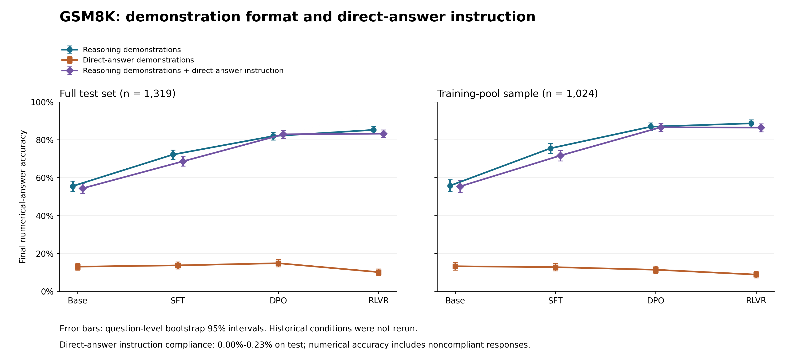

# Tülu 3 8B 四阶段模型 GSM8K 答题能力评测

## 1. 主要结论

本实验比较 Llama 3.1 / Tülu 3 系列的 **Base → SFT → DPO → RLVR** 四个已发布模型，在同一批 GSM8K 数学题上使用两种 8-shot 提示设置。主要指标为**最终数值答案正确率**。两种设置共完成 **18,744 次正式解答**，没有重新训练。

- **推理示范设置下，四阶段正确率逐步上升。** 完整测试集由 Base 的 **55.50%** 升至 RLVR 的 **85.22%**，净增加 **+29.72 个百分点**；训练抽样由 55.76% 升至 88.67%。
- **直接答案设置下，没有出现持续的阶段提升。** 完整测试集依次为 **12.96%、13.65%、14.78%、10.08%**。DPO → RLVR 下降 **4.70 个百分点**；训练抽样的正确率则随阶段逐步降低。
- **两种提示下的结果差异很大。** 直接答案设置在四个阶段、两个数据组上的正确率均较低。这一差异同时涉及示范答案形式和输出指令，不能单独解释为模型推理能力消失或某种训练算法的因果效果。

## 2. 四阶段答题结果

Tülu 3 官方用于 RLVR 的 GSM8K 数据，每条训练输入都包含 固定的8 道示范题

| 阶段 | 如何使用 |
|---|---|
| **SFT** | 使用 OpenMathInstruct2 （数据源包含 GSM8K 训练原题及其扩增题目）等来源的数学题与解答，学习生成完整回答 |
| **DPO** | 使用 OpenMathInstruct2 来源的题目，生成、比较候选回答，构造“更优／较差”的偏好对 |
| **RLVR** | 明确使用原始 GSM8K 的 7,473 道训练题，根据最终数值是否正确给予奖励 |

**图 1. 四阶段正确率。** 蓝色为推理示范，橙色为直接答案；空心圆与虚线表示训练抽样，实心方块与实线表示完整测试集。所有点标注两位小数正确率，纵轴统一为 0%–100%。连线连接不同阶段的已发布模型检查点，不是同一次训练过程的连续监测。95% 区间列于表 1。[矢量图 SVG](figures/four-stage-accuracy.svg)。

**表 1. 全部正确率与已保存的 95% bootstrap 区间。** 四阶段和两种提示分别评测相同的 1,024 道训练来源题与 1,319 道测试题。

| 提示设置 | 数据组 | 阶段 | 正确 / 总数 | 正确率 | 95% 区间 |
| --- | --- | --- | --- | --- | --- |
| 推理示范 | 训练抽样 | Base | 571 / 1024 | 55.76% | [52.64%, 58.89%] |
| 推理示范 | 训练抽样 | SFT | 773 / 1024 | 75.49% | [72.85%, 78.03%] |
| 推理示范 | 训练抽样 | DPO | 890 / 1024 | 86.91% | [84.86%, 88.96%] |
| 推理示范 | 训练抽样 | RLVR | 908 / 1024 | 88.67% | [86.72%, 90.53%] |
| 推理示范 | 完整测试集 | Base | 732 / 1319 | 55.50% | [52.77%, 58.15%] |
| 推理示范 | 完整测试集 | SFT | 952 / 1319 | 72.18% | [69.75%, 74.53%] |
| 推理示范 | 完整测试集 | DPO | 1081 / 1319 | 81.96% | [79.91%, 84.00%] |
| 推理示范 | 完整测试集 | RLVR | 1124 / 1319 | 85.22% | [83.24%, 87.11%] |
| 直接答案 | 训练抽样 | Base | 135 / 1024 | 13.18% | [11.13%, 15.23%] |
| 直接答案 | 训练抽样 | SFT | 130 / 1024 | 12.70% | [10.74%, 14.75%] |
| 直接答案 | 训练抽样 | DPO | 116 / 1024 | 11.33% | [9.38%, 13.28%] |
| 直接答案 | 训练抽样 | RLVR | 90 / 1024 | 8.79% | [7.13%, 10.55%] |
| 直接答案 | 完整测试集 | Base | 171 / 1319 | 12.96% | [11.14%, 14.78%] |
| 直接答案 | 完整测试集 | SFT | 180 / 1319 | 13.65% | [11.83%, 15.47%] |
| 直接答案 | 完整测试集 | DPO | 195 / 1319 | 14.78% | [12.89%, 16.76%] |
| 直接答案 | 完整测试集 | RLVR | 133 / 1319 | 10.08% | [8.49%, 11.75%] |

从已有的 1,319 道题里，随机抽取 1,319 次，允许重复。用这些题已经保存的答题结果重新计算正确率，不让模型重新回答。重复上述过程 10,000 次，得到 10,000 个正确率。取其中第 2.5% 和第 97.5% 分位数，作为区间两端，中间覆盖 95% 的重抽样结果。

### 2.1 阶段变化：以完整测试集为主

推理示范设置下，Base → SFT、SFT → DPO、DPO → RLVR 分别增加 **+16.68、+9.78、+3.26 个百分点**。训练抽样的走势同样上升，但 DPO → RLVR 的增幅为 +1.76 个百分点，95% 区间为 [−0.20, +3.71]，跨过零；不能据此断言两模型等效。

直接答案设置下，Base → SFT 和 SFT → DPO 的测试正确率小幅上升，但对应差值区间均跨零；DPO → RLVR 的差值为 **−4.70 个百分点**，区间全为负。训练抽样由 13.18% 降至 8.79%。

**表 2. 相邻阶段在完整测试集上的同题配对差值。** 差值方向为“后阶段 − 前阶段”。

| 提示设置 | 阶段比较 | 差值（百分点） | 95% 区间（百分点） |
| --- | --- | --- | --- |
| 推理示范 | Base → SFT | +16.68 | [+13.95, +19.41] |
| 推理示范 | SFT → DPO | +9.78 | [+7.51, +12.21] |
| 推理示范 | DPO → RLVR | +3.26 | [+1.52, +4.93] |
| 直接答案 | Base → SFT | +0.68 | [−1.21, +2.58] |
| 直接答案 | SFT → DPO | +1.14 | [−0.45, +2.73] |
| 直接答案 | DPO → RLVR | −4.70 | [−6.67, −2.65] |

净上升或净下降不意味着每一道题都同向变化。例如，推理示范的 DPO → RLVR 有 88 题错→对、45 题对→错；直接答案设置则有 60 题错→对、122 题对→错。

### 2.2 提示变化：同一个模型回答相同题目

**表 3. 完整测试集上两种提示的同题配对差值。** 四个阶段的差值及其区间均为负；训练抽样的四组差值也均为负，幅度为 −42.58 至 −79.88 个百分点。

| 阶段 | 直接答案 − 推理示范（百分点） | 95% 区间（百分点） |
| --- | --- | --- |
| Base | −42.53 | [−45.49, −39.42] |
| SFT | −58.53 | [−61.41, −55.57] |
| DPO | −67.17 | [−69.83, −64.52] |
| RLVR | −75.13 | [−77.63, −72.55] |

表中的差值均从未舍入的原始比例或保存的配对统计计算，再保留两位小数，因此可能与表 1 已舍入数值的直接相减相差 0.01 个百分点。表 2 与表 3 的区间来自同题配对统计，不能用两个正确率区间的相减替代。

## 3. 重要实验设置

### 3.1 模型：冻结的官方 8B 检查点

| 阶段 | 含义 | 官方模型 ID |
| --- | --- | --- |
| Base | 预训练基础模型 | [meta-llama/Llama-3.1-8B](https://huggingface.co/meta-llama/Llama-3.1-8B/tree/d04e592bb4f6aa9cfee91e2e20afa771667e1d4b) |
| SFT | 监督微调（SFT） | [allenai/Llama-3.1-Tulu-3-8B-SFT](https://huggingface.co/allenai/Llama-3.1-Tulu-3-8B-SFT/tree/f2a0b46b0cfda21003c6141b1ff837b7e165524d) |
| DPO | 直接偏好优化（DPO） | [allenai/Llama-3.1-Tulu-3-8B-DPO](https://huggingface.co/allenai/Llama-3.1-Tulu-3-8B-DPO/tree/a7beb67e33ffd01cc87ac3b46cadc1000985b8db) |
| RLVR | 使用可验证奖励的强化学习（RLVR） | [allenai/Llama-3.1-Tulu-3-8B](https://huggingface.co/allenai/Llama-3.1-Tulu-3-8B/tree/666943798adbde0b1aff34626007e26986a3c107) |

四阶段属于 Llama 3.1 8B / Tülu 3 8B 系列；SFT、DPO 和 RLVR 分别对应监督微调、偏好优化和可验证奖励强化学习阶段。官方训练流程见 [Tülu 3 训练配置](https://github.com/allenai/open-instruct/blob/main/docs/tulu3.md)。本次只对固定版本模型进行推理评测，不更新权重，也不以当前实验重新复现四阶段训练。

### 3.2 数据：训练来源抽样与完整测试集

GSM8K 是英文小学数学应用题数据集，要求通过多步计算得到数值答案；数据来源见 [GSM8K 官方项目](https://github.com/openai/grade-school-math)。本实验包含两个数据组：

- **训练抽样：1,024 题。** 从官方 RLVR 混合数据中属于 GSM8K 的 **7,473 条训练记录**，按固定顺序、随机种子 42 无放回抽取。此处的“训练”指题目来源；这些题在本次实验中只用于评测，没有拿来训练模型。RLVR 池来源见 [官方数据说明](https://huggingface.co/datasets/allenai/RLVR-GSM-MATH-IF-Mixed-Constraints)。
- **完整测试集：1,319 题。** 使用固定版本 GSM8K 官方测试划分的全部题目。它是主要能力结果的依据，训练抽样用于补充比较。

> {"question": "What is fifteen more than a quarter of 48?", "answer": "A quarter of 48 is 48/4=<<48/4=12>>12.\nThe number is 12+15=<<12+15=27>>27.\n#### 27"}

历史数据核验记录显示，7,473 条 RLVR GSM8K 记录与原训练集逐条对应；训练与测试题经空白归一化后没有重叠，8 道示范题也未与评测题重叠。四阶段与两种提示共用同一批正式题目，目标题原文和标准数值答案保持一致。

每种提示另从未入选正式训练抽样的题目中，以种子 43 抽取 **32 题 × 4 模型 = 128 次工程试跑**，仅用于检查管线可行性，无正确率或格式符合率门槛，不纳入正式统计。两种提示共计 18,744 次正式解答及 256 次工程试跑。

### 3.3 提示：相同 8 道示范题，两种答案形式

| 设置 | 示范内容 | 输出要求 |
| --- | --- | --- |
| 推理示范（CoT） | 沿用官方 RLVR 记录中的 8 道题及带解题过程的答案 | 沿用原始提示，不增加“仅最终答案”指令 |
| 直接答案（Direct Answer） | 8 道题及顺序不变，示范答案缩短为最终数值 | 明确要求只给最终数值，不写计算、步骤或解释 |

直接答案指令原文为：

> Answer the question directly. Give only the final numerical answer, without calculations, reasoning steps, or explanations.

两种设置**同时改变示范答案形式和输出指令**。因此，提示对照衡量的是整套设置变化的效果，无法拆分各部分的单独贡献。直接答案设置下，即使模型输出计算过程，也保留原回答，不因格式不符重试。

Base 使用纯文本封装；SFT、DPO、RLVR 使用各自官方聊天模板。历史分词核验记录显示，每种提示内部，三个聊天模型的输入 token 相同。Base → SFT 的比较同时涉及模型权重与输入封装变化。

### 3.4 推理、评分与统计

| 项目 | 共同设置 |
| --- | --- |
| 权重精度 | BF16（bfloat16） |
| 解码 | 贪心解码；temperature = 0.0，top_p = 1.0，repetition_penalty = 1.0；seed = 42 |
| 长度预算 | 最多生成 1,024 token；上下文上限 8,192 token |
| 停止条件 | EOS 或新题标记 `\n\nQuestion:` |
| 历史推理环境 | RTX 3090 24GB；vLLM 0.7.2；PyTorch 2.5.1 / CUDA 12.4；Transformers 4.49.0 |

**评分只检查最终数值。** 仅解析新生成文本，去除数值千分位逗号，提取最后一个有符号数，与标准答案做数值等值比较。没有可提取数值的回答计错；截断回答仍计入分母。正确数值不保证解题过程正确，最后数值提取规则也可能误读包含多个数字的回答。

**格式符合率独立于正确率。** 直接答案格式要求只有一个数值，允许规定的答案前缀、单个 boxed 包装、数学定界符、首尾空白和末尾句号。违反格式不会额外扣减正确率，也不排除该回答。

**区间按题目构成评估不确定性。** 引用原实验各数据组内 10,000 次 bootstrap 的百分位 95% 区间；阶段和提示差值保持同题配对。完整测试集本次得分是固定统计，区间反映题目构成变化的敏感性，不包含重新训练或重新生成的随机性。多个区间没有整体多重比较校正，不据此作整组显著性声明。

## 4. 输出诊断与解释边界

**表 4. 完整测试集的输出摘要。** token 是模型文本单位；格式符合率仅针对直接答案设置。

| 阶段 | 推理示范平均输出 token | 直接答案平均输出 token | 直接答案格式符合率 |
| --- | --- | --- | --- |
| Base | 99.4 | 4.6 | 94.31% |
| SFT | 91.0 | 4.7 | 88.48% |
| DPO | 103.2 | 5.0 | 88.48% |
| RLVR | 114.1 | 4.3 | 94.54% |

直接答案设置下，平均输出缩短至约 4–5 token，格式符合率达到 88.48%–94.54%，但正确率仍约为 10%–15%。这说明较高的格式遵从程度并未对应较高的答题正确率。两种提示、全部数据组均没有“无数值答案”；直接答案设置没有截断。推理示范在测试集的 Base、SFT 分别截断 15 题（1.14%）和 8 题（0.61%），DPO、RLVR 无截断。

解读结果时保留以下边界：

- **训练来源不能等同于实际见过。** 进入 RLVR 数据池不保证某个发布版模型实际采样过每一道题，也不保证 SFT、DPO 阶段没有接触相同内容。公开测试集被广泛用于开发与评测，不能保证模型从未接触。
- **阶段变化不等于算法的单独贡献。** 模型的数据、目标和训练预算共同变化；Base 与其他阶段还使用不同输入封装。训练／测试差距不能单独证明记忆或推理机制。
- **外显解释与内部推理不能直接等同。** 直接答案指令约束生成文本；没有输出过程不证明内部没有推理。本实验也不支持对内部推理机制的测量结论。

## 5. 固定版本、来源

### 5.1 固定版本

| 模型阶段 | 固定 revision |
| --- | --- |
| Base | `d04e592bb4f6aa9cfee91e2e20afa771667e1d4b` |
| SFT | `f2a0b46b0cfda21003c6141b1ff837b7e165524d` |
| DPO | `a7beb67e33ffd01cc87ac3b46cadc1000985b8db` |
| RLVR | `666943798adbde0b1aff34626007e26986a3c107` |

| 数据源 | 固定版本 |
| --- | --- |
| RLVR-GSM-MATH-IF-Mixed-Constraints | `7dbd180f5440c0b90f2944e6efea934b85437a95` |
| GSM8K / grade-school-math | `3101c7d5072418e28b9008a6636bde82a006892c` |

数据来源对应上述版本的 [RLVR 数据池](https://huggingface.co/datasets/allenai/RLVR-GSM-MATH-IF-Mixed-Constraints/tree/7dbd180f5440c0b90f2944e6efea934b85437a95)与 [GSM8K 数据目录](https://github.com/openai/grade-school-math/tree/3101c7d5072418e28b9008a6636bde82a006892c/grade_school_math/data)。模型链接见表中的官方模型 ID。

仓库内的溯源入口：

- 配置：[推理示范](../cot/experiment.json)／[直接答案](../direct-answer/experiment.json)。
- 汇总统计：[推理示范](../cot/reports/statistics.json)／[直接答案](../direct-answer/reports/statistics.json)；[跨提示配对统计](../direct-answer/reports/comparison.json)。
- 历史独立核验：[推理示范](../cot/reports/independent_audit.json)／[直接答案](../direct-answer/reports/independent_audit.json)；[科学溯源说明](../provenance/README.md)。

