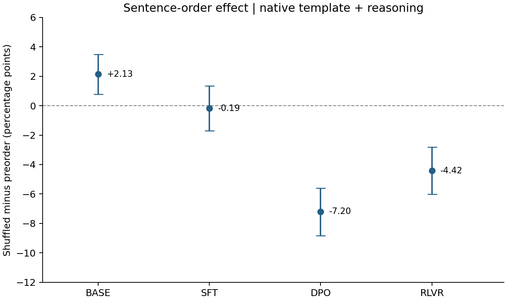

# Tülu 3 × PrOntoQA sentence-order sensitivity

A paired comparison of the original preorder corpus and one deterministic sentence permutation, across Llama 3.1 8B Base → Tülu 3 SFT → DPO → RLVR. Each version contains the same 4,320 formal questions (1,440 per hop), 48 pilot questions and four demonstrations. All context sentences in each question and demonstration are shuffled once with seed **20261014**; queries, answers, gold proofs and sample IDs are preserved. No questions are regenerated or selected by performance.

Scientific code is shared in [`../tulu_behavior/`](../tulu_behavior/). The single [Chinese report](../reports/report.zh-CN.md) includes the original geometry and behavior studies plus this comparison. The [original behavior experiment](../behavior/README.md) remains available under its own protocol.

## Main result

Primary endpoint: native-template reasoning answer accuracy, averaged equally across 1/3/5-hop strata. Differences are shuffled minus preorder, in percentage points. Four two-sided exact McNemar tests share one Holm correction; 95% intervals use 10,000 stratified paired bootstrap replicates (seed 20261007), with shared indices across both orders and all conditions.

| Checkpoint | Preorder | Shuffled | Change (pp), 95% CI | Holm p |
|---|---:|---:|---:|---:|
| Base | 51.67% | 53.80% | +2.13 [0.76, 3.50] | 0.00496 |
| SFT | 71.46% | 71.27% | −0.19 [−1.71, 1.34] | 0.83961 |
| DPO | 73.31% | 66.11% | −7.20 [−8.82, −5.60] | 1.74e−17 |
| RLVR | 69.75% | 65.32% | −4.42 [−6.02, −2.80] | 2.74e−7 |



## Published results

- [Four primary order tests](reports/order_primary_tests.csv), [all order effects and transition counts](reports/order_summary.csv), [changes in adjacent-stage gains](reports/order_stage_gain_changes.csv), and [comparison statistics](reports/order_comparison.json).
- [Shuffled summaries](reports/summary.csv), [secondary stage tests](reports/secondary_stage_tests.csv), [paired contrasts](reports/paired_differences.csv), [stage transitions](reports/transitions.csv), [diagnostics](reports/diagnostics.csv), [label summaries](reports/label_summary.csv), and [dataset summary](reports/dataset_summary.csv).
- [Difficulty curves](reports/figures/difficulty_curves.png), [plot values](reports/figures/values.json), and SVG versions of the [order effect](reports/figures/order_effect.svg) and [difficulty curves](reports/figures/difficulty_curves.svg).
- [Historical acceptance](provenance/history.json), [full local reanalysis](provenance/reanalysis.json), and [current aggregate verification](provenance/validation.json).

The published `analysis.json` contains four primary order tests and three **secondary** within-shuffled stage tests. The original preorder experiment retains its separate three-test primary family. Secondary stage-gain interactions do not belong to the four-test primary family.

Each order has **60,480 physical generations and 69,120 logical template views**. Base's native/plain views share the same physical responses. BF16, greedy decoding, batch 4, reasoning budget 512 and direct budget 32 are fixed. Missing answers, truncation and other failures remain in every denominator.

The release contains aggregate evidence only. Full questions, model inputs, responses, per-item scores, sampled case text, weights, runtime state and delivery archives are not published. The original experiment's compact [sample index](../behavior/reports/corpus-index.jsonl) supplies the unchanged sample/stratum/label mapping. Counts permit independent McNemar/Holm and point-estimate checks, but cannot reconstruct paired-bootstrap intervals or rescore proofs.

## CPU verification and complete-evidence reanalysis

Run from `experiments/prontoqa/`, with Python 3.12:

```bash
pip install -r requirements-analysis.txt
python -m tulu_behavior.verify --published
python -m pytest -q --import-mode=importlib behavior/tests behavior-order-sensitivity/tests
```

With complete external evidence for both orders:

```bash
python -m tulu_behavior.compare \
  --baseline-source /path/to/complete/behavior \
  --shuffled-source /path/to/complete/behavior-shuffled \
  --output-dir runs/order-reanalysis
```

Both sources need the original frozen file trees, tokenized inputs, all response batches and metadata, and the original 3-hop corpus/manifest at their configured paths. `--baseline-source` also resolves the shuffled experiment's historical baseline dependency. Archived code is verified as evidence and never imported or executed. Current publication code independently rescores both matrices, verifies every permutation and recomputes stage and order statistics. Outputs are written separately; sources are read-only. Historical counts/categories must agree exactly; floating comparisons use rtol=1e-10, atol=1e-12, with relative tolerance only for p-values, and record all observed roundoff. CPU checks do not rerun models, inspect local weights or decode output tokens using checkpoint tokenizers.

## Fresh shuffled generation

Install the pinned full environment in `../requirements.txt`, obtain the fixed checkpoint revisions in [experiment.json](experiment.json), and use a BF16-capable CUDA GPU. `--model-dir` contains `base/`, `sft/`, `dpo/` and `rlvr/`. Supply a complete preorder baseline accepted at batch 4 and budgets 512/32:

```bash
python -m tulu_behavior.pipeline \
  --experiment order-sensitivity \
  --baseline-source /path/to/complete/behavior \
  --model-dir /path/to/models \
  --output-dir runs/order-fresh --pilot-only
# Inspect the complete pilot evidence, then run with the same arguments without --pilot-only.
```

Preparation derives all three pools from the baseline without running the generator. Tokenization, model auditing, freezing, inference and scoring reuse the common implementation. The fixed pilot never raises budgets or reduces the batch size: budget exhaustion or OOM stops for diagnosis. Resume reuses verified committed batches and rejects changed code, source identity, models or configuration. Fresh run `reports/analysis.json` retains the shared runner’s within-order stage analysis; the four primary order tests and their figures are in `reports/order_comparison.json`, `reports/order_primary_tests.csv` and `reports/order-figures/`. Final completion requires actual case review bound to the frozen protocol and sampled generations. Server connection management and GPU scheduling are outside the scientific runner.

## Interpretation and sources

This experiment jointly changes rule order, initial-fact positions, distractor positions and demonstrations; it cannot isolate any one of those causes. One permutation per item does not measure variation across permutations. A nonsignificant result does not establish order invariance. Checkpoint contrasts do not identify causal effects of training methods, and different hop pools cannot be paired by position.

Original experiment code follows the project's [MIT license](../LICENSE); the shared [PrOntoQA generator](../vendor/prontoqa/UPSTREAM.json) retains [Apache-2.0](../vendor/prontoqa/LICENSE). Models and credentials are not redistributed. See [source attribution](../NOTICE.md).
