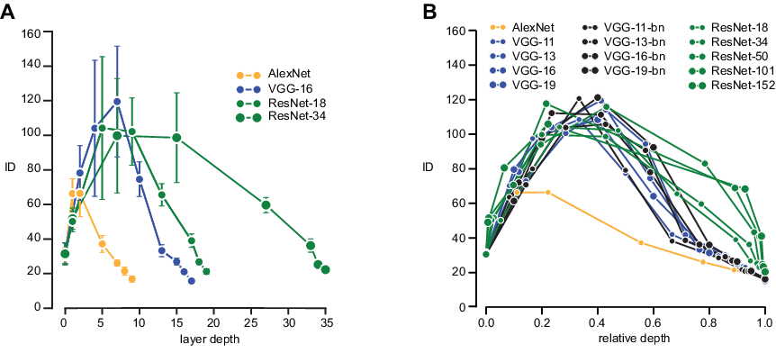
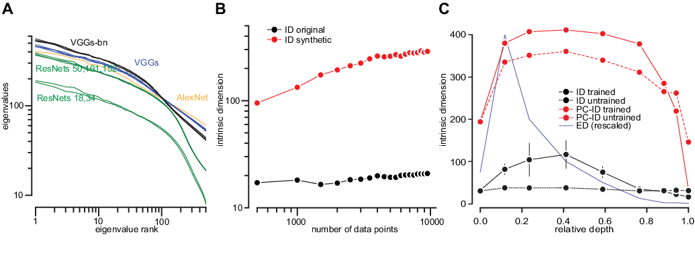
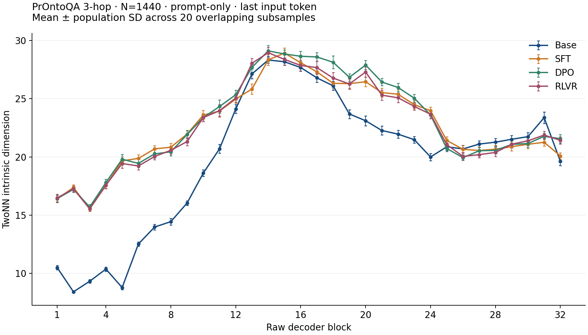
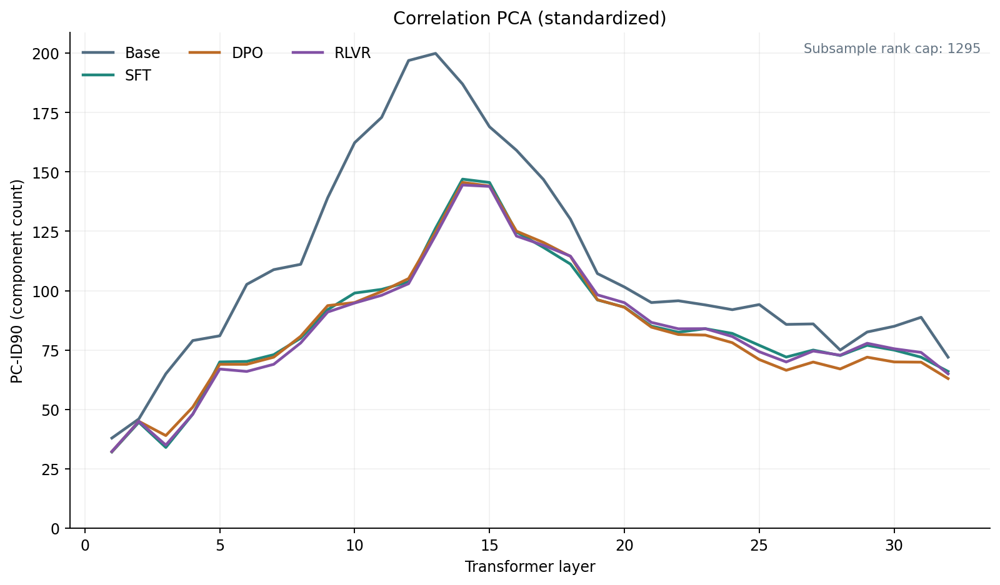
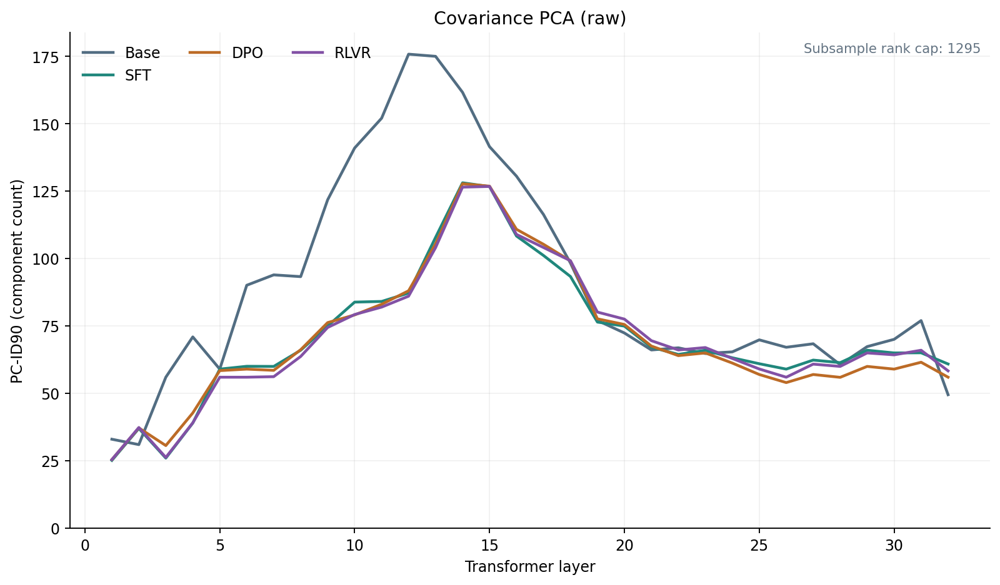
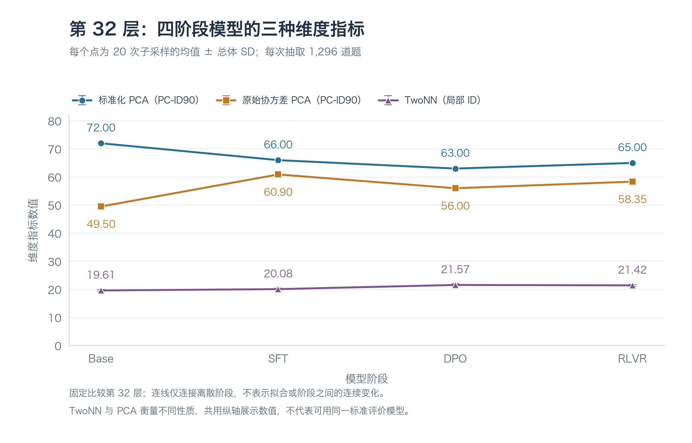
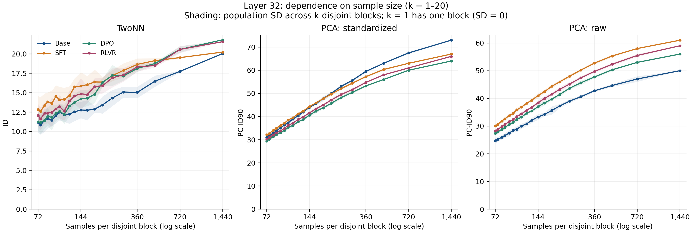
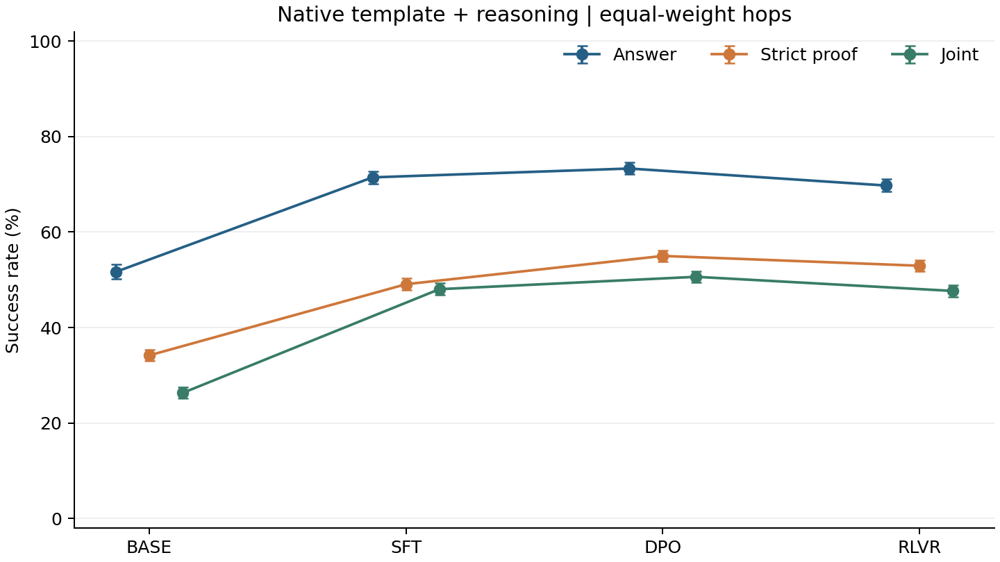
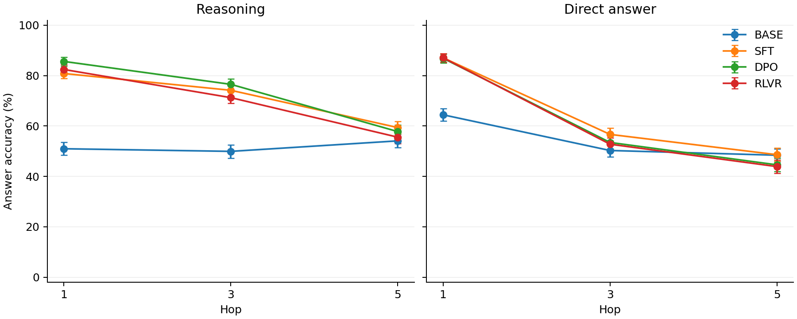

# Llama 3.1 / Tulu3 8B 四阶段模型：表示几何与逻辑行为评测

**PrOntoQA 上的 TwoNN／PCA 表示分析与 1／3／5-hop 配对行为评测**

来源是 Ansuini、Laio、Macke 和 Zoccolan 的 [《Intrinsic dimension of data representations in deep neural networks》（2019，v2）](https://arxiv.org/html/1905.12784v2)。

摘要：深度神经网络会在多个处理层中逐步变换其输入。这些网络学到的表征具有怎样的几何性质？ 在此，我们研究数据表征的内在维度（ID），即描述一种表征所需的最少参数数量。 我们发现，在经过训练的网络中，ID 比每一层中的单元数量低几个数量级。沿着各层看，ID 起初会增加，随后在最后几层逐步降低。值得注意的是，最后一个隐藏层的 ID 可以预测测试集上的分类准确率。通过线性维度估计（例如使用主成分分析）或在经过人为线性化的表征中，都无法发现这些结果。它们在未训练的网络中以及在使用随机化标签训练的网络中也都无法发现。这表明，能够泛化的神经网络会将数据变换到低维流形上，但这些流形不一定是平坦的。

**原论文的逐层 ID 实验（Figure 3）。** 作者研究图像分类 CNN 如何组织表示，主要设置如下：

| 项目 | 原论文设置 |
| --- | --- |
| 模型 | 共 14 个：AlexNet；VGG-11／13／16／19 各有带／不带 BatchNorm 两个版本；ResNet-18／34／50／101／152 |
| 训练状态 | 使用 torchvision 提供的 ImageNet 预训练权重；测量时固定权重、切换到评估模式，只做前向计算，没有继续训练或微调 |
| 测量数据 | 从 ImageNet 的 7 个类别各固定抽取 500 张图片，共 3,500 张，包括考拉、蝴蝶和若干犬种 |
| 表示与统计 | 在池化层、全连接层及 ResNet 阶段输出等选定位置，将每张图片的激活展平成向量；先对每个类别单独用 TwoNN 估计 ID，再对 7 类的 ID 求平均 |

**原论文 Figure 3｜跨网络的逐层 ID。** A 展示 4 个网络的逐层曲线，误差条为 7 个类别 ID 的标准差；B 将 14 个网络的层位换算为相对深度，便于比较不同长度的网络。横轴表示**网络深度，不是训练时间**；曲线描述同一批图片通过固定模型时的表示变化。图片来自 Ansuini 等人（2019）[原论文 v2 Figure 3](https://arxiv.org/html/1905.12784v2#S3.F3)，未修改，许可为 [CC BY-NC-SA 4.0](https://creativecommons.org/licenses/by-nc-sa/4.0/)。方法细节见[实验附录](https://arxiv.org/html/1905.12784v2#A1.SS1)和[作者测量代码](https://github.com/ansuini/IntrinsicDimDeep/blob/master/scripts/pretrained/hunchback.py)。

**关键结论。** 多种训练好的 CNN 呈现 ID 前部升高、后部降低的总体形状，最终 ID 远小于表示向量的坐标数，但并非所有网络的曲线完全一致。作者解释，前部可能削弱光照等与分类无关的低层相关性，使表示展开；后部则压缩同类图片的姿势、背景等变化。这是对观察结果的机制解释，不能把 ID 上升直接等同于“知识增多”。[作者结果说明](https://github.com/ansuini/IntrinsicDimDeep#our-work)

论文另以末层 ID 与测试表现的跨架构比较、PCA／高斯对照及随机权重／随机标签实验，支持表示具有低维非线性结构、且其几何组织与学习和泛化有关；这些证据尚未建立因果关系或“ID 越低，模型一定越好”的普遍规律。与 Figure 3 相比，本报告研究语言模型的单个 token 隐藏向量，并在固定逻辑题池上估计 ID，不采用其图像特征图及逐类别平均口径；相似曲线只能说明描述性形状相近，不能直接继承原论文的机制或能力结论。[原论文 §3–4](https://arxiv.org/html/1905.12784v2#S3)

**原论文的 PCA 与几何对照实验（Figure 5）。** 该实验检验：TwoNN 得到的低维表示，是否也能用少数线性主成分概括。

| 项目 | 原论文设置 |
| --- | --- |
| 模型与训练状态 | 分析上述 ImageNet 预训练 CNN，并以 VGG-16 展示主要对照；另使用随机初始化、未经训练的 VGG-16。测量时均固定权重，不继续训练 |
| 数据与表示 | 使用 ImageNet 图片的激活向量；A 为多种网络的末层混合类别表示（作者脚本默认约 2,000 张图片），B 改变 VGG-16 末层分析的样本数，C 比较 VGG-16 的逐层物体表示 |
| PCA 口径 | 对坐标中心化并标准化，相当于对相关矩阵做 PCA；将解释约 90% 总方差所需的主成分数称为 PC-ID。论文另报告，使用原始协方差得到定性相近的结果 |
| 对照目的 | 以随机权重检查曲线是否依赖训练；以论文所称匹配二阶统计的合成高斯数据，检查真实表示的低 ID 是否仅由线性相关性解释 |

**原论文 Figure 5｜PCA 与 TwoNN 的区别。** A：末层特征值谱平滑衰减，没有清晰截断。B：VGG-16 真实表示的 TwoNN ID 较低、随样本数相对稳定；合成高斯对照的估计高得多，并随样本数增加。C：黑线为 TwoNN ID，红线为 PC-ID，实线／虚线分别为训练后／随机权重；蓝线为按比例缩放后的表示坐标数 ED，不是另一种 ID。图片来自 Ansuini 等人（2019）[原论文 v2 Figure 5](https://arxiv.org/html/1905.12784v2#S3.F5)，未修改，许可为 [CC BY-NC-SA 4.0](https://creativecommons.org/licenses/by-nc-sa/4.0/)。设置见[原论文 §3.3](https://arxiv.org/html/1905.12784v2#S3.SS3)、[作者末层 PCA／高斯对照代码](https://github.com/ansuini/IntrinsicDimDeep/blob/2c5140009eb3efccca1d774dc66cb043c04b26d8/scripts/pretrained/last_hidden_pca.py)及[逐层 PCA 代码](https://github.com/ansuini/IntrinsicDimDeep/blob/2c5140009eb3efccca1d774dc66cb043c04b26d8/scripts/pretrained/hunchback.py)。

5c比较“随机初始化的 VGG-16”和“经过完整 ImageNet 训练的 VGG-16”

| 图 | 画什么 | 主要发现 |
|---|---|---|
| **5A：PCA 特征值谱** | 不同网络最后隐藏层的特征值，按大小排序；两轴均为对数刻度 | 谱平滑下降，没有明显截断，难以直接选出一个清晰的线性维数 |
| **5B：高斯对照** | VGG-16 真实末层表示与合成高斯数据的 **TwoNN ID**，随样本数变化 | 真实表示 ID 较低且相对稳定；高斯对照高得多，并随样本数增加 |
| **5C：逐层方法比较** | VGG-16 训练后／随机权重的 TwoNN ID（黑）、PC-ID（红）；蓝线是缩放后的坐标数 ED （CNN，不同层的表示大小会变化）ED = 通道数 × 高度 × 宽度| PC-ID 明显高于 TwoNN ID；PCA 曲线在两种权重下形状相近，TwoNN 则明显不同 |

如果两者具有相同的均值、协方差和样本数，但真实表示的 TwoNN ID 更低，就支持：
- 真实表示存在额外的组织结构，限制了它能怎样变化。
- 仅靠各方向的方差和线性相关性，解释不了这种低维结构。

**关键结论。** PC-ID 明显高于 TwoNN ID：论文以 VGG-16 末层约 200 对约 18 为例。训练前后，PCA 曲线形状定性相近，而 TwoNN 曲线差别明显，说明 PCA 的线性方差维数未捕捉到同样的训练相关几何变化。作者结合高斯对照，将结果解释为表示位于低维但弯曲的流形上；不能仅凭谱没有截断或 PCA–TwoNN 差距就认定曲率已获证明。[原论文 §3.3](https://arxiv.org/html/1905.12784v2#S3.SS3)

本报告沿用相关矩阵 PCA，并增加协方差敏感性分析、与 TwoNN 配对的子样本及分块尺度检查；未开展原论文的随机权重和高斯对照。因此，本实验中的 PCA–TwoNN 差距描述两种维度口径的不同，尚不足以独立复现原论文的流形解释。

## 摘要

本报告包含两个独立子实验，比较 Llama 3.1 8B Base 与 Tulu3 8B 的 SFT、DPO、RLVR 三个冻结检查点。表示几何子实验使用同一批 1,440 道 PrOntoQA 3-hop 题，测量回答生成前、最后一个输入 token 在 32 个 Transformer block 的原始输出；以 TwoNN 估计局部内在维度，以保留 90% 方差所需的主成分数（PC-ID90）描述全局线性维数。行为子实验保留这批 3-hop 题，新增独立的 1-hop 和 5-hop 题各 1,440 道，比较推理后回答／直接回答、原生／纯文本模板，共完成 60,480 次物理生成。

**主要发现：** 四阶段的 TwoNN 与两种 PCA 曲线均呈整体“中部高、两端低”的形状，但阶段排序依赖指标、层位与预处理。TwoNN 峰值集中在 28.32–29.10，峰高未随阶段序列单调变化；两种 PCA 的峰高均为 Base > SFT > DPO > RLVR，但该顺序不适用于所有层。末层的 Base 在标准化 PCA 中最高、在原始协方差 PCA 中最低，是预处理改变比较结论的直接例子。样本规模检查保留了三个指定层位的中部优势，但绝对估计仍明显漂移。

行为子实验的唯一主要终点（原生模板、推理后回答、三个 hop 等权答案正确率）为 Base 51.67%、SFT 71.46%、DPO 73.31%、RLVR 69.75%；三个相邻阶段差值为 +19.79、+1.85、−3.56 个百分点，均在三个预定检验的 Holm 校正后低于 0.05。严格证明与联合成功率另行报告。结论限于固定检查点和协议，不将行为排序与几何维度作相关性或因果联结。

## 1. 研究问题

本报告回答四个问题：四阶段的逐层维度曲线是否具有共同形状；阶段差异在 TwoNN 与 PCA 中是否一致；这些差异对 PCA 预处理及样本规模是否敏感；在独立的行为协议下，答案、严格证明及联合成功率如何随检查点、hop、作答方式和模板变化。

方法依据为 Ansuini 等人的 [《Intrinsic dimension of data representations in deep neural networks》v2](https://arxiv.org/html/1905.12784v2)，其中使用 TwoNN、子采样与 PCA 分析视觉网络表示。本实验将这些方法迁移到语言模型和逻辑题表示，并增加共享配对子采样及两种 PCA 的分块尺度分析。

### 1.1 PrOntoQA 的题目结构与跳数

PrOntoQA 是 Saparov 和 He He 在 ICLR 2023 论文[《Language Models Are Greedy Reasoners: A Systematic Formal Analysis of Chain-of-Thought》](https://arxiv.org/abs/2210.01240)中提出的合成逻辑问答数据集。生成器先构造形式逻辑结构，再生成简单的自然语言题干、查询及标准证明，因此可以分别检查最终答案是否正确、输出证明的每一步是否成立。本实验使用[原版 v1 的固定生成器](../vendor/prontoqa/UPSTREAM.json)，不是后续 PrOntoQA-OOD 的扩展设置。

**本实验的陈述主要是类别／属性判断及其否定。** 个体事实如“Alex 是 dumpus”，通用规则如“所有 dumpus 都是 yumpus”或“所有 numpus 都不具有 opaque 属性”。规则采用 Modus Ponens：已知某对象满足 A，且 A 能推出 B，就得到该对象满足 B。虚构类别名称用于减少现实常识的干扰；这里没有“Alex 喜欢 Bob”等涉及多个对象的关系，也没有数量或时间推理。这些限制描述本实验所选配置，不代表 PrOntoQA 生成器的全部能力。

**跳数（hop）是从已知事实推出目标结论所需的最少规则应用次数。** 初始事实本身不算一跳；1-hop 应用一次规则，3-hop 连续应用三次，5-hop 连续应用五次。题目要求判断某个对象是否具有目标类别／属性，并非机械连接题干的第一句和最后一句。有效证明沿一条规则链展开，但题干还含无关属性、不能用于当前对象的规则等干扰项，规则的文本顺序也不一定顺着解题方向。

表示几何分析固定使用 1,440 道 3-hop 题，输入为零示例题干与查询；行为评测另加入独立的 1-hop、5-hop 题各 1,440 道，并共用四道独立的 3-hop 提示示例。三个 hop 的正式题池分别生成，不是同一道题逐步延长；背景规则长度也会变化，因此跨 hop 的表现差异不能完全归因于推理步数。

### 1.2 真实的 1／3／5-hop 样本

以下三题来自项目保留的[真实正式题样本](../behavior/tests/fixtures/formal-items.jsonl)。为展示证明结构，仅摘出必要的英文原句，并按推理顺序排列；省略的干扰规则仍存在于完整题干中。以下推理说明依据样本中的标准证明，不是模型生成结果。

**1-hop：Sally，答案 True。**

> Sally is a tumpus.
> Tumpuses are not transparent.
>
> True or false: Sally is not transparent.

由“Sally 是 tumpus”和“tumpus 不透明”，应用一次规则得到 **Sally 不透明**，与查询一致，答案为 True。

**3-hop：Alex，答案 True。**

> Alex is a dumpus.
> Each dumpus is a yumpus.
> Yumpuses are numpuses.
> Numpuses are not opaque.
>
> True or false: Alex is not opaque.

证明链为 **Alex 是 dumpus → 是 yumpus → 是 numpus → 是 not opaque**，共应用三次规则，答案为 True。这里 opaque 意为“不透明的”，not opaque 是对该属性的否定。原题还含 `Every wumpus is opaque.`，但没有依据说明 Alex 是 wumpus，因此不能将这条规则套用到 Alex。标准证明共有 7 句，因为它同时列出初始事实、所用规则和各步结论；这不等于 7-hop。

**5-hop：Wren，答案 False。**

> Wren is a tumpus.
> Tumpuses are dumpuses.
> Dumpuses are wumpuses.
> Every wumpus is a jompus.
> Every jompus is a yumpus.
> Yumpuses are temperate.
>
> True or false: Wren is not temperate.

证明链为 **Wren 是 tumpus → 是 dumpus → 是 wumpus → 是 jompus → 是 yumpus → 是 temperate**，共应用五次规则。推出的是 `Wren is temperate.`，与查询 `Wren is not temperate.` 相反，因此答案为 False。原题另有 `Vumpuses are not temperate.`；vumpus 与 wumpus 是不同类别，不能因名称相似而混用。这里 False 由查询的显式否定得到证明，而不是因为暂时无法证明查询为真。

这些样本主要检验规则链追踪、干扰排除和否定处理。题目可以逐步形式核验，但这类任务的表现不足以代表多条证据汇合、复杂搜索或开放式规划等全部推理能力；输出证明有效也不能直接说明模型内部采用了相同过程。

## 2. 表示几何子实验的设置与统计口径

| 项目 | 已执行设置 |
| --- | --- |
| 数据 | 原版 PrOntoQA v1 固定版本生成；fictional ontology、preorder、公开 3-hop 定义、默认干扰项；1,440 道不同题目，True 737、False 703 |
| 输入 | 零示例；题干与查询以一个空格连接，不含标准答案或证明。Base 为原生纯文本；SFT、DPO、RLVR 为原生 Tulu chat 模板，添加 assistant generation prompt |
| 表示 | 每题每阶段取 32 个 raw decoder block 的最后有效输入位置，维数 4,096；不含 embedding 或最终 RMSNorm，不包含生成 token |
| 数值精度 | FP32 前向与保存，不量化、不使用 TF32；TwoNN 距离和 PCA 数值计算均为 float64 |
| 主曲线 | 共享 20 组无放回子样本，每组 1,296 题；所有阶段、层位和方法使用相同索引 |
| 误差展示 | 均值 ± 总体标准差（SD，ddof=0）；子样本之间重叠，不是 20 次独立实验，SD 不是置信区间 |
| 尺度检查 | 预先指定 L1、L16、L32；k=1…20，每个 k 使用固定随机排列分为 k 个互斥等长块，每块 floor(1,440/k) 题，余数丢弃 |

**TwoNN。** 在各样本集合内计算原始向量的欧氏距离，以第二近邻／第一近邻距离比及经验分布做过原点回归，保留排序比值最低 90%，沿用固定作者实现的末尾两点裁切规则。表示不做逐维标准化或 L2 归一化。这里的“抽取 90% 题目”和“拟合保留 90% 距离比值”是两项不同操作。

TwoNN 通过第一、第二近邻的距离比，估计一组表示在当前采样尺度下的有效几何自由度，即局部变化相当于发生在多少维空间中。方法由 Facco、d’Errico、Rodriguez 和 Laio 在 [2017 年论文](https://arxiv.org/pdf/1803.06992)中提出，Ansuini 等人的 2019 年论文将其应用于神经网络表示。本实验的一个样本是一道题在指定阶段、指定层的最后有效输入 token 的隐藏向量；完整题集在每层形成 1,440 × 4,096 的表示矩阵，主曲线的每个子样本则为 1,296 × 4,096。样本来自不同题目，不是向量的 4,096 个坐标，也不是不同网络层；每个样本集合输出一个整体维度估计。

算法在每个阶段、每个层位及每个样本集合内独立执行：

1. **寻找两个近邻。** 排除样本自身，以欧氏距离得到第一、第二近邻距离 $r_{i,1}$、$r_{i,2}$。不让 $r_{i,1}=0$ 或 $r_{i,1}=r_{i,2}$ 的样本贡献距离比；其余有效比值的数量记为 $M$。本实验主分析没有出现上述退化情况。
2. **计算距离比并排序。** 令 $\mu_i=r_{i,2}/r_{i,1}$，按升序得到 $\mu_{(1)}\le\cdots\le\mu_{(M)}$。
3. **构造经验累积分布并变换。** 对排序后的第 $i$ 个比值，取 $\widehat F(\mu_{(i)})=i/M$，构造回归坐标：

   $$
   a_i=\log\mu_{(i)},\qquad b_i=-\log\left(1-\frac{i}{M}\right).
   $$

4. **拟合过原点的直线。** 按固定作者实现先裁去排序末尾两点，再取前 $\lfloor0.9M\rfloor$ 个点；实际拟合点数为 $q=\min(\lfloor0.9M\rfloor,M-2)$。以最小二乘拟合 $b_i=\widehat d\,a_i$，斜率为：

   $$
   \widehat d=\frac{\sum_{i=1}^{q}a_i b_i}{\sum_{i=1}^{q}a_i^2}.
   $$

尾部裁切后，经验累积分布的分母仍为裁切前的有效比值数 $M$，不改成 $q$。主曲线每次估计中 $M=1,296$，因此实际拟合 1,166 个点。[固定作者估计代码](https://github.com/ansuini/IntrinsicDimDeep/blob/2c5140009eb3efccca1d774dc66cb043c04b26d8/IDNN/intrinsic_dimension.py)使用的是这一线性拟合路径；本文实验也沿用此路径，未采用乘积似然的最大似然公式。

理论依据是：若邻域内可近似为 $d$ 维空间，且到第二近邻的尺度内采样密度近似恒定，则距离比的累积分布为 $F(\mu)=1-\mu^{-d}$，从而 $-\log[1-F(\mu)]=d\log\mu$。以经验分布替代理论分布后，直线斜率提供 $d$ 的估计。这里的结果是局部近邻统计汇总出的有效几何维度，不是语义概念数量、信息量或推理能力的直接度量；其尺度敏感性见第 6 节，解释限制见第 8 节。

**PCA。** 主口径为相关矩阵 PCA：在当前样本集合内逐维中心化并除以总体标准差；敏感性口径为原始协方差 PCA：只中心化。每个子样本、每个尺度块均独立拟合预处理，再用完整样本 Gram 矩阵特征值分解计算谱，不采用随机或截断近似。PC-ID90 定义为累计解释方差首次达到或超过 90% 的最小主成分个数，从 1 计数；作者脚本的严格 >90% 零基索引另行保留，未混入正文计数。

**跨阶段可比性。** Base 的读出 token 全部为句末 `.`（id 13），后三阶段为 assistant 前缀末尾的 `>\n`（id 397）；平均输入长度分别为 125.30 与 134.30 token。因此，Base 与后三阶段的差异包含权重、输入格式及读出语境差异。后三阶段在本批题上的分词输入文件完全相同，减少了它们之间的格式差异，但单一冻结检查点比较仍不构成训练方法的因果识别。

## 3. TwoNN：共同中部峰形，阶段差异随深度变化

**图 1｜四阶段 TwoNN 逐层估计。** 英文图中的 N=1,440 指完整题集；每个曲线点实际为 20 个、每个 1,296 题子样本的均值，误差条为总体 SD。横轴是网络层位，不是生成时间。四阶段在 L14–15 附近达到均值峰值，随后整体回落，但存在局部反弹。来源：[逐层结果](id_summary.csv)；[SVG](figures/id_overlay.svg)。

**表 1｜TwoNN 的首层、峰值与末层（均值 ± SD）。** 峰层由未平滑的均值曲线选取；若并列则取最早层。

| 阶段 | 第 1 层 | 均值峰层 | 峰值 | 第 32 层 |
| --- | --- | --- | --- | --- |
| Base | 10.499 ± 0.178 | L14 | 28.321 ± 0.267 | 19.612 ± 0.342 |
| SFT | 16.394 ± 0.307 | L15 | 28.916 ± 0.441 | 20.081 ± 0.277 |
| DPO | 16.424 ± 0.318 | L14 | 29.105 ± 0.459 | 21.569 ± 0.367 |
| RLVR | 16.485 ± 0.323 | L14 | 28.951 ± 0.455 | 21.423 ± 0.315 |

Base 的首层估计低于三个后训练检查点；到均值峰值附近，四阶段数值集中在较窄范围，DPO 最高、Base 最低。末层排序为 DPO > RLVR > SFT > Base，与阶段先后顺序并不一致：DPO 到 RLVR 的末层均值略有下降，而 Base 到 SFT、SFT 到 DPO 均上升。这些是样本池上的描述性大小关系，不能用 SD 的重叠或不重叠判断统计显著性。

四阶段的均值峰值均高于首层与末层，但均不满足峰前逐层严格上升、峰后逐层严格下降；末层均仍高于首层。因此，可报告“整体中部峰形与后段回落”，不宜表述为“单调压缩到低于输入的维度”。首层本身也已是第一个 block 的输出，并非输入 embedding。

## 4. PCA：峰高排序一致，局部阶段排序不统一

**图 2｜标准化 PCA 的 PC-ID90。** 曲线与阴影分别为同一套配对子样本的均值与总体 SD。标准化在每个子样本内独立拟合，改变了各坐标的相对尺度。来源：[PCA 逐层结果](../pca/reports/summary.csv)；[SVG](../pca/reports/correlation_overlay.svg)。

**图 3｜原始协方差 PCA 的 PC-ID90。** 只中心化，保留坐标原有尺度；误差口径与图 2 相同。两种预处理均保留整体中部峰形，但具体数值和峰位不同。来源：[PCA 逐层结果](../pca/reports/summary.csv)；[SVG](../pca/reports/covariance_overlay.svg)。

**表 2｜两种 PCA 的首层、峰值与末层（均值 ± SD）。**

| 阶段 | PCA 口径 | 第 1 层 | 峰层 | 峰值 | 第 32 层 |
| --- | --- | --- | --- | --- | --- |
| Base | 标准化 | 37.95 ± 0.22 | L13 | 199.90 ± 0.30 | 72.00 ± 0.00 |
| Base | 原始协方差 | 33.00 ± 0.00 | L12 | 175.80 ± 0.40 | 49.50 ± 0.50 |
| SFT | 标准化 | 32.10 ± 0.30 | L14 | 146.95 ± 0.38 | 66.00 ± 0.00 |
| SFT | 原始协方差 | 25.15 ± 0.36 | L14 | 128.10 ± 0.30 | 60.90 ± 0.30 |
| DPO | 标准化 | 32.25 ± 0.43 | L14 | 145.60 ± 0.49 | 63.00 ± 0.00 |
| DPO | 原始协方差 | 25.45 ± 0.50 | L14 | 127.75 ± 0.43 | 56.00 ± 0.00 |
| RLVR | 标准化 | 32.30 ± 0.46 | L14 | 144.50 ± 0.50 | 65.00 ± 0.00 |
| RLVR | 原始协方差 | 25.45 ± 0.50 | L15 | 126.75 ± 0.43 | 58.35 ± 0.48 |

两种 PCA 的峰高均按 Base > SFT > DPO > RLVR 排列；相较于 TwoNN 的接近峰高，PCA 中 Base 与后三阶段的峰高差异更明显。然而，这一结果只比较各阶段自己的均值峰值，不代表 Base 在全部层位都最高，也不代表每一步后训练都降低同一层的表示维度。

峰位也有方法依赖：Base 的标准化 PCA、原始协方差 PCA、TwoNN 峰位依次为 L13、L12、L14。RLVR 原始协方差 PCA 宜描述为 L14–15 附近的平台：20 次子采样中 13 次两层并列、6 次 L15 独高、1 次 L14 独高。表中的 L15 是均值曲线的峰层，不能解释为唯一且稳定的精确峰位。

## 5. 末层对比：阶段排序依赖指标和预处理

**图 4｜第 32 层的三指标阶段比较。** 横轴为 Base、SFT、DPO、RLVR 四个模型阶段，三条线分别表示 TwoNN、标准化 PCA 和原始协方差 PCA，共用从零起始的纵轴。每个点为同一套 20 个重叠子样本的均值，误差条为总体 SD；每个子样本包含 1,296 道题。所有点均来自第 32 层，不是跨层平均；连线仅辅助比较离散阶段，不表示拟合或阶段之间的连续变化。TwoNN 与 PC-ID90 衡量不同性质，共用纵轴不代表两者可以作为同一种量直接比较。PC-ID90 的 SD=0 表示这 20 次整数阈值计数相同，不表示谱相同或没有不确定性。来源：[图中完整数值](report-assets/data/layer32_stage_comparison.csv)；[SVG](figures/04_layer32_stage_comparison.svg)。

末层标准化 PCA 为 **Base 72.00 > SFT 66.00 > RLVR 65.00 > DPO 63.00**；原始协方差 PCA 为 **SFT 60.90 > RLVR 58.35 > DPO 56.00 > Base 49.50**。Base 从前者最高变为后者最低，说明逐维标准化会实质改变阶段比较，而非对所有阶段乘上统一比例。

这种敏感性不限于末层：32 层中有 15 层的阶段两两大小／并列关系随预处理改变，其中 13 层存在严格顺序反转。全部 2,560 个同阶段、同层、同子样本的 PCA 预处理配对中，标准化 PC-ID90 都高于原始协方差版本，逐层均值差范围为 4.95–31.75。

全部 5,120 个 PCA–TwoNN 配对中，PC-ID90 均高于 TwoNN。然而，TwoNN 描述局部近邻几何，PC-ID90 描述全局线性方差分布；标准化 PCA 还改变了度量。因此，数值差距既不能视为 TwoNN 的估计误差，也不能单独作为流形弯曲或信息压缩机制的证据。

## 6. 样本尺度：局部形状保留，绝对估计仍漂移

**图 5｜末层三指标随每块样本数的变化。** 横轴为对数样本数；每个点为对应 k 个互斥块的均值，阴影为块间总体 SD。不同 k 使用各自的固定排列；连线仅辅助阅读，没有拟合曲线。k=1 只有一个 1,440 题完整块，SD=0 来自定义，不表示估计无不确定性。这里的块间 SD 与图 1–4 的重叠子采样 SD 含义不同。来源：[图中完整数值](report-assets/data/layer32_sample_scale.csv)；[SVG](figures/05_layer32_sample_scale.svg)。

**表 3｜末层从每块 1,440 题减至 72 题的均值相对变化。** 按“(72 题分块均值／1,440 题完整块估计 − 1) × 100%”计算；其基准不是主曲线的 1,296 题均值。

| 阶段 | TwoNN | 标准化 PCA | 原始协方差 PCA |
| --- | --- | --- | --- |
| Base | -44.2% | -57.5% | -50.5% |
| SFT | -36.6% | -52.0% | -50.7% |
| DPO | -48.4% | -54.0% | -51.1% |
| RLVR | -44.1% | -54.1% | -52.0% |

TwoNN 末层下降约 36.6%–48.4%，两种 PCA 同样出现明显变化，不能据此认定绝对维度估计已经收敛。PCA 还受有限样本秩上限约束：中心化后的最大秩为 n−1，完整集、主曲线子样本与最小尺度块分别最多为 1,439、1,295、71。PC-ID90 低于硬上限并不证明已收敛；在较大的样本区间，L16 的两种 PCA 从 720 增至 1,440 题仍增长 11.4%–19.4%。

另一方面，四阶段全部 k=1…20 的 TwoNN 分块均值均保留 L16 高于 L1 和 L32；PCA 的全部 160 个“阶段 × 预处理 × k”组合均满足 L16 > L32 > L1。该结论只覆盖三个预先指定层位，不能推广为全部 32 层曲线或 L14／15 精确峰位的跨尺度稳定性。

## 7. 行为评测：答案、严格证明与联合成功

### 7.1 独立行为协议与唯一主要终点

行为子实验使用相同的四个固定检查点；原有 1,440 道 3-hop 题的编号、内容、顺序和标签均保留。1-hop、5-hop 各新增 1,440 道独立题，共 4,320 道正式题。三个 hop 之间不按题号配对；同一道题在检查点、作答条件和模板之间配对。各池均由同一固定 PrOntoQA v1 生成器产生，正式题、预实验题和示例互不重叠。

| 项目 | 行为子实验已执行设置 |
| --- | --- |
| 正式题集 | 1／3／5-hop 各 1,440 题；True／False 分别为 759／681、737／703、699／741 |
| 示例 | 共用四道独立 3-hop 示例，标签顺序 True、False、True、False；目标标准答案与证明不进入提示 |
| 作答 | `cot`：逐句英文证明后回答；`direct`：只输出 `Answer: True` 或 `Answer: False` |
| 模板 | `native` 为各检查点原生格式，`plain` 为统一纯文本；后三阶段的原生格式含一个 user 消息，不额外添加 system 消息 |
| 推理 | BF16、greedy、不量化、不使用 TF32；固定种子 20261007；正式微批量 4，写入批次 16 |
| 预算 | 独立预实验 672 次生成后，以完整度而非正确率选择 CoT 512／direct 32 token；正式运行固定预算，不因答错重试 |
| 生成计数 | 每题有 14 个物理条件：Base 2 个，后三阶段各 4 个；合计 60,480 次物理生成、69,120 条逻辑视图 |
| Base 共享 | Base 的 native／plain 逻辑视图引用同一物理输出，不构成重复实验，也不按两条独立观测计算不确定性 |

唯一主要终点为 **native+cot 下，1／3／5-hop 等权平均的答案正确率**。严格证明和答案＋证明联合成功率为次要指标；direct 的证明指标不适用，不按零分计入。所有指标以相应条件的全部正式题目为分母，保留错误、拒答、格式失败和截断。

答案从最终明确答案行或末行独立 True／False 提取，不能由证明补全。严格证明必须解析每一句断言，逐步使用题干公理或对已成立事实的一次有效 Modus Ponens 推导，并到达正确命题；False 题须证明查询的显式否定。允许有效冗余和其他合法推导路径，但必要中间事实遗漏、额外错误断言或证明解析失败均不成功。见[评分实现](../tulu_behavior/scoring.py)、[提示构造](../tulu_behavior/prompts.py)和[固定配置](../behavior/experiment.json)。

### 7.2 主要结果与相邻阶段比较

**表 4｜原生模板、推理后回答，三个 hop 等权；百分率及 95% bootstrap 区间。**

| 阶段 | 答案正确率 | 严格证明成功率 | 答案＋证明联合成功率 |
| --- | --- | --- | --- |
| Base | 51.67% [50.14, 53.22] | 34.17% [32.96, 35.39] | 26.30% [25.12, 27.52] |
| SFT | 71.46% [70.16, 72.75] | 49.07% [47.85, 50.37] | 48.03% [46.78, 49.35] |
| DPO | 73.31% [72.06, 74.56] | 55.00% [53.84, 56.18] | 50.62% [49.42, 51.83] |
| RLVR | 69.75% [68.43, 71.04] | 52.94% [51.76, 54.12] | 47.66% [46.41, 48.89] |

**图 6｜四阶段行为成功率。** 点与误差条为等权平均估计及 95% 分层配对 bootstrap 百分位区间，非几何子实验的 SD。10,000 次重采样在每个 hop 内有放回抽题，同次抽样在全部检查点、模板、作答条件及指标之间共享索引，固定种子 20261007。区间只涵盖题目抽样不确定性，不涵盖示例选择或训练随机性。来源：[完整汇总](../behavior/reports/summary.csv)、[实际绘图数值](../behavior/reports/figures/values.json)、[SVG](../behavior/reports/figures/stage_comparison.svg)。

**表 5｜主要终点的三项预定比较。** 差值均为后一阶段减前一阶段，单位为百分点；只对这三个主要比较进行双侧精确 McNemar 检验，在同一个大小为 3 的 family 中作 Holm 校正。

| 比较 | 答案正确率差值 [95% CI] | 答错→答对／答对→答错 | 精确 McNemar p | Holm 校正 p |
| --- | --- | --- | --- | --- |
| Base→SFT | +19.79 [18.06, 21.50] | 1,263／408 | 1.50315×10⁻¹⁰¹ | 4.50946×10⁻¹⁰¹ |
| SFT→DPO | +1.85 [0.35, 3.36] | 590／510 | 0.0171823 | 0.0171823 |
| DPO→RLVR | −3.56 [−4.51, −2.66] | 129／283 | 2.39489×10⁻¹⁴ | 4.78978×10⁻¹⁴ |

本协议下，SFT 相对 Base 的主要终点提高，DPO 相对 SFT 再提高，RLVR 相对 DPO 下降；三项检验均在 Holm 校正后低于 0.05。这里比较的是固定检查点，不是不同训练方法的独立因果效应。完整计数与未取整数值见[主要检验](../behavior/reports/primary_tests.csv)和[阶段转移](../behavior/reports/transitions.csv)。

**表 6｜证明与联合指标的相邻阶段差值，百分点 [95% CI]。** 这些是次要描述性结果，没有新增显著性检验 family。

| 比较 | 严格证明 | 联合成功 |
| --- | --- | --- |
| Base→SFT | +14.91 [13.40, 16.41] | +21.74 [20.23, 23.22] |
| SFT→DPO | +5.93 [4.72, 7.13] | +2.59 [1.32, 3.87] |
| DPO→RLVR | −2.06 [−2.80, −1.30] | −2.96 [−3.80, −2.15] |

答案正确不保证证明合法，证明合法也不保证最终标签正确。答案与证明独立评分，联合成功必须同时满足两者；不能将答案正确率解释为推理轨迹的正确率。

### 7.3 难度、作答方式与模板

**图 7｜原生模板下的答案难度曲线。** 左为推理后回答，右为直接回答；每点以该 hop 的全部 1,440 题为分母，误差条为上述配对 bootstrap 区间。各 hop 独立生成，同时背景规则长度也会变化，连线不能解释为纯推理深度效应。来源：[汇总](../behavior/reports/summary.csv)、[数据分层](../behavior/reports/dataset_summary.csv)、[SVG](../behavior/reports/figures/difficulty_curves.svg)。

后三阶段的原生模板 CoT 答案正确率总体随 hop 增加而下降：SFT 为 80.83%→74.17%→59.38%，DPO 为 85.62%→76.53%→57.78%，RLVR 为 82.43%→71.25%→55.56%；Base 的 50.97%→49.93%→54.10% 不呈同样的单调关系。DPO 在 1-hop 和 3-hop 高于 SFT，而在 5-hop 低于 SFT。

原生模板下，direct 的三 hop 等权答案正确率为 Base 54.37%、SFT 64.12%、DPO 61.64%、RLVR 61.25%。CoT−direct 差值依次为 −2.71 [−4.81, −0.60]、+7.34 [5.51, 9.17]、+11.67 [10.07, 13.26]、+8.50 [6.85, 10.12] 个百分点。后三阶段的等权平均在 CoT 条件较高，但 1-hop 的 direct 更高，不能推断“要求证明对所有难度都有益”。

模板也会改变阶段排序。纯文本 CoT 的四阶段等权正确率为 51.67%、72.64%、70.65%、68.17%；SFT→DPO 为 **−1.99 [−3.50, −0.49]** 个百分点，与主要终点中原生模板的正差值方向不同。native−plain 的 CoT 差值在 Base 为精确 0（共享输出），SFT 为 −1.18，DPO 为 +2.66，RLVR 为 +1.57 个百分点。以上作答／模板比较均为次要描述性结果；完整区间见[全部配对差值](../behavior/reports/paired_differences.csv)，标签分项见[标签汇总](../behavior/reports/label_summary.csv)。

### 7.4 失败模式与验收范围

**表 7｜原生模板 CoT 的诊断比例。** 各列可重叠，不可相加。

| 阶段 | 证明解析失败 | 跳步标记 | 逻辑错误标记 | 平均输出 token |
| --- | --- | --- | --- | --- |
| Base | 0.42% | 22.31% | 46.55% | 32.4 |
| SFT | 0.25% | 18.38% | 34.63% | 33.8 |
| DPO | 0.21% | 20.30% | 25.97% | 33.2 |
| RLVR | 0.30% | 20.12% | 28.54% | 33.3 |

全部物理生成的答案均可提取，未出现长度上限截断；EOS 停止 51,840 条，声明的下一题标记停止 8,640 条，最长输出 95 token。证明解析失败仍按严格证明失败计分；“有答案”不代表答案正确或证明合法。受控语法解析失败可能导致后续事实无法进入有效事实集合，从而产生派生跳步标记，因此表中跳步率不是“实际省略中间步骤”的独立计数。详见[全部诊断汇总](../behavior/reports/diagnostics.csv)。

## 8. 讨论

**共同形状与阶段排序应分开判断。** 在同一固定题集上，三类指标一致呈现总体中部峰形，这是本实验较一致的描述性观察。阶段排序则依赖层位与方法：TwoNN 与 PCA 的峰高排序不同，PCA 自身的末层排序也随预处理改变。因此，没有证据将四阶段概括为统一的“维度逐阶段升高”或“逐阶段降低”。

**后训练差异不能自动解释为能力差异。** Base 与后三阶段采用不同原生格式和读出语境；本实验仅含每阶段一个检查点、一个固定逻辑题集与一种读出定义。后三阶段输入相同有助于比较，但未控制训练随机性、其他训练差异或任务变化，不能据此确定某种训练方法的独立因果效果。

**几何观察不等于机制或性能证明。** 表示几何子实验没有生成答案，不测正确率、生成推理轨迹或泛化；未开展匹配二阶统计的高斯对照或随机权重对照。离散、模板化文本也不自动满足连续流形与局部密度假设。结合实际尺度漂移，当前数值应解释为指定样本规模与方法下的估计，而非真实维度的已证精确值或下界。新增行为子实验直接测量回答与证明，但其结果不为几何指标提供机制或因果证明。

**行为结论取决于具体条件。** 主要终点中 DPO 最高，RLVR 相对 DPO 下降；纯文本推理条件的 SFT→DPO 差值却为负。因此，不能把一个模板下的阶段排序推广为整体模型能力或所有任务的排序。两项子实验虽然使用相同四个检查点，并共享原有 3-hop 题目内容，但几何实验为零示例、FP32 输入前向，行为实验为四示例、BF16 自回归生成；示例、精度、测量对象和统计单位均不同。本报告没有新增逐题几何—正确率相关性、跨实验回归或因果结论。

## 附录：结果、版本与复核入口

### A. 完成与复现证据

原始表示提取共 4 × 1,440 = 5,760 次正式前向，每阶段保存 90 个批次，共 360 个 NPZ；每批表示形状为 [16, 32, 4096]。TwoNN 共 128 个阶段×层汇总、2,560 个子采样估计，均有效，主分析未出现零近邻距离或近邻并列。PCA 共 256 个全量结果、5,120 个子采样结果和 5,040 个尺度块结果，合计 10,416 条记录，128 个完整谱文件。

原始 TwoNN 检查 57 项通过，PCA 检查 56 项通过；发布版另有 109 项测试通过，并从 Release 解包的表示重新完成 TwoNN 与 PCA 分析。14 张结果表、128 个谱文件的复核通过：主成分计数精确一致，浮点比较容差为 rtol=1e−10、atol=1e−12。这些分别是不同阶段的验证记录，不是相互独立的实验重复；发布复核没有重新执行四个正式模型的前向提取。见[发布复核记录](../provenance/validation.json)。

本报告引用的原始完成状态、测试数量与题集计数另见[原实验证据摘要](report-assets/evidence/original-experiment-summary.json)，其中保留来源记录的 SHA-256；[发布输入清单](../provenance/artifacts.json)记录固定数据和全部原始表示文件的身份。

### B. 固定检查点与参数

| 阶段 | 固定模型标识 | 固定 revision |
| --- | --- | --- |
| Base | `meta-llama/Llama-3.1-8B` | `d04e592bb4f6aa9cfee91e2e20afa771667e1d4b` |
| SFT | `allenai/Llama-3.1-Tulu-3-8B-SFT` | `f2a0b46b0cfda21003c6141b1ff837b7e165524d` |
| DPO | `allenai/Llama-3.1-Tulu-3-8B-DPO` | `a7beb67e33ffd01cc87ac3b46cadc1000985b8db` |
| RLVR | `allenai/Llama-3.1-Tulu-3-8B` | `666943798adbde0b1aff34626007e26986a3c107` |

题集种子为 62471893；共享子采样种子为 20261007；尺度排列种子为 20261008。PrOntoQA 生成器 revision 为 `066f73fc70bfaa92ed2476fd3c41b4951ad6e63a`，TwoNN／PCA 作者参考代码 revision 为 `2c5140009eb3efccca1d774dc66cb043c04b26d8`。参见[实验参数](../experiment.json)、[PCA 参数](../pca/config.json)、[模型资产记录](../provenance/models.json)和[实际分词记录](../provenance/tokenization.json)。

### C. 数据与图表索引

| 内容 | 本报告包中的入口 |
| --- | --- |
| TwoNN 原始统计 | [逐次估计](id_replicates.csv)、[逐层汇总](id_summary.csv)、[曲线摘要](curve_summary.csv) |
| TwoNN 尺度 | [全部尺度点](scale_checks.csv)、[尺度摘要](scale_summary.csv) |
| PCA 原始统计 | [全量结果](../pca/reports/full.csv)、[逐次结果](../pca/reports/replicates.csv)、[逐层汇总](../pca/reports/summary.csv)、[曲线摘要](../pca/reports/curve_summary.csv) |
| PCA 对照与尺度 | [逐次配对](../pca/reports/comparison_replicates.csv)、[配对汇总](../pca/reports/comparison_summary.csv)、[尺度结果](../pca/reports/scale_summary.csv) |
| 本报告新增展示数据 | [末层阶段比较](report-assets/data/layer32_stage_comparison.csv)、[末层尺度比较](report-assets/data/layer32_sample_scale.csv)、[末层相对变化](report-assets/data/layer32_scale_changes.csv)、[L16 样本增长](report-assets/data/layer16_pca_scale_growth.csv) |
| 图表科学来源 | [来源清单](report-assets/source-map.json)；输入和表示身份见实验 provenance，当前汇总校验见行为验证记录。 |

表示几何数据目录中的原始统计与既有结果逐字节一致；该子实验新增展示表仅筛选或汇总已有结果，没有重新抽样、拟合或提取表示。图 1–3 保留原图字节，图 4–5 由本报告包中的 CSV 绘制；前置的原论文 Figure 3、5 使用从原论文 v2 下载的未修改图片，来源与许可见各自图注及来源清单；原论文 Figure 2 图片亦保留在图表目录中。行为子实验的图 6–7 与验收记录独立位于 `behavior/`，见第 7 节。本报告通过相对路径引用仓库中的图表与数据，转交时需保留整个仓库目录结构；Markdown 不固定分页。

### D. 公开复现与方法来源

- [当前公开代码与结果、数据范围及复核限制](../README.md)。原始 `v1.0.0` 及其表示附件的身份保留在历史清单中，不提供旧仓库下载入口。完整 PCA 谱及其索引未纳入本次公开快照；完整数值重算须自行提供相应外部证据。
- [原论文 v2](https://arxiv.org/html/1905.12784v2)，尤其是 TwoNN、子采样和 §3.3 的 PCA 对照。
- [固定作者代码](https://github.com/ansuini/IntrinsicDimDeep/tree/2c5140009eb3efccca1d774dc66cb043c04b26d8)；[固定 PrOntoQA 生成器](https://github.com/asaparov/prontoqa/tree/066f73fc70bfaa92ed2476fd3c41b4951ad6e63a)。
