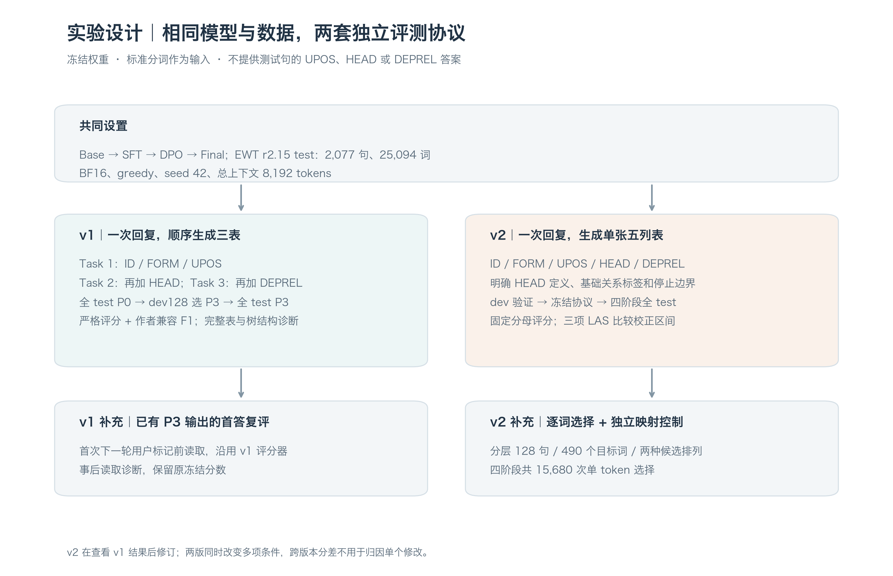
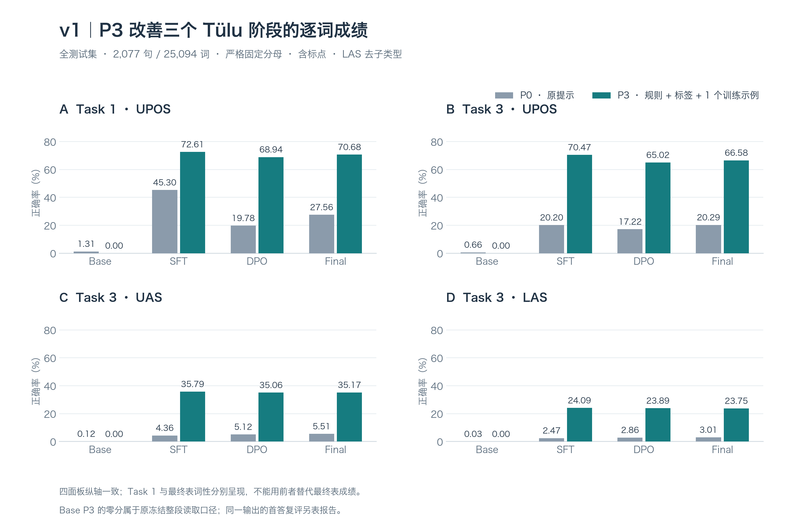
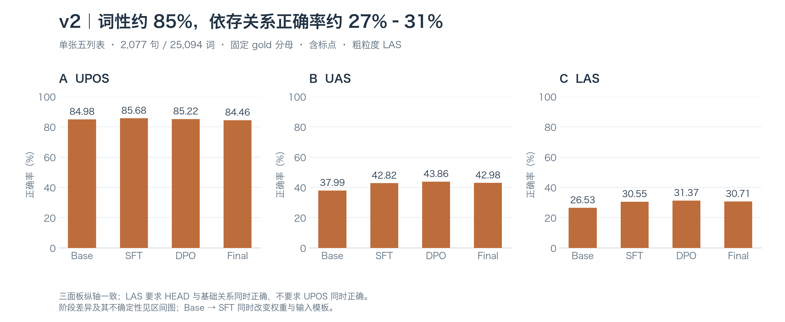
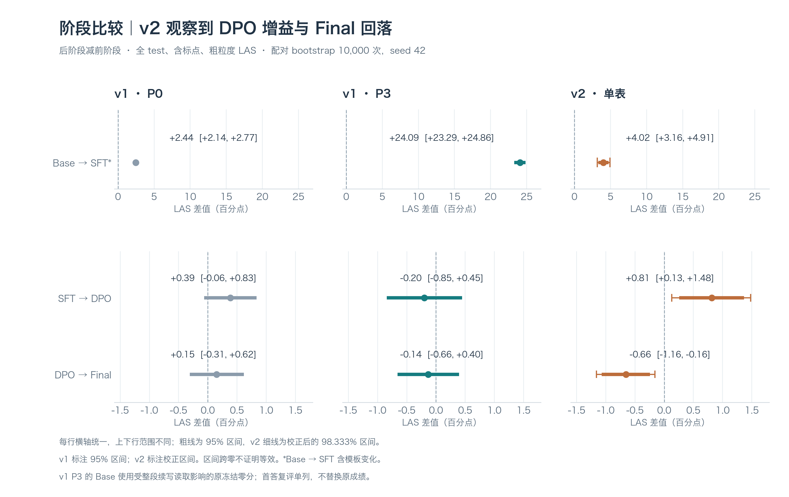
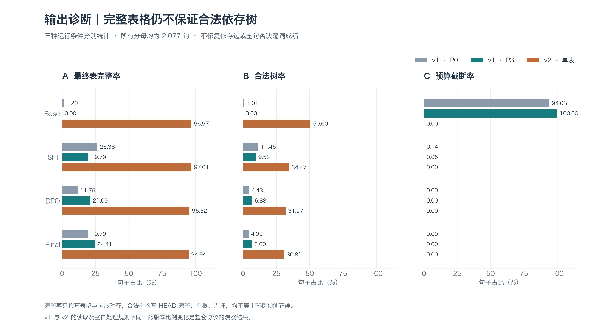
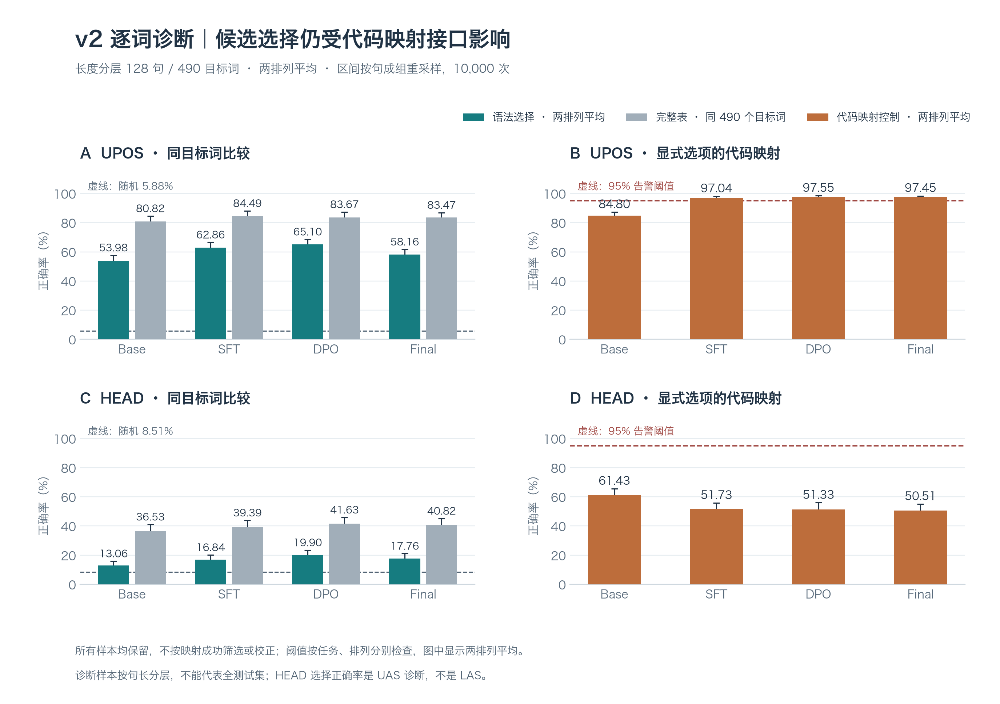
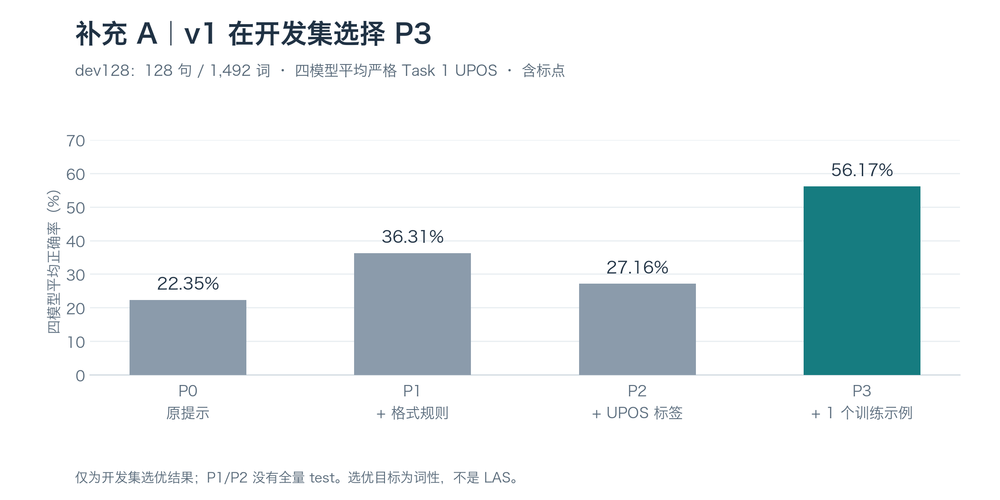
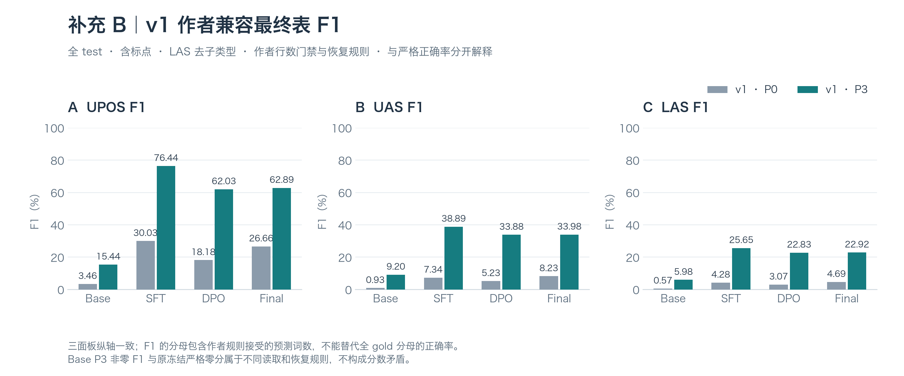

# 通用后训练阶段的句法解析表现：两版冻结模型评测报告

## 摘要

本研究比较 Llama-3.1-8B Base 与 Tülu-3-8B 的 SFT、DPO、Final 四个阶段，在不进行句法任务训练的条件下能否输出正确的词性和依存结构。两版实验使用相同模型版本、UD English EWT r2.15 数据及标准分词，但采用不同的任务与读取协议：原实验（v1）在一次回复中生成三张逐步扩展的表，并比较原提示 P0 与开发集选出的 P3；v2 在查看 v1 结果后，改为生成单张完整表，明确中心词定义、结束边界及字段读取规则。

v1 中，P3 将三个 Tülu 阶段的严格 LAS 从约 2%–3% 提高到约 24%，但输出完整性仍低。Base 的 P3 原冻结成绩为零；对同一批已有输出只读取首答、沿用原评分器复评后，其 LAS 为 **24.36%**，表明整段续写和回答边界显著影响了原评分。v2 的完整表率达到 **94.94%–97.01%**，严格 LAS 为 **26.53%–31.37%**；DPO 相对 SFT 增加 **0.81 个百分点**，Final 相对 DPO 下降 **0.66 个百分点**，两项校正区间均不跨零。两版共同表明：指定接口下的解析表现依赖任务协议，逐词正确、格式完整和树结构合法必须分别评估；通用后训练没有带来持续递增的依存解析成绩。

## 1. 研究问题与共同设置

### 1.1 研究对象与方法来源

本研究回答两个问题：四个模型阶段的可观察句法解析表现如何变化，以及输出协议会在多大程度上影响这种比较。这里的“句法表现”指模型在给定输入和输出要求下完成任务的成绩，不能直接等同于内部句法表征或独立于接口的知识水平。

方法来源是 Matsuda、Ma 与 Asahara（2025）的三步依存解析方法：先预测词性，再添加中心词编号，最后添加依存关系，用简化 CoNLL-U 的 TSV 表表示结果。原论文包含解析任务监督微调；本研究只加载已有通用模型进行冻结推理，没有进行解析任务 SFT、LoRA 或强化学习，因此属于**方法复用与扩展评测**，不能宣称复现了论文的任务微调成绩。[原论文](https://aclanthology.org/2025.iwpt-1.2/)

| 阶段 | 使用的官方 checkpoint | 本次评测中的含义 |
| --- | --- | --- |
| Base | `meta-llama/Llama-3.1-8B` | 预训练基础模型 |
| SFT | `allenai/Llama-3.1-Tulu-3-8B-SFT` | 通用监督微调后的模型 |
| DPO | `allenai/Llama-3.1-Tulu-3-8B-DPO` | 直接偏好优化后的模型 |
| Final | `allenai/Llama-3.1-Tulu-3-8B` | 包含 RLVR 阶段的最终发布模型 |

两版使用的四个模型 revision 完全一致。名称中的阶段描述已有 checkpoint 的训练位置，并不表示本研究重新实施了这些训练过程。Base 与 Tülu 的输入模板不同；SFT→DPO→Final 还可能同时改变训练数据和预算，所以阶段差异只能按具体 checkpoint 比较解释，不能归因于某一个训练目标。

### 1.2 数据、输入与推理条件

数据固定为 **UD English EWT r2.15**，源码 revision 为 `4dc8e10cf32352e11ab2c46e024b19853b91546e`。全测试集包含 **2,077 句、25,094 个标准词**，其中非标点词为 21,998 个。评分只使用整数 ID 的词记录，跳过多词 token 和空节点。本研究提供标准分词，因此不评估模型自行分词的能力。

输入包含原句和词形；v1 按作者转换方式提供逐词列表，v2 显式提供 ID 与 FORM。测试句的 UPOS、HEAD 和 DEPREL 仅供评分，不进入推理提示。v1 的 dev128 从开发集无放回抽取，seed 为 42，共 **128 句、1,492 词**；v2 沿用该开发样本做运行验证。

两版共同使用未量化 BF16、贪心解码、temperature 0、top-p 1、禁用 top-k、重复惩罚 1、seed 42，以及 **8,192 token 总上下文**。记录的推理环境为 Python 3.11、PyTorch 2.5.1、Transformers 4.49.0、vLLM 0.7.2，最大并发序列数为 4。模型答案错误、格式失败和预算截断均保留，不通过重试选择更好的答案。两版的输出预算与结束规则不同，详见第 3 节。

**图 1．共同设置与两版流程。**上游模型和数据相同，任务输出与读取规则分别冻结。v1 首答复评使用已有生成文本；v2 全表解析和逐词选择均是独立请求，不能把复评分数混入 v2 主结果。

### 1.3 评价指标

**UPOS** 衡量词性标签是否正确；**UAS** 衡量直接中心词 HEAD 是否正确；**LAS** 要求 HEAD 与依存关系 DEPREL 同时正确，不额外要求词性正确。HEAD 为词的直接中心词编号，句根的 HEAD 为 0。本报告的主要逐词成绩均包含标点，以全部 25,094 个标准词为固定分母；LAS 去除冒号后的关系子类型，例如 `nmod:poss` 按 `nmod` 比较。

两版都只计入可按唯一合法 ID 与词形对齐的预测，缺失、重复 ID、不可对齐或非法预测计错，合法部分仍可得分，不修正预测依存边。v1 仅接受原词形及作者转换规定的末尾空格；v2 对字段首尾空白进行修整。这些读取规则不同，因此跨版本分差不仅来自模型生成内容。

**完整表率**的分母是 2,077 句，检查表格列数、ID 与词形对齐是否完整，不要求标注正确。**合法树率**检查全部 HEAD 可用、合法、只有一个根且无环，不要求依存边与标准答案一致，也不检查全部关系标签正确。两项不是严格的包含关系，更不是“整句解析完全正确率”。结构诊断不修边，也不因整树不合法而否决其中正确的单条边。

v1 另报**作者兼容 F1**。作者评分器先实施预测行数门禁，并包含按位置恢复 ID／词形、处理 HEAD 和根标签等规则。其 F1 为 `2 × 正确词数 /（标准词数 + 接受的预测词数）`，与严格固定分母正确率分开解释；本研究没有为 v2 增加作者兼容评分。

## 2. 原实验 v1：三步提示与开发集选优

### 2.1 做了什么、如何实施

v1 沿用固定版本的作者提示和转换代码。每个句子只发起一次生成请求，要求模型在**同一回复内**依次输出：Task 1 的 `ID / FORM / UPOS`；Task 2 在该表上添加 HEAD；Task 3 再添加 DEPREL。它不是三次调用，也没有把标准词性或标准中心词填入后续步骤。

Base 使用作者的角色文本模板，包括模板内固定日期文本；三个 Tülu 使用原生聊天模板。输出预算为总上下文扣除输入后剩余的 token 数。严格读取器若发现同一任务的重复标记或多张歧义表，不从中选择一个看似正确的答案；无歧义表中的合法部分仍评分。

提示候选为累积修改：P0 保持作者任务提示；P1 增加任务标记、字面制表符、禁止额外说明等格式规则；P2 再列出 17 个 UPOS 标签；P3 再加入一个固定训练集示例。示例选取规则是：在 6–12 词的训练句中，最大化不同 UPOS 标签数，平局按原顺序选取。实际示例为 **“Before you fall for Dems’ spin, here are the facts”**，共 12 词、11 种 UPOS 标签，包含三张标准答案表。P3 是单示例提示，不是模型参数训练。

实际流程先完成运行预检并冻结条件，再评测 P0 全测试集；随后在同一 dev128 上比较四模型×四提示，用**四模型平均严格 Task 1 UPOS**选优，平局时依次看平均 LAS 和 P0–P3 顺序。该平均值分别为 **22.35%、36.31%、27.16%、56.17%**，因此统一选择 P3，再进行全测试集评测。候选提示在预检时已有冻结记录，选优函数仅读取开发集结果。P1/P2 没有全量测试，不能据开发集分数推断其全测试集成绩；选优目标是词性，也不能称 P3 是按 LAS 选出的最优提示。

### 2.2 全测试集成绩

表 1 单位为 %。词性分别报告 Task 1 与最终 Task 3，以免把早期正确词性当成最终表的正确词性；UAS 和 LAS 均取 Task 3。

| 提示 | 阶段 | Task 1 UPOS | Task 3 UPOS | UAS | LAS |
| --- | --- | ---: | ---: | ---: | ---: |
| P0 | Base | 1.31 | 0.66 | 0.12 | 0.03 |
| P0 | SFT | 45.30 | 20.20 | 4.36 | 2.47 |
| P0 | DPO | 19.78 | 17.22 | 5.12 | 2.86 |
| P0 | Final | 27.56 | 20.29 | 5.51 | 3.01 |
| P3 | Base | 0.00 | 0.00 | 0.00 | 0.00 |
| P3 | SFT | 72.61 | 70.47 | 35.79 | 24.09 |
| P3 | DPO | 68.94 | 65.02 | 35.06 | 23.89 |
| P3 | Final | 70.68 | 66.58 | 35.17 | 23.75 |

**图 2．v1 的提示差异。**P3 提高三个 Tülu 阶段的成绩，尤其减少了早期词性与最终表词性的差距。Base 的零分是原冻结整段读取结果，其首答诊断见第 4.1 节。

P0 下，SFT 的 Task 1 UPOS 为 45.30%，到最终表只有 20.20%；说明“能输出早期词性”并不保证后续表可读取或词性保持正确。加入 P3 后，SFT 的 Task 1 UPOS、UAS、LAS 分别增加 **27.31、31.43、21.61 个百分点**；DPO、Final 的 LAS 分别增加 **21.02、20.74 点**。这些是提示组合的描述性差值，当前实验不能分离格式规则、标签清单和示例的各自贡献，也没有为 P0→P3 分差计算配对区间。

阶段比较并不支持简单的持续提升叙述。P0 的 LAS 点估计逐阶段上升，但 SFT→DPO 的 **+0.39 点**和 DPO→Final 的 **+0.15 点**的 95% 区间都跨零。P3 下，两项 LAS 点估计分别为 **−0.20、−0.14 点**，区间也跨零。词性变化较清楚：P3 的 SFT→DPO Task 1 UPOS 为 **−3.67 点**，95% 区间 [−4.95, −2.44]；DPO→Final 为 **+1.74 点**，[+0.95, +2.58]。这些结果说明词性和依存指标可能不同步；区间跨零也不证明模型等效。

## 3. v2：修订输出协议后重新评测

### 3.1 相对 v1 改了什么

v2 在查看 v1 结果后修订，仍冻结相同模型，用相同测试集与同一个训练示例。它是**新的独立评测协议**，没有覆盖原实验结果。关键变化如下。

| 维度 | v1 | v2 |
| --- | --- | --- |
| 输出任务 | 一次回复顺序生成三张表 | 一次回复生成一张五列表 |
| HEAD 说明 | 沿用作者的 “dependent word indexes” 措辞 | 明确为直接中心词，根为 0，禁止指向自身 |
| 输入与标签要求 | 作者逐词转换；P3 列 UPOS 标签并示范三表 | 显式 ID／FORM；列 UPOS 与基础 DEPREL 标签，要求单根 |
| Base 模板 | 作者角色文本模板 | BOS 后接纯文本任务提示 |
| Tülu 模板 | 原生模板，P3 含示例对话轮次 | 原生模板一次应用，示例写入同一用户提示 |
| 输出预算 | 8,192 总上下文扣除输入后的余量 | 完整解析最多输出 4,096 tokens |
| 结束与读取 | 整段输出解析，重复任务造成歧义 | 显式结束标记、EOS 或下一输入边界；只读首答 |
| 空白处理 | 原词形及约定末尾空格 | 修整各字段首尾空白后对齐 |

v2 的结束标记为 `<END_PARSE>`；遇到预先声明的下一轮输入／角色边界也结束当前回答。没有边界时保留输出，不根据答案正确与否选择表格。若首答仍出现歧义表、重复 ID 或缺失词，其对应预测仍按固定分母计错。

运行顺序是先完成 dev128 全表生成与小规模逐词接口验证，再冻结代码、输入、配置及候选记录，然后运行四阶段全测试集和诊断。开发阶段发现的低分及映射告警没有触发按成绩修改协议。**这只能说明 v2 内部的冻结与执行顺序，不能把此前已查看的 EWT test 重新称为盲测，也不能宣称整项研究预注册。**

### 3.2 全测试集成绩与阶段差异

表 2 为单张最终表成绩，单位为 %。四阶段均完成 2,077 句、25,094 词，完整解析没有预算截断。

| 阶段 | UPOS | UAS | LAS | 逐词对齐率 | 完整表率 | 合法树率 |
| --- | ---: | ---: | ---: | ---: | ---: | ---: |
| Base | 84.98 | 37.99 | 26.53 | 99.07 | 96.97 | 50.60 |
| SFT | 85.68 | 42.82 | 30.55 | 98.92 | 97.01 | 34.47 |
| DPO | 85.22 | 43.86 | 31.37 | 98.36 | 95.52 | 31.97 |
| Final | 84.46 | 42.98 | 30.71 | 98.23 | 94.94 | 30.81 |

**图 3．v2 的词性与依存成绩。**输出基本可对齐，但 HEAD 与关系的联合正确率仍远低于词性正确率。DPO 的 UAS、LAS 点估计最高；阶段间不确定性见图 4。

两版的相邻阶段区间都使用整句配对 bootstrap，重采样 10,000 次、seed 42。每次同时抽取两阶段对应句，用抽样句的正确词数与标准词数之和计算微平均分差，不是对句子正确率作简单平均。v2 以三项相邻阶段 LAS 分差作为主要比较，除 95% 区间外，报告 Bonferroni 校正的 **98.333% 区间**；UPOS、UAS 是辅助比较。

| 比较 | LAS 差值（百分点） | 95% 区间 | 校正后 98.333% 区间 |
| --- | ---: | --- | --- |
| Base→SFT | +4.02 | [+3.32, +4.74] | [+3.16, +4.91] |
| SFT→DPO | +0.81 | [+0.26, +1.37] | [+0.13, +1.48] |
| DPO→Final | −0.66 | [−1.07, −0.25] | [−1.16, −0.16] |

**图 4．阶段 LAS 比较。**上行比较 Base→SFT，下行比较两个 Tülu 相邻阶段；每行三面板同尺度，上下行尺度不同。v1 显示原有 95% 区间；v2 粗线为 95% 区间，细线与数字标注为校正区间。v1 P3 的 Base 采用原冻结零分，未混入首答复评。Base→SFT 在两版中都伴随模板变化，其大分差不能作为纯 SFT 效应。

v2 的两个 Tülu 相邻比较在校正后仍不跨零，支持**该协议下 DPO 相对 SFT 有小幅 LAS 增益，Final 相对 DPO 有小幅回落**。Final 的 LAS 点估计仍略高于 SFT，但没有计算这两者的直接配对区间，不能补充“显著高于”或“等效”的结论。辅助指标中，SFT→DPO 的 UAS 增加 1.04 点；DPO→Final 的 UPOS、UAS 分别下降 0.75、0.88 点。完整辅助区间及不含标点成绩保留在配套证据中。

### 3.3 输出完整与结构合法仍有差距

| 条件 | 阶段 | 最终表完整率 % | 合法树率 % | 预算截断率 % |
| --- | --- | ---: | ---: | ---: |
| v1 P0 | Base | 1.20 | 1.01 | 94.08 |
| v1 P0 | SFT | 26.38 | 11.46 | 0.14 |
| v1 P0 | DPO | 11.75 | 4.43 | 0.00 |
| v1 P0 | Final | 19.79 | 4.09 | 0.00 |
| v1 P3 | Base | 0.00 | 0.00 | 100.00 |
| v1 P3 | SFT | 19.79 | 9.58 | 0.05 |
| v1 P3 | DPO | 21.09 | 6.88 | 0.00 |
| v1 P3 | Final | 24.41 | 6.60 | 0.00 |
| v2 | Base | 96.97 | 50.60 | 0.00 |
| v2 | SFT | 97.01 | 34.47 | 0.00 |
| v2 | DPO | 95.52 | 31.97 | 0.00 |
| v2 | Final | 94.94 | 30.81 | 0.00 |

**图 5．三个独立的句子级诊断。**分母均为全测试集，不把失败句删除。跨版本完整率变化包含读取规则变化，不能全部归因于生成格式改善；三个指标也不构成逐级筛选的漏斗。

v1 P3 虽提高逐词成绩，却没有同步提高所有完整性指标，例如 SFT 的 Task 1 完整表率从 P0 的 52.67% 降到 27.15%，合法树率从 11.46% 降到 9.58%。v2 基本解决了表格缺失和对齐问题，但四阶段分别仍有 **935、1,315、1,351、1,353 句检测到环**。Base 的合法树率最高，其 LAS 却低于三个 Tülu；DPO 相对 SFT 的 LAS 上升时，合法树率反而下降。结构约束满足程度与边的正确程度不能互相替代。

一个固定首句样例说明了差别。测试首句为 “What if Google Morphed Into GoogleOS?”，共 7 词。v2 DPO 的输出有齐全的五列和词编号，但 `Google` 的 HEAD 为 3，指向它自己；标准 HEAD 为 4。Base 在该句的 `Morphed` 与 `GoogleOS` 之间形成 4↔6 的环。这些是真实输出中的标注错误，不是表格缺失。样例按测试首句固定选取，仅用于说明，不能估计错误频率；原文与标准答案见[样例证据](v2/examples.json)。

## 4. 补充诊断：回答读取与逐词选择接口

### 4.1 v1 P3 的首答复评

原冻结 v1 中，Base P3 的全部 2,077 句都耗尽输出预算，严格读取器对三项任务均记录重复任务歧义。后续事后分析没有重新生成答案：四阶段统一在首次字面边界 `\nheader: user` 前截取输出；不存在边界时保留全部文本，再调用冻结的 **v1 严格评分器**，保留全部标准词分母，不修边、不择优挑表。

| 阶段 | 读取方式 | Task 1 UPOS % | Task 3 UAS % | Task 3 LAS % | 出现边界的句数 |
| --- | --- | ---: | ---: | ---: | ---: |
| Base | 原冻结整段 | 0.00 | 0.00 | 0.00 | — |
| Base | 首答复评 | 73.02 | 34.28 | 24.36 | 2,077 |
| SFT | 原冻结／首答相同 | 72.61 | 35.79 | 24.09 | 0 |
| DPO | 原冻结／首答相同 | 68.94 | 35.06 | 23.89 | 0 |
| Final | 原冻结／首答相同 | 70.68 | 35.17 | 23.75 | 0 |

固定首句的 Base P3 输出先生成三张解析表，随后写出 `header: user`，继续生成另一句输入和更多任务表。首答复评将后续文本排除，因此恢复了一批可评分的预测。**同一模型、同一生成结果、仅改变读取边界就产生较大分差**，比“零分不代表没有句法能力”的一般提醒提供了更直接的证据。

复评不替换原冻结成绩，也不是 v2 成绩。原 `finish_reason=length` 仍保留，不能把原生成的全部截断记录改成正常停止。Base 首答 LAS 24.36% 与 v2 26.53% 的差距也不能解释为单独由停止规则带来的收益，因为 v2 还改变了任务、模板、提示和空白处理。

### 4.2 v2 的逐词受限选择与映射控制

v2 另做诊断，检验把长表生成改成单词选择是否减轻任务负担。它按 **2–10、11–20、21–40、>40 词**四个长度层各抽 32 句，seed 42，共 128 句；每句最多固定抽取 4 个目标词，实际共 **490 个目标词**。该样本刻意覆盖长句，不包含单词句，不能代表全测试集的自然句长分布。

每个目标词分别询问 UPOS 与 HEAD。UPOS 候选为 17 个标签；HEAD 候选包含 ROOT 和其他词的编号，排除目标词自身。候选映射到运行前和运行时都验证为单 token 的数字代码。每题使用两种排列，候选含义不变，但位置与代码改变；报告两排列平均，不选择较好的排列。模型只能生成一个允许的代码，因此这里的 `length` 停止是预期完成，不能当成长表预算截断。

另设置独立映射控制题：直接告诉模型需要查找的标签或 HEAD 选项，要求返回其代码，**无需判断句法答案**。控制目标用独立 seed 43 指定，不依据测试词的真实句法答案，也不把控制题结果反馈给语法题。每阶段共有 `490 × 2任务 × 2排列 × 2题型 = 3,920` 次请求，四阶段共 **15,680 次**。

| 阶段 | UPOS 选择 % | 同目标完整表 UPOS % | UPOS 映射 % | HEAD 选择 % | 同目标完整表 UAS % | HEAD 映射 % |
| --- | ---: | ---: | ---: | ---: | ---: | ---: |
| Base | 53.98 | 80.82 | 84.80 | 13.06 | 36.53 | 61.43 |
| SFT | 62.86 | 84.49 | 97.04 | 16.84 | 39.39 | 51.73 |
| DPO | 65.10 | 83.67 | 97.55 | 19.90 | 41.63 | 51.33 |
| Final | 58.16 | 83.47 | 97.45 | 17.76 | 40.82 | 50.51 |

**图 6．逐词接口诊断。**左侧完整表成绩仅取同一批 490 个目标词，避免与不同样本的全测试集成绩比较；虚线为候选随机水平。右侧为独立映射控制，虚线是 95% 告警阈值。误差线为按句成组重采样的 95% 区间。

UPOS 选择随机水平为 5.88%，HEAD 的平均随机水平为 8.51%，后者随句长和候选数变化。选择正确率高于随机，但四阶段均低于同目标词的完整表成绩。各阶段 HEAD 映射只有约 50%–61%，Base 的 UPOS 映射也低于 95%；三种 Tülu 的 UPOS 映射则约为 97%。这些控制结果表明，受限输出虽避免了长表格式问题，却引入了不可忽略的候选查找、编码或输出接口负担，尤其影响 HEAD 诊断。

告警按任务和排列分别判断。所有样本均保留，没有筛掉映射失败题、只分析成功子集或按映射正确率作比例校正。两排列的语法答案一致率也较低，HEAD 为 16.33%–29.18%。因此不能用选择题低分单独证明模型缺少句法知识；映射达到 95% 也不保证排除全部接口影响。诊断不预测 DEPREL，所以 HEAD 选择不是 LAS。记录的候选 logprobs 是允许候选集内的条件概率，不能当成全词表原始概率。

## 5. 结论与解释范围

**第一，输出协议是评测结果的一部分。**v1 P0/P3 的差异、Base 同输出首答复评的变化、以及 v2 的高对齐率，都说明任务措辞、示例、模板、终止和读取规则会影响可观察成绩。v2 比 v1 有更高的逐词分数和完整表率，但多项条件同时改变，没有单因素消融，不能把改进归因于“单表”“明确 HEAD”或“停止标记”中的任意一项。

**第二，后训练阶段的增益依任务和指标而异。**v1 原提示下的词性变化较大，依存分差不确定；P3 下两个 Tülu 相邻 LAS 区间均跨零。v2 则观察到校正后仍成立的 DPO 增益和 Final 回落。因此合并结论应是“未见通用后训练带来持续递增的解析成绩”，而不是“DPO 没有效果”或“所有阶段等效”。这些发现限定在四个固定 checkpoint、英语 EWT 和相应协议内。

**第三，可读取、格式完整、树合法与解析正确须分开报告。**v2 的完整表几乎覆盖全部句子，但 LAS 最高只有 31.37%，合法树率最高为 50.60%；较高的合法树率也未必对应较高 LAS。逐词正确边可以存在于非法树内，合法树也可以有大量错误边，现有实验不支持“输出整齐即完成解析”的判断。

本研究没有直接测量内部表征，也没有进行 EWT 与预训练／后训练数据的重叠排查，不能证明无污染。v2 使用此前查看过的测试集，首答复评也是事后诊断；二者均保留这种证据身份。若要判断某个训练目标对句法能力的因果作用，或独立归因协议中的某项修改，需要新的控制实验；本报告不将这些尚未实施的实验写成已完成工作。

## 补充资料与证据核验

### A. v1 开发集选优与作者兼容评分

**图 A1．开发集选优。**分母与全测试集不同，目标是四模型平均 Task 1 UPOS。P3 被选中，并不构成示例单独有效或 LAS 最优的消融证据。

| 提示 | 阶段 | 作者最终表 UPOS F1 % | UAS F1 % | LAS F1 % |
| --- | --- | ---: | ---: | ---: |
| P0 | Base | 3.46 | 0.93 | 0.57 |
| P0 | SFT | 30.03 | 7.34 | 4.28 |
| P0 | DPO | 18.18 | 5.23 | 3.07 |
| P0 | Final | 26.66 | 8.23 | 4.69 |
| P3 | Base | 15.44 | 9.20 | 5.98 |
| P3 | SFT | 76.44 | 38.89 | 25.65 |
| P3 | DPO | 62.03 | 33.88 | 22.83 |
| P3 | Final | 62.89 | 33.98 | 22.92 |

**图 A2．作者兼容评分。**F1 包含作者门禁与恢复规则，可能高于或低于严格正确率。Base P3 的非零 F1 与原冻结零分来自不同读取规则，不能把它解释成严格三表成功率。

含标点的作者评分没有异常适配。不含标点口径下，P0 SFT/DPO 分别记录 16/1 句评分器异常，P3 SFT/DPO/Final 分别为 7/55/89 句；保留和去除子类型两种口径各有相同数量。异常句以空预测代入作者评分，不从标准分母删除。v1 的 Task 1 兼容 F1 是本研究的扩展，不能冒充原论文指标。

### B. 结果文件、验证与重建

本次重写只使用已完成实验。v1 的八组全测试集结果每组均为 2,077 个唯一句子、25,094 词，无基础设施失败；生成截断和格式错误仍保留。v2 完成四组全测试集及四组正式逐词诊断，另有开发阶段记录；完成审计覆盖 16 个运行单元。逐词选择的单 token 正常完成不与全表截断合并统计。

重写时已核对正文表格的 170 个数值、CSV 分数和未舍入阶段差值；从既有原始输出复算的 v2 逐句成绩、配对区间、逐词选择与映射诊断均匹配已保存结果，v1 首答复评也复算一致。v2 原始输出 SHA-256 与完成审计匹配，冻结源码和输入哈希匹配；v1 复评源文件身份匹配。配套快照保存汇总、诊断、配置、部分冻结源码及来源身份，完整生成文本和逐句记录仍在原实验目录。历史冻结哈希继续表示历史文件，不能用来证明后来改写的说明文档。

| 资料 | 内容 |
| --- | --- |
| [v1 P0 结果](test/P0/)／[P3 结果](test/P3/) | 原冻结严格成绩、作者 F1、Task 2、两种标点口径及子类型成绩 |
| [v1 选优记录](provenance/selection.json)／[完成审计](provenance/final_audit.json) | 开发集选择依据与八组测试的完成身份 |
| [v2 主结果](v2/summary.csv)／[阶段区间](v2/paired-bootstrap.json) | 单表主成绩、不含标点辅助成绩、95% 与校正区间 |
| [v2 逐词诊断](v2/diagnostic-summary.json) | 两排列、随机水平、映射告警、同目标词比较及区间 |
| [首答复评汇总](v2/first-turn-summary.json)／[真实样例](v2/examples.json) | 事后读取规则、完整标准分母、源文件身份及固定首句节选 |
| [证据快照说明](v2/README.md)／[来源清单](v2/evidence-manifest.json) | 文件复制与提取规则、SHA-256、外部完整证据的位置 |
| [报告核验记录](v2/report-verification.json) | 本次汇总、原始文件身份、统计复核和链接检查结果 |

运行 `python results/plot_report.py` 可从当前快照重建八张图，需要 Matplotlib；未自动找到中文字体时用 `--font` 指定字体文件。PNG 用于报告，SVG 用于放大或后续排版。作图脚本只读冻结结果，不加载模型、不改变历史成绩。源码见[作图脚本](plot_report.py)，矢量图见[图形目录](figures/)。

参考文献：Hiroshi Matsuda, Chunpeng Ma, and Masayuki Asahara. 2025. *Step-by-step Instructions and a Simple Tabular Output Format Improve the Dependency Parsing Accuracy of LLMs*. IWPT / SyntaxFest 2025, pp. 11–19. [论文与书目信息](https://aclanthology.org/2025.iwpt-1.2/)。
