# Tulu3 8B 四训练阶段的真假表征：复现报告

**Base → SFT → DPO → RLVR｜城市激活替换与 PCA 可视化**  
原论文版本：arXiv:2310.06824v3。

## 1. 核心结论

本次将 Marks 与 Tegmark《The Geometry of Truth》的两项实验迁移到 Llama-3.1／Tulu3 8B 的四个训练阶段：用**激活替换**定位影响真假评分的内部状态，用 **PCA** 观察事实陈述的真假分离及其跨数据集关系。四阶段均保留了相似的局部定位规律和多种受控数据上的真假分离，但变化并非随训练阶段单调增强。

- **定位位置保持一致。** 固定城市真假对中，四阶段的句末国家词 Canada 的最大干预变化量都在 block 8，句号峰值都在 block 12；城市词在前部层作用强，最后读出位置在后部层作用增强。
- **SFT／DPO 的局部变化量较大，RLVR 的基线更接近零。** Canada 峰值变化量依次为 7.8750、10.8125、10.5000、6.2500。四阶段均发生 TRUE／FALSE 二标签偏好翻转；RLVR 句号处也翻转，但这受到其较弱的原假句 FALSE 偏好影响，不能解释为句号表征最强。
- **PCA 中较明显的形状变化出现在 Base→SFT。** 简单城市、翻译和大小比较在 Base 已有清楚分离；后训练阶段中，合取分离和公司事实簇内的真假分化更清楚，CounterFact 可见真假位移，但复杂数据仍有重叠。SFT、DPO、RLVR 的固定层图整体接近。
- **共同真假方向具有条件性。** 数值反义关系在后三阶段的联合图中呈较一致的真假方向；城市和翻译的否定关系仍有不同的分离方向。现有结果不能给四阶段的“真值表征强度”排序。

## 2. 复现了原论文的哪些实验

| 本次实验 | 原论文对应部分 | 本次实际完成的范围 |
|---|---|---|
| 城市激活替换 | 第 3 节、图 2；附录 B 提供更多原始案例 | 一个固定城市真假对，四个模型，全部 32 层；共 1,632 个层×位置干预点 |
| 单数据集 PCA | 第 4 节、图 1 | 11 个数据集、四阶段；block 12 主图、block 14 对照及全 32 层 |
| 联合／跨数据集 PCA | 第 4 节、图 3 | 三组否定／反义数据对；cities 基底投影及作者三种基底×五个目标数据集矩阵 |
| 层间结构变化 | 附录 C、图 7 与图 8 | 全层结果已保存；正文展示城市／否定城市的六个固定展示层 |

本次没有实施第 5 节的分类探针训练和跨数据集准确率评估，也没有实施第 6 节沿探针方向的干预。第 3 节的完整状态替换，与第 6 节的方向干预属于不同实验。原论文的整体结论汇集了更多证据；本报告只评价上述已完成的部分。[论文与实验对应章节](https://arxiv.org/html/2310.06824v3)。

## 3. 模型、数据与重要设置

### 3.1 原论文与本次的设置对照

| 设置 | 原论文／固定公开代码 | 本次 |
|---|---|---|
| 模型与比较对象 | LLaMA-2 7B／13B／70B 的规模差异；图 2 使用 13B，图 1 使用 70B | 同一 8B 谱系的四个训练阶段 |
| 输入界面 | 普通陈述／补全提示 | Base 普通补全；SFT／DPO／RLVR 原生 Tulu chat 模板，无 system 消息 |
| 城市实验输入 | 两条带真假标签的示例，以及 Chicago／Toronto–Canada 真假对 | 保持同样的示例和真假对；chat 阶段把完整提示作为一条 user 消息 |
| 城市实验指标 | 替换后的 TRUE／FALSE 下一 token 对数概率差；公开代码用带前导空格标签 | Base 用 ` TRUE`／` FALSE`；chat 阶段用 `TRUE`／`FALSE`；另保存另一种形式作诊断 |
| PCA 输入 | 单独的陈述，无真假任务或 few-shot 示例 | 同样无显式真假任务、示例或生成答案；chat 阶段仍有原生包装和 assistant 起始标记 |
| 内部状态 | decoder block 输出残差；PCA 在句末标点处取状态 | 同一类 block 输出、最终 RMSNorm 前；定位覆盖陈述最终句号的 token |
| PCA 层选择 | 论文的 13B“第 15 层”对应固定代码 block 14；70B 配置为 block 27；部分联合图另选层 | block 12 为事先确认的主层，block 14 为对照；完整分析 block 0–31 |
| PCA 计算 | 各数据集中心化，协方差特征分解得到主成分；标签用于颜色 | FP32 分析，前两个 PC；不标准化各维、不 whitening，不用标签选 PC、层或符号 |
| 数值计算 | 固定公开代码的本地模型加载使用 BF16；论文本节未完整列出运行精度与批量配置 | BF16 前向、FP32 读出评分、SDPA；城市 batch=1，PCA batch=25；eval、无梯度、无 KV cache |

**本报告所有本次层号均从 0 开始**：block 8、12、14 分别是第 9、13、15 个 block。原图保留论文自己的标注。本次 PCA 主层 block 12 来自此前独立城市实验的句号因果峰值，在查看 PCA 结果前固定；它是针对 Tulu 的取层适配，不能当作原模型层号的直接等价替换。[本次配置](../patching/configs/experiment.json) · [PCA 配置](../pca/configs/experiment.json) · [作者层配置](https://github.com/saprmarks/geometry-of-truth/blob/5d1c630c44f7e50bda7ad86d601ccadf9abc5ddb/config.ini)。

SFT、DPO、RLVR 的模板、输入文本和 token 序列已核验一致，可以在相同输入界面下比较这三个阶段的观测。Base→SFT 的变化则同时包含权重、模板，以及城市实验主标签形式的变化。

### 3.2 PCA 的全部数据集

数据与作者代码固定到提交 `5d1c630c44f7e50bda7ad86d601ccadf9abc5ddb`，使用 CSV 的全部原始行。

| 类别 | 数据集 | 内容 | 实际行数 |
|---|---|---|---:|
| 受控事实 | cities | 城市所属国家 | 1,496 |
| 受控事实 | neg_cities | 城市陈述加入 not 的否定版本 | 1,496 |
| 受控事实 | sp_en_trans | 西班牙语词与英语译义 | 354 |
| 受控事实 | neg_sp_en_trans | 翻译陈述的否定版本 | 354 |
| 受控事实 | larger_than | 两个数的“大于”比较 | 1,980 |
| 受控事实 | smaller_than | 两个数的“小于”比较 | 1,980 |
| 逻辑组合 | cities_cities_conj | 两条城市陈述的合取（and） | 1,498 |
| 逻辑组合 | cities_cities_disj | 两条城市陈述的析取（or） | 1,498 |
| 非精选事实 | companies_true_false | 公司业务等事实 | 1,200 |
| 非精选事实 | common_claim_true_false | 多主题一般事实陈述 | 4,450 |
| 非精选事实 | counterfact_true_false | 多种实体与关系的事实陈述 | 31,964 |
| **合计** | **11 个数据集** | **每阶段使用同样的行和顺序** | **48,270** |

论文表 1 中合取／析取各为 1,500 行，CounterFact 为 31,960 行；本次保留作者固定 CSV 的 1,498／1,498／31,964 行，不补行或删行。论文另有用于区分真值与文本似然的 `likely` 数据集，本次未纳入，因而不评估这项区分。

城市激活替换实验使用下面的**固定单例**；`cities.csv` 仅作为其来源资料保存，没有用于采样或扩大城市干预实验的样本量。

## 4. 实验一：城市真假判断的激活替换

### 4.1 原论文怎样做，本次怎样做

本次的原始假提示为：

```text
The city of Tokyo is in Japan. This statement is: TRUE
The city of Hanoi is in Poland. This statement is: FALSE
The city of Chicago is in Canada. This statement is:
```

真提示仅把最后一行的 `Chicago` 换成 `Toronto`。先运行真提示并保存内部状态；随后运行假提示，每次只在**一个 block、一个 token 位置**将其完整残差向量换成真提示对应向量，再继续计算后续输出。这一真→假替换方向与作者的城市案例一致。[作者固定替换代码](https://github.com/saprmarks/geometry-of-truth/blob/5d1c630c44f7e50bda7ad86d601ccadf9abc5ddb/patching.py)。

评分定义为：

\[
D=\log P(\mathrm{TRUE})-\log P(\mathrm{FALSE}),\qquad
\Delta=D_{\mathrm{替换后}}-D_{\mathrm{原假句}}.
\]

`D` 等于两候选 token 的 logit 差；`D>0` 表示更偏向 TRUE，`D<0` 表示更偏向 FALSE。正 Δ 只表示相对原假句向 TRUE 移动，必须检查替换后 D 才能判断是否跨零。本次不运行自由文本生成。

**原论文结果。** 图 2 的 LLaMA-2-13B 热图显示三个主要区域：前部层的城市词、中间层的陈述末词／句号、后部层的答案读出位置。作者据此提出，句末状态可能汇集整句的真假相关信息，并选择这类位置开展后续分析；这种解释仍需后续实验支持。[论文第 3 节与图 2](https://arxiv.org/html/2310.06824v3#S3)。

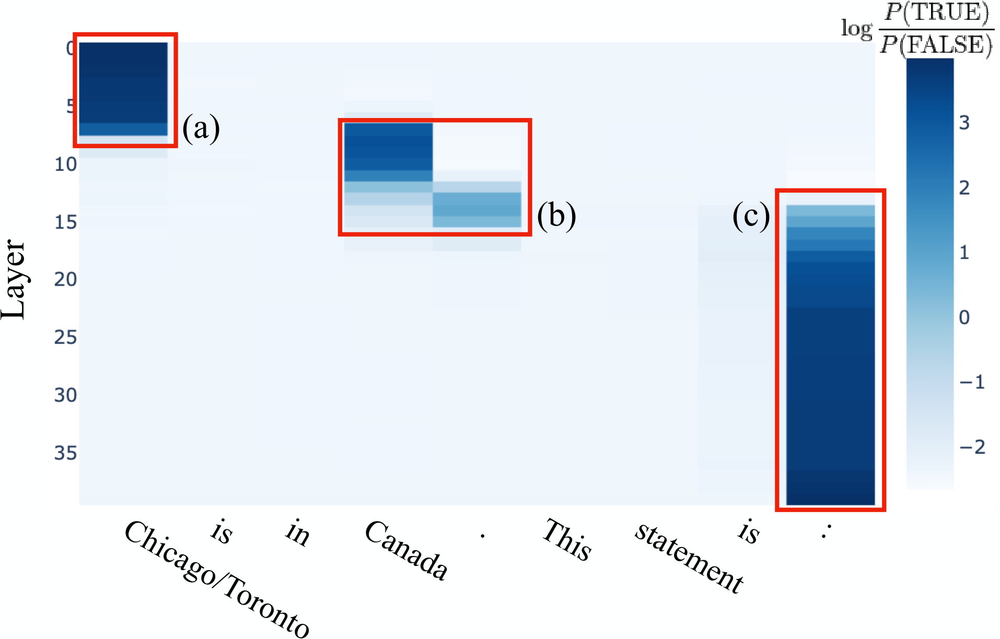

**图 1｜原论文图 2。** 来源：Marks & Tegmark，论文 v3，原图未修改。横轴为 token，纵轴为论文标注的层，蓝色色阶为替换后的 D；三个红框分别标记作者讨论的城市、句末与答案区域。这里仅引用其位置分布，不从图中估算精确数值。

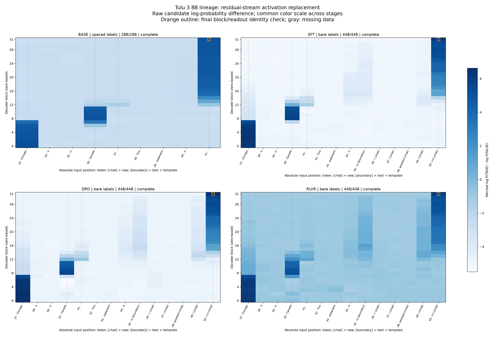

**图 2｜本次四阶段原始评分热图。** 每个格子是一项真实干预，纵轴为 block 0–31，横轴为各模型实际输入位置，统一色阶显示 D。Base 扫描 9 个位置，后三阶段各 14 个位置，分别为 288、448、448、448 个点。橙色空框标记末层末位置的恒等检查；chat 新增位置和边界合并位置已单独标注。

图中再次出现城市→Canada／句号→读出的层次分布。但 Base 和 chat 的绝对位置及标签形式不同，不能按热图列号或与原图的颜色深浅直接比较表征强度。

### 4.2 四阶段数值结果

| 阶段 | 原假句 D | 原真句 D | Canada，block 8 Δ | Canada 替换后 D | Canada 跨零 | 句号，block 12 Δ | 句号替换后 D | 句号跨零 |
|---|---:|---:|---:|---:|---|---:|---:|---|
| Base | −2.8750 | 5.0000 | 7.8750 | 5.0000 | 是 | 1.5000 | −1.3750 | 否 |
| SFT | −5.1250 | 6.1875 | 10.8125 | 5.6875 | 是 | 3.7500 | −1.3750 | 否 |
| DPO | −4.8750 | 6.5000 | 10.5000 | 5.6250 | 是 | 4.0000 | −0.8750 | 否 |
| RLVR | −1.1250 | 6.0625 | 6.2500 | 5.1250 | 是 | 2.1250 | 1.0000 | 是 |

**Canada 的替换在四阶段都足以改变二标签偏好。** Canada 在真、假输入中的 token 相同，被替换的是包含不同上下文信息的内部状态；因此这个位置的效应不能仅归于换入另一个城市 token。不过完整向量也包含实体关联等信息，本实验不能将效应唯一归因于抽象真值。

SFT 和 DPO 的 Canada、句号 Δ 高于 Base；RLVR 的 Δ 较低。RLVR 句号跨零是因为原假句 D 只有 −1.1250，距边界更近：其句号 Δ=2.1250，小于 SFT 的 3.7500 和 DPO 的 4.0000。Δ 与是否跨零应分别解读。

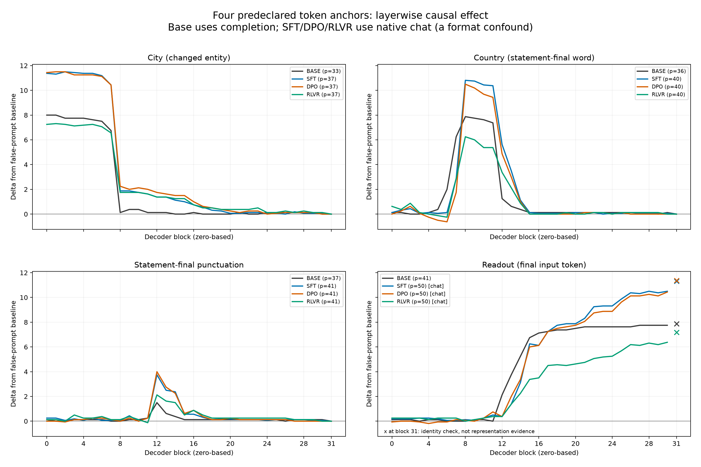

**图 3｜预先固定的四个位置的层曲线。** 横轴为零起计 block，纵轴为 Δ；灰／蓝／橙／绿依次表示 Base／SFT／DPO／RLVR。城市词前部层作用较强，Canada 四阶段均在 block 8 达峰，句号均在 block 12 达峰；后部层读出效应增强。block 31 的读出叉号是恒等检查，不连入科学解释用的曲线。

### 4.3 标签与输出解释

Base 的四个锚点绝对位置为 33／36／37／41；后三阶段为 37／40／41／50。Base 在原文冒号处读出，chat 在新增 assistant 起始标记的末 token 读出。图中 `[chat]` 表示新增模板 token，`[boundary]` 表示原文冒号与模板换行合并的 token，二者均需结合实际位置解释。

主标签形式在运行前固定，两种形式的结果都已保存。辅助标签下 Canada 和句号的峰值层仍为 8 和 12，但跨零判断有敏感性：DPO 句号在主指标 bare 下为 −0.8750，辅助 spaced 下为 +0.0625；本报告保留主指标下“未跨零”的结论。

RLVR 假句基线中，指定标签的全词表概率为 `P(FALSE)=0.04871`、`P(TRUE)=0.01581`，最高概率的下一 token 却是 `The`（0.59343）。因此，“TRUE／FALSE 偏好翻转”不等于已观察到自由生成答案改变。两候选概率也没有归一化为一个二分类分布。

最后一个 block 的最后输入位置被换成真提示完整向量后，后续相同输出头必然恢复真提示评分；四阶段实际误差均为 0。它验证替换实现，不提供独立的真值表征证据。本节结论只适用于这个固定城市真假对。

## 5. 实验二：PCA 真假结构及其四阶段变化

### 5.1 方法与原论文结果

每条陈述单独输入模型，取覆盖**陈述最终句号**的 token 上的 block 输出。chat 输入的句号可能与模板换行合并，仍定位到陈述句号处，不取整个聊天输入末 token。各数据集的全量激活先减去自身均值，再分析前两个主成分：

- **单数据集图**：每个数据集拟合自己的 PCA，观察该数据内部的真假结构。
- **联合图**：两数据集分别中心化后拼接，拟合共同 PCA，观察分离方向的关系。
- **跨数据集图**：目标数据减去自身均值后，投影到来源数据的 PC 基底；目标标签只决定颜色。

各阶段和各层独立拟合。PC 的符号由最大绝对载荷确定，不使用真假标签；蓝点左右换边不能解读为模型真假判断反转，跨阶段的 PC 坐标也不属于同一坐标系。

**原论文结果。** 图 1 展示 70B 在若干受控数据中的分离；图 3 展示跨数据集的方向一致与不一致，以及大小比较随模型规模变化的结构。图 8 展示 13B 城市与否定城市的分离方向随层变化。它们提示真假相关结构存在，但其跨数据集一致性依赖模型和位置。[论文第 4 节](https://arxiv.org/html/2310.06824v3#S4) · [附录 C](https://arxiv.org/html/2310.06824v3#A3)。

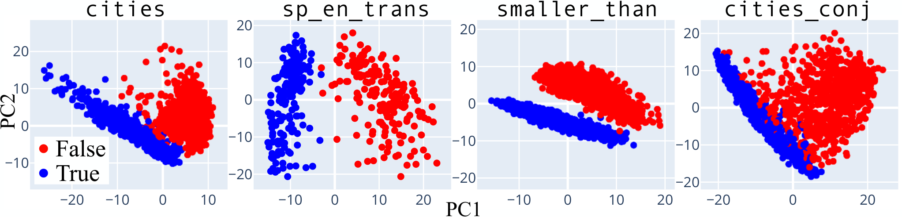

**图 4｜原论文图 1。** 论文 v3 的 LLaMA-2-70B 图，原图未修改；四个数据集分别使用自身前两个 PC，蓝真、红假。其展示的是模型规模研究中的 70B 结果，本次对应图改为比较四个 8B 训练阶段。

### 5.2 单数据集：哪些结构改变，哪些仍重叠

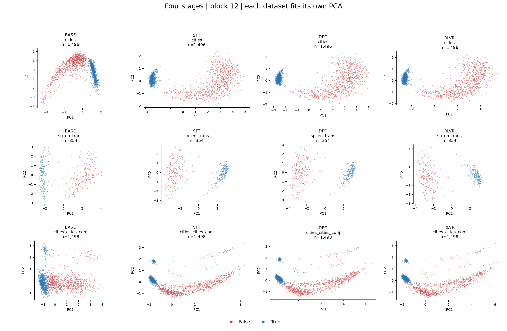

**图 5｜block 12：城市、翻译、合取。** 每列依次为 Base／SFT／DPO／RLVR，每行对应一个数据集；每格使用该阶段、该数据集已保存的 PC1／PC2 投影和全部行，蓝真、红假，n 为实际点数。

城市和翻译在 Base 已清楚分离，后训练阶段仍保留分离，但簇形改变。合取在 Base 有分离趋势和边界重叠；后三阶段分离更清楚，三个后训练检查点的整体形状接近。这是原生输入下的观测变化，Base→SFT 的权重与包装影响未被分离。

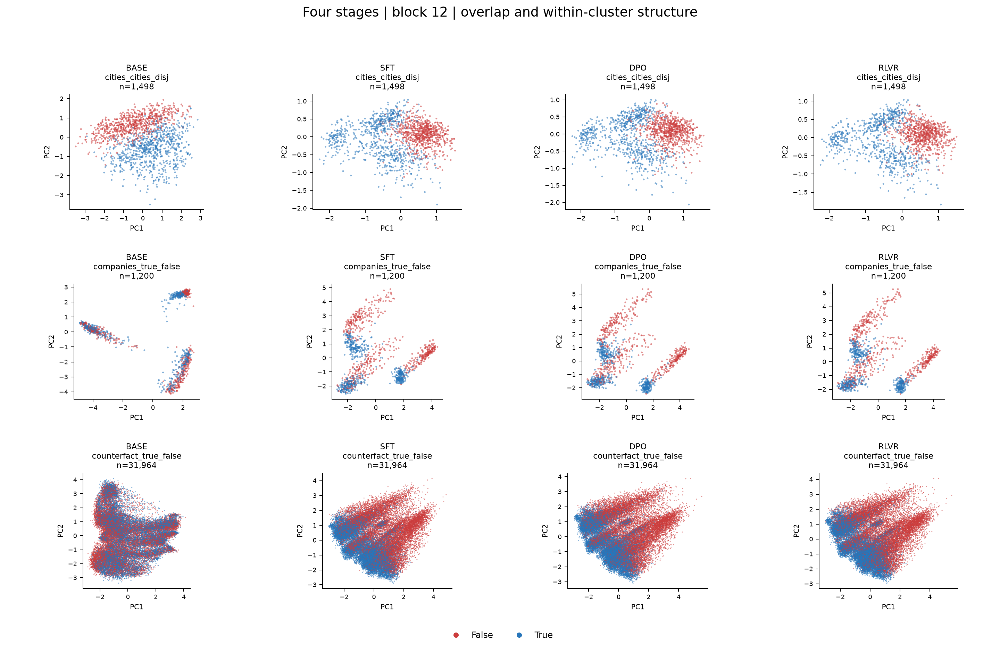

**图 6｜block 12：析取、公司事实、CounterFact。** 四阶段顺序、坐标和颜色同图 5，所有原始行均保留。

析取在四阶段均有明显重叠；公司事实在 Base 的多个簇内真假混合，后三阶段簇内真假分化更明显；CounterFact 从 Base 的广泛混合变为后三阶段可见真假位移，但仍有重叠。不能把这些图形变化换算成未测量的准确率。

下表完整保留 11 个数据集在主层 block 12 的视觉观察。**“清楚分离”是对二维图的描述，不代表所有点严格线性可分，也不是统计显著性结论。**

| 数据集 | Base | SFT | DPO | RLVR |
|---|---|---|---|---|
| cities | 清楚分离，假句弧状展开 | 清楚分离 | 清楚分离 | 清楚分离 |
| neg_cities | 清楚分离 | 清楚分离 | 清楚分离 | 清楚分离 |
| sp_en_trans | 清楚分离 | 清楚分离 | 清楚分离 | 清楚分离 |
| neg_sp_en_trans | 清楚分离 | 清楚分离 | 清楚分离 | 清楚分离 |
| larger_than | 清楚分离 | 清楚分离 | 清楚分离 | 清楚分离 |
| smaller_than | 清楚分离 | 清楚分离 | 清楚分离 | 清楚分离 |
| cities_cities_conj | 分离趋势，边界有重叠 | 清楚分离，簇形改变 | 清楚分离，簇形改变 | 清楚分离，簇形改变 |
| cities_cities_disj | 位移与明显重叠 | 位移与明显重叠 | 位移与明显重叠 | 位移与明显重叠 |
| companies_true_false | 多个簇内真假混合 | 簇内真假分化，仍有重叠 | 簇内真假分化，仍有重叠 | 簇内真假分化，仍有重叠 |
| common_claim_true_false | 整体位移，大范围重叠 | 整体位移，大范围重叠 | 整体位移，大范围重叠 | 整体位移，大范围重叠 |
| counterfact_true_false | 广泛混合 | 可见真假位移，仍有重叠 | 可见真假位移，仍有重叠 | 可见真假位移，仍有重叠 |

block 14 对照中，城市、翻译、大小比较和合取的分离仍可见，析取和非精选事实依然有重叠。[完整 90 页 PCA 图册](../figures/PCA-atlas.pdf)。

### 5.3 联合与跨数据集：是否存在共同真假方向

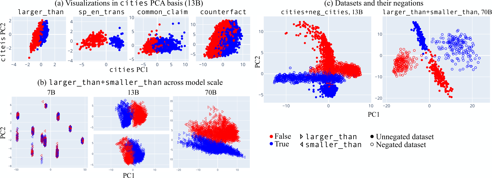

**图 7｜原论文图 3。** 论文 v3 原图未修改：(a) 为 13B 的 cities 基底投影，(b) 比较 7B／13B／70B 的大小关系，(c) 展示分离方向的差异。原图用蓝真、红假，形状／空实标记区分数据集；各子图的模型和层选择不同，不能将整张图视作同一模型同一层。

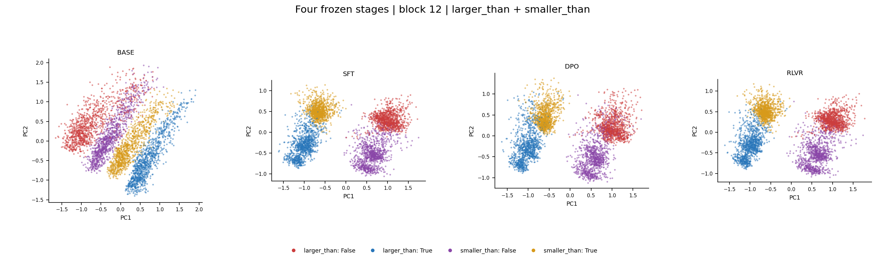

**图 8｜block 12：larger_than＋smaller_than 的四阶段联合 PCA。** 从左到右为四阶段；larger_than 蓝真、红假，smaller_than 金真、紫假。每个阶段使用共同基底和两数据集全部 3,960 条陈述。

后三阶段两种关系的真句主要位于一侧、假句位于另一侧；关系类型在另一方向分化。Base 也有同向趋势，但共同图重叠较多。本次观察到共同方向，却没有复现原论文随 7B→13B→70B 规模变化的实验路径。

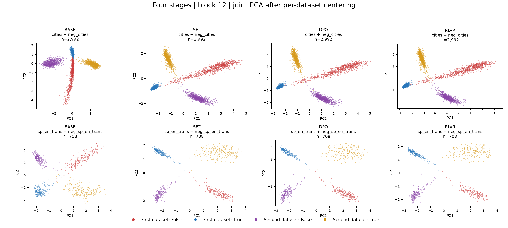

**图 9｜block 12：两组否定关系。** 上行为 cities＋neg_cities，下行为 sp_en_trans＋neg_sp_en_trans；各列为四阶段。原数据蓝真、红假，否定数据金真、紫假；各数据集分别中心化后，使用同一对数据的共同 PC。

这两组均保留不同的真假分离方向。单独看每个数据集能分开，不意味着合在一起沿同一真假轴分开；图中的方向关系只属于二维投影，不能当作高维夹角的测量。

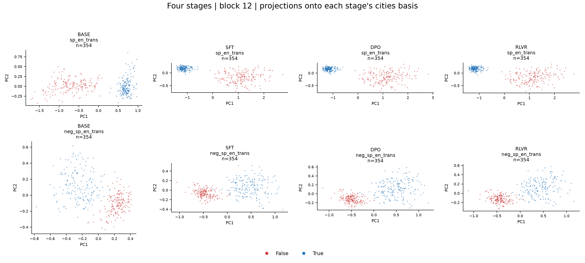

**图 10｜block 12：cities 基底中的翻译与否定翻译。** 每列都使用该阶段 cities 自身的前两个 PC；目标分别中心化，蓝真、红假。这里目标数据不参与基底拟合。

相对于各阶段 cities 的主要分离方向，普通翻译可见同向真假位移，否定翻译反向。这说明 cities 的主要轴不能直接作为覆盖所有结构的统一真假轴；此处也未训练探针测量泛化准确率。

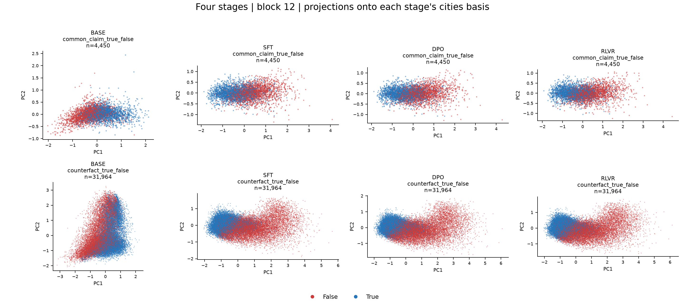

**图 11｜block 12：cities 基底中的非精选事实。** 上行为 common_claim，下行为 CounterFact，四阶段顺序、颜色和基底规则同图 10。

这些数据在自身前两个 PC 中混合较多，在 cities 基底中却可见真假位移，仍保留重叠。自身 top-2 PCA 不清楚分离，不能推出高维状态没有真假相关信息；两种图回答的是不同问题。

### 5.4 层间演变：有没有随深度形成统一方向

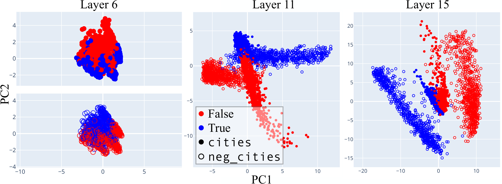

**图 12｜原论文图 8。** 论文 v3 的 LLaMA-2-13B 原图，层号沿用论文标注；蓝真、红假，实心为 cities，空心为 neg_cities。它展示两数据集的分离方向随深度由相反、转动到较一致的过程。[原论文附录 C](https://arxiv.org/html/2310.06824v3#A3)。

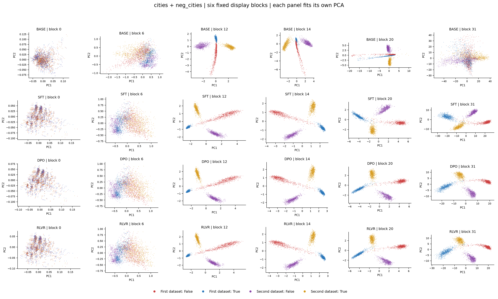

**图 13｜本次 cities＋neg_cities 的层间对照。** 每行依次为 Base／SFT／DPO／RLVR，每列为零起计 block 0、6、12、14、20、31；蓝／红为 cities 真／假，金／紫为 neg_cities 真／假。每格使用该阶段该层已保存的联合 PCA，保留全部 2,992 个点。六层用于压缩展示，不改变 block 12 主层，也不替代完整 32 层结果。

本次同样看到层内结构演变，但城市否定对在中间层和不少晚层仍有不同方向，未观察到随深度必然合为同一轴。完整全层图还显示：Base 数值对在部分中间层较清楚、晚层重新混合；后三阶段较持续地保留共同方向。合取与析取的演变也不同。因而，PCA 分离程度或共同方向都不能视为随层深普遍单调变化的量。

## 6. 怎样理解四个训练阶段的变化

| 比较 | 已观察到的变化 | 可以支持的判断与限制 |
|---|---|---|
| Base→SFT | 城市局部 Δ 增大；合取、公司事实簇内分化和 CounterFact 的图形变化较明显 | 原生使用条件下结构改变；权重与模板同时变化，不能单独归因于 SFT 权重 |
| SFT→DPO | Canada Δ 从 10.8125 到 10.5000，句号 Δ 从 3.7500 到 4.0000；PCA 整体形状接近 | 变化不是所有位置都同向；没有支持所有数据集普遍改善的测量 |
| DPO→RLVR | Canada／句号 Δ 降低，原假句 D 更接近零；PCA 整体结构接近 | 局部评分幅度与原基线一起变化；不能据此判断真值表征变弱或变强 |
| 四阶段共有 | Canada／句号峰值层一致，简单事实分离保留，否定与复杂数据仍有条件性 | 支持相似定位与几何现象在这组模型中存在，尚不足以证明通用真值方向 |

两项实验互补：激活替换提供单例中哪些状态影响二标签输出的因果证据；PCA 提供大量陈述的二维结构证据。它们没有共同识别并验证一个跨事实、跨模板、跨阶段通用的真值方向，也没有测量自由生成事实正确率。

## 7. 核验与资料索引

| 项目 | 已保存的验证结果 | 证据 |
|---|---|---|
| 城市干预 | 1,632／1,632 点完整；119 项真实模型控制与 20 项 CPU 测试通过；独立核验 0 个错误 | [独立核验](../patching/artifacts/independent_verification.json)、[数值汇总](../patching/artifacts/summary.json) |
| PCA 数据与结果 | 每阶段 48,270 行×32 层，四阶段共 6,178,560 个 4,096 维向量；10 项 CPU 测试、96 项真实模型控制通过 | [固定协议](../pca/configs/experiment.json)、[控制汇总](../pca/artifacts/control_summary.json) |
| PCA 独立重建 | 核验 1,792 次拟合、2,344 组投影；服务器从原始激活重建通过，0 个错误，最大投影绝对差约 0.00003815 | [服务器重建](../pca/artifacts/verification_remote.json)、[本地核验](../pca/artifacts/verification_local.json) |
| 本报告新增图与整合核验 | 只重排已保存投影；来源哈希、逐图点数、报告数值及本地链接检查通过；不重新拟合、抽样或改变坐标；原论文图原样引用 | [来源与导出清单](../provenance/integrated_report_figures.json)、[整合核验记录](../provenance/integrated_report_check.json) |

PCA 的不同 batch 形状存在已记录的 BF16 数值差异；同形状、同 padding 的控制最大绝对差为 0。正式提取前已完成诊断并确定检查方式，详情见[数值控制记录](../pca/artifacts/batch_precision_diagnostic.json)与[正式前诊断](../pca/provenance/diagnostics)。本次整合复用既有计算和验证，没有新增远端模型运行。整理后的离线核验同时记录当前文件完整性与当前代码身份；原始运行清单仍标识历史代码，二者不作等同。

完整材料：[城市完整数值结果](../patching/results)、[PCA 全层数值结果](../pca/results)、[已有 90 页图册](../figures/PCA-atlas.pdf)、[核验与复运行说明](../README.md)。旧报告与过程图已清理，本报告是唯一的整合报告。

PCA 原始 BF16 激活约 47.14 GiB，仅留服务器；本地保留输入、中心、基底、逐行投影和完整性清单。其历史完整性记录见各阶段的 `raw_manifest.json`；本地核验不会重新读取服务器激活。本 Markdown 的图片和证据使用项目相对路径，移交时需要保留对应项目文件。

### 附录 A：冻结版本与来源

| 阶段 | 精确模型 revision |
|---|---|
| Base | `d04e592bb4f6aa9cfee91e2e20afa771667e1d4b` |
| SFT | `f2a0b46b0cfda21003c6141b1ff837b7e165524d` |
| DPO | `a7beb67e33ffd01cc87ac3b46cadc1000985b8db` |
| RLVR | `666943798adbde0b1aff34626007e26986a3c107` |

正式前向环境：Python 3.10.20、PyTorch 2.4.0+cu124、Transformers 4.57.6、NumPy 2.2.6。环境、输入和文件身份分别保存于各阶段 manifest；本次重排图的本地绘图库版本记录在导出清单。

论文：Samuel Marks & Max Tegmark，*The Geometry of Truth: Emergent Linear Structure in LLM Representations of True/False Datasets*，[arXiv:2310.06824v3](https://arxiv.org/html/2310.06824v3)，2024-08-19。本报告原图引自该版本图 1、2、3、8，均未修改，采用原文 [CC BY 4.0](https://creativecommons.org/licenses/by/4.0/) 许可。

作者代码与数据：[固定提交](https://github.com/saprmarks/geometry-of-truth/tree/5d1c630c44f7e50bda7ad86d601ccadf9abc5ddb)；[城市来源清单](../patching/third_party/source_manifest.json)与 [PCA 来源清单](../pca/third_party/source_manifest.json)。
